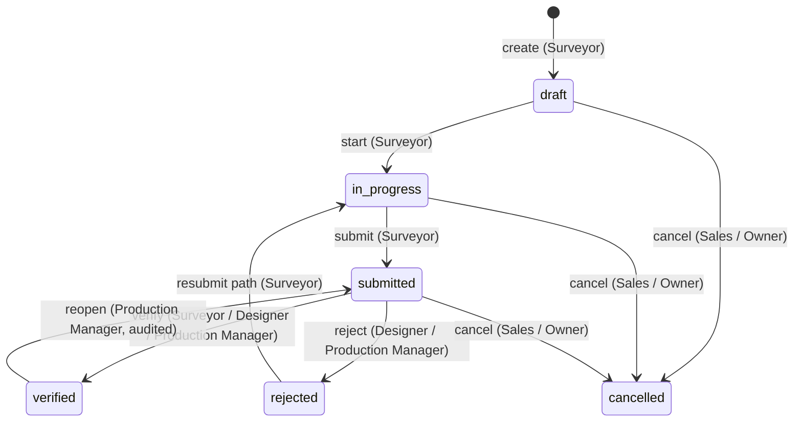
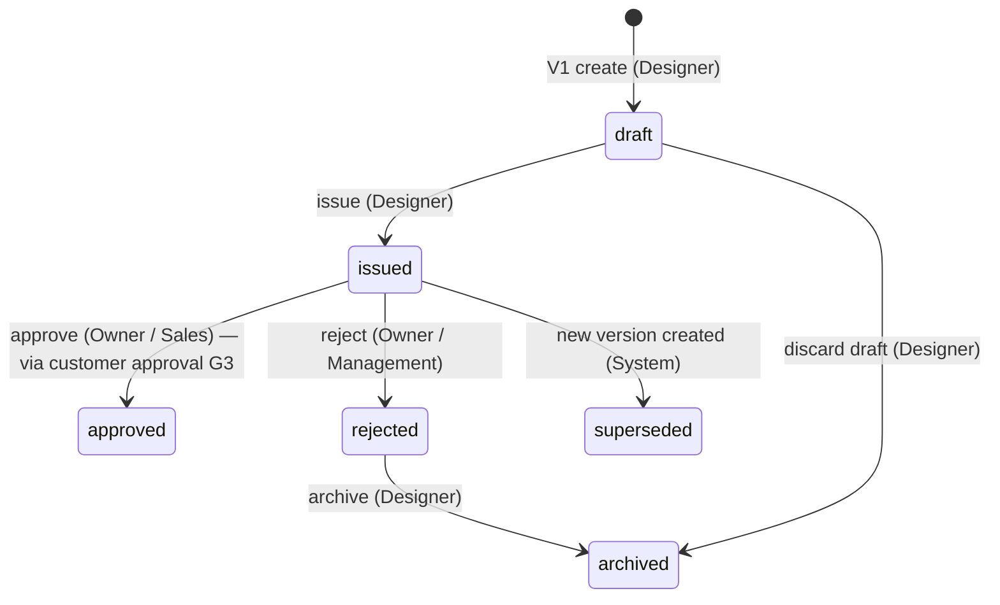
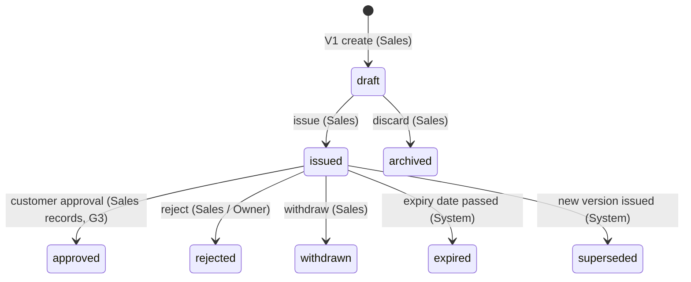
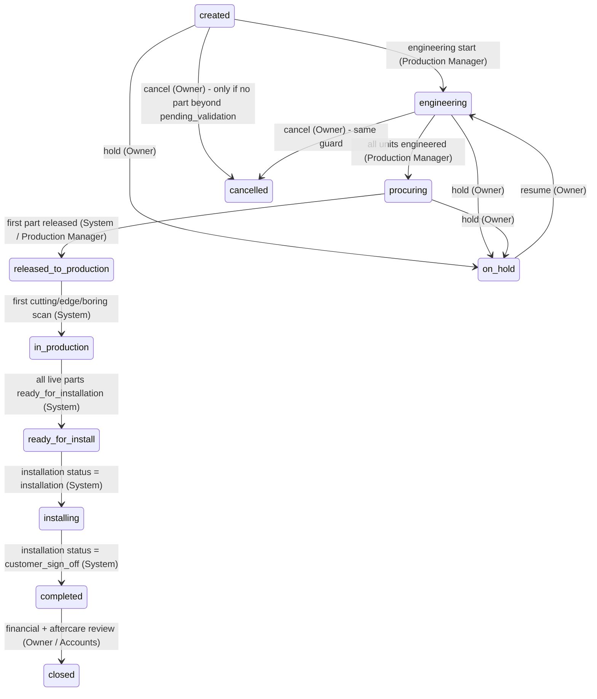
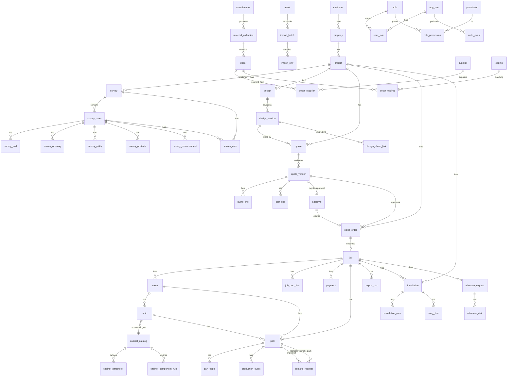

# Interio — Bespoke Operations Platform Specification

> **Interio** is the multi-tenant SaaS product specified in this document — built to serve multiple clients and resellable in future. **First client and tenant 1: Opulent Interiors Group Ltd**; their client-facing conversation lives untouched in `client/`.
>
> V2.0 · single consolidated developer specification · machine-readable schema: `db/schema.dbml`

# Part 0 — Index, how to read and change control

**Product:** **Interio** — bespoke operations platform, built as a **multi-tenant SaaS product** (resellable to multiple clients); first client / tenant 1: Opulent Interiors Group Ltd
**Status:** V2.0 — single consolidated specification; multi-tenancy designed in; **Opulent = tenant 1**
**Audience:** Developers, product, management

This file is the single source of truth for what the platform must do. It **replaces the previous twelve-document set (`00`–`11`)**; those files are archived in `docs/archive/` and are no longer maintained. Part 3 (the PRD) is the contract; every other part elaborates it and must not contradict it. Where a fact is not yet confirmed, it is recorded in the Open Questions Register (Part 12) — never guessed.

## Document map

| Part | Title | Contents | Was |
|---|---|---|---|
| 0 | Index, how to read and change control | This page: map, reading order, glossary, change control | `00-README` |
| 1 | Modules and their connectivity | The 15 modules: what each owns, reads, emits, and how they connect end to end | *new* |
| 2 | Tenancy and platform architecture | Multi-tenant model, isolation, login, tenant lifecycle, platform console and logs | *new* |
| 3 | Product requirements (contract) | Scope, rules R1–R8, requirements S1–S41, NFRs N1–N11, acceptance | `01-PRD` |
| 4 | Workflows and state machines | 14 state machines, transition guards, gates G1–G8 | `03` |
| 5 | Data model and integrity | Identity standard, entities, columns, constraints, indexes, dedup, tenancy columns | `02` |
| 6 | Security, RBAC, audit and retention | Roles, permission matrix, auth, audit, governed deletion, retention | `05` |
| 7 | Commercial engine | Costing, pricing chain, quotes, approval, deposits, payments | `06` |
| 8 | Cabinet engineering and production export | Catalogue, deterministic breakdown, validation, labels, Macmazza export | `07` + `08` |
| 9 | Survey mobile application | Field forms, offline model, sync, submission | `04` |
| 10 | API specification | Complete endpoint inventory, permissions, platform namespace, coverage map | `10` |
| 11 | Frontend specification | Pages, controlled sidebar, shared module register, build order | `11` |
| 12 | Roadmap, phasing, CRM insertion and open questions | Phasing (Phase 0 tenancy first), build conventions checklist, Open Questions Register (R7), definition of done | `09` |
| 13 | Fulfilment tests and verification matrix | Contract parity checks (C-01…C-08), requirement→test traceability, module/tenancy/journey/performance tests, UI contract | *new* |
| — | `db/schema.dbml` | Machine-readable schema (Postgres DBML) — validate with `dbml2sql <file> -o out.sql --postgres` | unchanged |
| — | `client/` | Client-facing research document (v1.2, all answers merged), the approved response PDF, and the differences review file — plain English, **safe to send as-is**; everything outside `client/` is developer-only | unchanged |

## Reading order

**New to the project:** Part 1 (what the system is and how the modules connect) → Part 2 (tenancy) → Part 3 (the contract).

**Developer path (build sequence):** Part 3 → Part 5 → Part 4 → Parts 10 + 11 (parallel contracts) → the module's own part (9, 7, 8, 6) → Part 12 for sequencing and open questions → Part 13 (the tests that prove each phase done).

**Management / commercial path:** Part 3 (scope + S-requirements) → Part 7 → Part 12.

**Survey mobile path:** Part 3 (S1–S9, R1, R2) → Part 9 → Part 5 (survey entities) → Part 6 (mobile auth).

## Conventions

- **PRD** means Part 3. References like “Part 5 §4.13” point within this file.
- Requirement codes **S1–S41**, rules **R1–R8**, gates **G1–G8** and NFRs **N1–N11** are defined only in Part 3 and referenced from every other part.
- Tables are named exactly as in Part 5 / `db/schema.dbml`; states exactly as in Part 4 (R6 vocabulary).
- Mermaid diagrams (Parts 3, 4) render in GitHub/VS Code preview.

## Version history

| Version | Date | Change |
|---|---|---|
| V1 | 2026-10-12 | Base contract across the original document set (S1–S35, R1–R7, G1–G8, N1–N9) |
| V1.1 | 2026-10-18 | + S36 layout helper, + S37 view-only customer link, + S38 data import/export; N10 multi-region currency; VPS hosting confirmed (Q12); client research document aligned |
| V2.0 | 2026-10-20 | **Consolidation:** twelve documents → this single file (Parts 0–12), cross-references rewritten. **Multi-tenancy:** the platform is a SaaS product and Opulent Interiors Group is **tenant 1** — + R8, S39–S41, N11, Q20–Q21; billing/subscriptions explicitly out of scope; single common domain with login-based tenant resolution; platform console = tenants, logs, support access (Part 2); product named **Interio** (Opulent remains client / tenant 1) |
| V2.1 | 2026-10-21 | **Fulfilment-test layer (Part 13):** contract parity checks, requirement→test traceability matrix, module/tenancy/journey/performance tests, UI contract. DB performance finalisation: O(log n) index policy, keyset pagination composites, denormalisation catalogue (Part 5 §3) |

## Change control

- Specification changes carry a version note at the top of Part 3 (and a row here).
- Any change to S-numbers, R-numbers, entity names or state names must be applied across the whole file in the same change (R6) — one file now, so there is no excuse for drift.
- **Part 8's production export section may be revised only after the field-mapping capture checklist has been completed against the saw PC, or with explicit management approval.**
- Client-facing files under `client/` change only with client agreement; internal decisions never leak into them.

## Glossary

| Term | Meaning |
|------|---------|
| Pipeline | Full process: `LEAD → CRM → SURVEY → DESIGN → QUOTE → CUSTOMER APPROVAL → ORDER → CABINET ENGINEERING → PROCUREMENT → PRODUCTION → MACMAZZA → PART TRACKING → ASSEMBLY → INSTALLATION → PAYMENT → AFTERCARE` |
| Phase 1 scope | Pipeline from `SURVEY` onward. `LEAD → CRM` is a reserved future seam (Part 12). |
| **Platform** | The SaaS product we operate: the software, the database, the operator console and logs (Part 2). |
| **Tenant** | One business's completely isolated world inside the platform: its users, roles, settings, catalogue and all data. **Opulent Interiors Group is tenant 1.** |
| **Platform operator** | Us — the party that runs the platform, creates/suspends tenants and holds the platform console (Part 2 §2.5). |
| **Tenant admin** | The tenant's own System Admin: invites users, sets roles and tenant settings. |
| Unit | A single cabinet/wardrobe/furniture unit within a room (entity `unit`). |
| Part | A single physical component (side, back, shelf, front…) with a permanent UUID (entity `part`). |
| Remake | Replacement production of a damaged/incorrect part; the original part record is never deleted. |
| BORING | Whether a part requires drilling. Printed prominently as `BORING: YES` / `BORING: NO`. |
| Macmazza | Machine manufacturer (MACMAZZA SRL, Pesaro, Italy). Workshop saw: **Top Saw TS 75 (2016, serial 863)**. |
| Optimak | Optimisation software used with the Macmazza machine installation. |
| Hold point | A blocking condition: work cannot finalise until genuine on-site information is obtained (Part 8). |
| Manufacturing-critical measurement | A measurement that affects manufactured dimensions; must carry verification before production release (S9). |
| Caption | Free-text display name shown in UI. Never an identifier, never used for joins. |
| Version | Immutable revision of a design or quote (`design_version`, `quote_version`). Approved versions are frozen. |
| **RLS** | Row-Level Security — a database policy that makes every query return only its own tenant's rows, even if application code forgets a filter (Part 2 §2.2). |
| **Support grant** | A time-boxed, audited permission for platform staff to touch one tenant's data (S41). |

# Part 1 — Modules and their connectivity

This chapter answers two questions: **what are the modules of the platform, and how does data travel between them?** Every fact here is a pointer into the detailed parts that follow — this is the map, not the terrain. Read it once at the start; come back whenever you need to know who owns a table or what hands off to whom.

**How to read it:** a module is a coherent area of the product with its own data, its own state machine(s) and its own API/UI sections. Modules are not deployment units — everything ships as one application and one database — but they are the unit of *ownership*: you know which part of the spec governs any given feature. All modules run **inside exactly one tenant** (Part 2); the Platform module sits outside and looks in.

## 1.1 The shape of the system

```
  CATALOGUE ───────────────┐   (cabinets, parameters, rules, materials, suppliers — feeds
  (Part 8)                 │    design placement, costing and engineering for every module below)
                           │
  IDENTITY ────────┐       │   (login, roles, tenant context — issues the session that every
  (Parts 2, 6)     │       │    module below checks on every request)
                   ▼       ▼
  CUSTOMERS ──▶ SURVEY ──▶ DESIGN ──▶ COMMERCIAL ──▶ ORDERS ──▶ ENGINEERING ──▶ PRODUCTION ──▶ SITE ──▶ AFTERCARE
  & PROJECTS     (mobile)   STUDIO     (quote +       & JOBS     (parts +       (workshop +    (install) (warranty)
  (Part 5/10)   (Part 9)   (Part 11)   approval)     (Part 4)    validation)    saw export)
                             │             │            │                         │
                             │             │            │            ┌────────────┤
                             │             ▼            ▼            ▼            ▼
                             │        FINANCE ◀── deposit/stages/final     PROCUREMENT
                             │        (payments)                            (actual costs vs quoted)
                             │
  GOVERNANCE spans everything: RBAC checks · audit trail · retention · governed deletion · import/export
  REPORTS reads everything and writes nothing.
  PLATFORM (operator console) manages tenants, logs and support access from outside the data flow (Part 2).
```

Two rules make the diagram honest:

1. **Arrows are gates, not suggestions.** Every handoff shown is enforced server-side by a gate (G1–G8, Part 4 §13): the next module cannot start on bad data.
2. **Every write is audited.** Whatever module you are in, `audit_event` is written (and for part activity, `production_event`) — Part 6 §7.

## 1.2 Module catalog

### M1 — Identity and tenancy
- **Responsibility:** login, sessions/MFA, users, roles and permission grants, invitations, and the *tenant context* attached to every request.
- **Owns:** `tenant`, `app_user`, `role`, `permission`, `role_permission`, `user_role`, `user_invitation`, `setting` (tenant-scoped configuration: branding, VAT, currency, reference pattern, critical-measurement list, label template, retention keys).
- **State:** `app_user.state` = `active / suspended / disabled` (Part 4 §1).
- **Reads:** platform console (tenant record); **emits:** the authenticated session — `{tenant_id, user, roles, permission codes}` — consumed by *every other module* on *every* request (R4, R8).
- **Spec:** Part 2 (tenancy), Part 6 (RBAC/auth), Part 10 §2–3, Part 11 login/onboarding.

### M2 — Customers and projects
- **Responsibility:** the records spine: customer → property → project, duplicate prevention (R5), surveyor assignment, and governed import of these records.
- **Owns:** `customer`, `property`, `project`, `project_user`, `import_batch`, `import_row`.
- **State:** `project.status` = `active / on_hold / completed / cancelled` (+ archival `state`); `import_batch.status` = `staged / committed / cancelled`.
- **Reads:** `setting` (dedup rules); **emits:** *project context* + assignments → Survey (mobile entry, S1) and the project hub every later module hangs off.
- **Spec:** Part 5 §4.1–4.3, Part 10 §5–6, Part 11 §4.2, S38 for imports.

### M3 — Survey (field capture)
- **Responsibility:** the mobile-first capture of reality: rooms, walls, openings, utilities, obstacles, measurements with provenance, notes, photo/video/plan media — fully offline — then verification.
- **Owns:** `survey`, `survey_room`, `survey_wall`, `survey_opening`, `survey_utility`, `survey_obstacle`, `survey_measurement`, `survey_note`, and `asset` (media, shared with Design/Site/Commercial evidence).
- **States:** survey machine `draft → in_progress → submitted → verified/rejected` (**G8** verification of manufacturing-critical measurements); asset upload machine (Part 4 §2, §12).
- **Reads:** assignments from M2, critical-measurement list from `setting`; **emits:** a `submitted`/`verified` survey → Design Studio (G1 requires ≥ `submitted`).
- **Spec:** Part 9 (full), Part 10 §7–8 and §24 (sync), Part 4 §2.

### M4 — Design studio
- **Responsibility:** 2D/3D design in the browser (**three.js** — the web is the studio; the iPhone supplies the spatial data), version control, renders, advisory layout suggestions (S36), view-only customer links (S37).
- **Owns:** `design`, `design_version`, `design_share_link`, render `asset` rows.
- **State:** `design_version.status` = `draft → issued → approved/rejected/superseded/archived` (**G1**: issue needs survey ≥ `submitted`) (Part 4 §3).
- **Reads:** survey context **read-only** (never writes M3 data), catalogue placement options (M5), decor/finishes (M5); **emits:** an `issued` design version → Commercial (pricing works only from issued content).
- **Spec:** Part 11 §4.4 (editor), Part 10 §9, Part 5 §4.13.

### M5 — Catalogue (cabinets, materials, suppliers)
- **Responsibility:** the *master data* the business designs, prices and engineers from: parametric cabinet library with data-driven parameters and component rules; materials chain Manufacturer → Collection → Decor → edging → suppliers; used identically by Design, Commercial and Engineering.
- **Owns:** `cabinet_catalog`, `cabinet_parameter`, `cabinet_component_rule`, `manufacturer`, `material_collection`, `decor`, `edging`, `decor_edging`, `supplier`, `decor_supplier`, `decor_attribute`.
- **State:** none (workflow-wise) — `active/discontinued`/customer-visible flags; catalogue edits are audited and never retro-engineer existing units (Part 8 §1).
- **Reads:** tenant settings; **emits:** placement options (M4), costing inputs (M7), engineering rules (M8). One row in this module is read by three others — the strongest coupling in the system, which is why it is data, not code (S14/S15).
- **Spec:** Part 8 §1, §8, Part 10 §10–11, Part 11 §4.5–4.6.

### M6 — Commercial (costing, quotes, approval)
- **Responsibility:** turn an issued design into money: automatic costing (13 elements), pricing chain (cost → mark-up → discount → VAT → total → GP), quote versions, and the atomic customer-approval record.
- **Owns:** `cost_line`, `quote`, `quote_version`, `quote_line`, `approval`.
- **State:** quote machine + G2 (issue), **G3** (atomic approval with evidence) (Part 4 §4).
- **Reads:** issued design version (M4), catalogue/material prices (M5), rates from `setting`; **emits:** approved quote version + deposit condition → Orders & Jobs (G3 → G4); approval snapshots feed Finance (contract value) and Engineering (what was sold).
- **Spec:** Part 7 (full), Part 10 §12–13, Part 11 §4.2 (quote builder).

### M7 — Orders and jobs
- **Responsibility:** the commercial-to-production bridge: order row per approval, and the **permanent Job ID** every downstream department shares; job rooms and units (placed cabinets snapshotted from the design).
- **Owns:** `sales_order`, `job`, `room`, `unit`.
- **State:** order `open/completed/cancelled`; job machine `created → engineering → procuring → released_to_production → in_production → ready_for_install → installing → completed → closed` (+ `on_hold`, `cancelled`) (Part 4 §5).
- **Reads:** approved quote + satisfied deposit (M6/M10 — **G4** transaction, idempotent); survey/design FKs copied onto the job for traceability (N9); **emits:** the job spine → Engineering, Procurement, Production, Site, Finance.
- **Spec:** Part 5 §4.17–4.19, Part 10 §13–14, Part 4 §5.

### M8 — Engineering (breakdown and validation)
- **Responsibility:** deterministic cabinet → parts breakdown (same inputs, same components, rule version recorded), per-edge edging, boring decision, validation V01–V13, and part labels/QR (S28).
- **Owns:** `part`, `part_edge` (operates on `unit.engineering_status` in M7).
- **State:** part machine begins here: `pending_validation → held / released` (**G5**: validation pass + survey chain verified) (Part 4 §6).
- **Reads:** job rooms/units (M7), catalogue rules (M5), survey verification chain (M3, indirectly via job FKs); **emits:** validated, released parts + printed labels → Production.
- **Spec:** Part 8 §3–5, §7, Part 10 §14–15, Part 4 §6.

### M9 — Production (workshop, remakes, saw export)
- **Responsibility:** track every physical step by scan (`cutting → cut → edge_banding → boring → assembly → quality_control → complete → ready_for_installation`), manage remakes, and produce the Macmazza/Optimak export package behind the **G6 hold point**.
- **Owns:** `production_event` (append-only), `remake_request`, `export_run` (+ label rendering from part data).
- **States:** part progression (Part 4 §6), remake machine (§7), export run `preview/production/failed` (§11) — production export blocked until mapping `confirmed`.
- **Reads:** released parts (M8), label template from `setting`; **emits:** workshop history (queries/boards), export files to the saw PC, `ready_for_installation` parts → Site.
- **Spec:** Part 8 §5–7 (§6 = export), Part 10 §16–17, Part 11 §4.7.

### M10 — Procurement (job costs)
- **Responsibility:** record actual costs against quoted elements per job and surface variance; sourcing is human, tracking is ours.
- **Owns:** `job_cost_line`.
- **State:** none (rows with correction history via audit).
- **Reads:** quoted `cost_line` (M6), suppliers (M5); **emits:** variance into Reports (job profit) and Purchasing views.
- **Spec:** Part 7 (money convention), Part 10 §18, Part 11 §4.8.

### M11 — Site and aftercare
- **Responsibility:** delivery/installation scheduling and execution, snags linked to parts, customer sign-off (**G7** evidence), and warranty/service requests with part lineage.
- **Owns:** `installation`, `installation_user`, `snag_item`, `aftercare_request`, `aftercare_visit`.
- **States:** installation machine `ready_to_install → … → customer_sign_off → complete`; aftercare `open → assigned → in_progress → resolved → closed` (Part 4 §8–9).
- **Reads:** job + parts (M7/M8); **emits:** sign-off evidence → Finance (final payment/close), remake requests → Production (snag → remake link).
- **Spec:** Part 10 §19–20, Part 11 §4.9–4.10.

### M12 — Finance (operational payments)
- **Responsibility:** deposit → stage → final payment rows, and *derived* financials (contract value, balance, outstanding) — an operational picture, never an accounting ledger (S33).
- **Owns:** `payment`.
- **State:** payment machine `pending → paid / cancelled / refunded` (Part 4 §10).
- **Reads:** contract value from the approved quote (M6) copied to `job`; **emits:** deposit satisfaction → **G4** (job creation) and close-out checks (job `closed` needs outstanding = 0 or audited override).
- **Spec:** Part 7 §5, Part 10 §21, Part 11 §4.11.

### M13 — Reports and dashboards
- **Responsibility:** read-only aggregation: pipeline, quote margins, job profit, production board, aftercare, audit summary — plus the role dashboards.
- **Owns:** nothing (queries over everyone's data within the tenant).
- **State:** none; every report respects the caller's permission scope; CSV export is audited (Part 10 §22).
- **Reads:** all modules; **emits:** numbers, dashboards, CSVs.
- **Spec:** Part 10 §22, Part 11 §4.1/§4.11.

### M14 — Governance (RBAC, audit, retention, deletion, import/export)
- **Responsibility:** the cross-cutting guarantees: permission enforcement on every endpoint, the append-only audit trail, retention rules, the governed deletion process (two approvals), and governed CSV import/export (S38).
- **Owns:** `audit_event` (append-only), `import_batch`/`import_row` (see M2 for domain imports).
- **State:** deletion-request queue (open → approved ×2 → executed); import batch machine (Part 4 §1).
- **Reads:** everything (audit) — **writes:** audit rows wherever any module writes; export CSVs from permission-filtered queries; **emits:** compliance evidence.
- **Spec:** Part 6 (full), Part 10 §4/§25–26, Part 11 §4.12/§4.13.

### M15 — Platform (operator console)
- **Responsibility:** the SaaS layer *outside* tenant data: create/suspend tenants, first-admin invitations, support access grants, platform logs and platform audit (S39–S41). **No billing** — deliberately out of scope (Part 2 §2.6).
- **Owns:** `support_access_grant`, `platform_audit_event` (reads `tenant` from M1).
- **State:** tenant `active / suspended / offboarded`; grants `active / expired / revoked`.
- **Reads:** tenant list, application logs, (under an active grant only) one tenant's business data; **emits:** tenant lifecycle events, support-access trails — everything it does is itself audited.
- **Spec:** Part 2 (full), Part 10 §25, Part 11 §4.14.

## 1.3 End-to-end journey (one job, with the actual requests)

The spine of the product — every hop is a real API call with a gate behind it:

| # | Hop | Who | Key requests (Part 10) | Writes | Gate |
|---|-----|-----|------------------------|--------|------|
| 1 | Project setup | Sales | `POST /customers` → `/properties` → `/projects` → `/projects/:id/assignments` | M2 rows | dedup R5 on creates |
| 2 | Survey capture | Surveyor (mobile) | `GET /projects?scope=mine` → `POST /projects/:id/surveys` → `POST /sync/push` (rooms/walls/openings/measurements/media) | M3 rows | — |
| 3 | Survey verify | Surveyor/Designer/PM | `POST /surveys/:id/transition` (→ `submitted`), verify critical measurements, (→ `verified`) | survey status, verification cols | **G8** |
| 4 | Design | Designer | `POST /projects/:id/designs` → `/designs/:id/versions` → `GET …/context` → save → `POST …/transition` (→ `issued`); optional share-link | M4 rows | **G1** |
| 5 | Quote | Sales | `POST /projects/:id/quotes` → `/quotes/versions/:vid/lines` + `/costs` → `/costs/recompute` → `transition` (→ `issued`) | M6 rows | **G2** |
| 6 | Approval | Sales | `POST /quotes/versions/:vid/approval` (evidence asset mandatory) | `approval` (frozen snapshot) | **G3** |
| 7 | Deposit + job | Accounts | `POST /jobs/:id/payments` (deposit → `paid`) → `POST /orders` → `POST /sales-orders/:id/job` (Idempotency-Key) | payment, order, job | **G4** |
| 8 | Engineering | Prod Manager | `POST /units/:id/engineer`, `POST /jobs/:id/engineer` → `POST /parts/:id/validate` | unit, part, part_edge | job → `procuring` |
| 9 | Release | Prod Manager | `POST /parts/:id/validate` → `POST /parts/:id/release` → `POST /jobs/:id/labels` | part status, labels | **G5** |
| 10 | Export | Prod Manager | `POST /jobs/:id/exports` (`mode=production` needs `mapping_status='confirmed'`) | export_run | **G6 (hold point)** |
| 11 | Workshop | Workshop | `POST /parts/:id/scan` (loop through statuses); remakes `POST /parts/:id/remakes` | production_event, part status | part machine guards |
| 12 | Procurement | Purchasing | `POST /jobs/:id/costs` | job_cost_line | — |
| 13 | Installation | Installer | `POST /jobs/:id/installations` → transitions → `POST …/signoff` (evidence) | installation, snags | **G7** |
| 14 | Payments | Accounts | `POST /jobs/:id/payments` (stages/final) → `GET /jobs/:id/financials` (derived) | payment | job `closed` checks |
| 15 | Aftercare | Sales/Installer | `POST /jobs/:id/aftercare` → `/aftercare/:id/visits` | aftercare rows | — |

The seven client-visible authorisation pauses (client research document §36) map exactly onto G8, G1, G2, G3, G4, G5, G7 + job close — see Part 3 §2.4.

## 1.4 Reads, writes and handoffs (one table, one page)

| Module | Reads from | Writes (owns) | Hands off to |
|---|---|---|---|
| M1 Identity & tenancy | platform console | tenant, users, roles, invitations, settings | session → **all** |
| M2 Customers & projects | settings | customer, property, project, assignment, import batches | → M3 (assignments), context → all |
| M3 Survey | M2 assignments, settings | survey tree, measurements, notes, assets | → M4 (verified survey, G1/G8) |
| M4 Design studio | M3 (read-only), M5 | design, design_version, share links, renders | → M6 (issued version) |
| M5 Catalogue | settings | cabinets, parameters, rules, materials, suppliers | → M4 (placement), M6 (prices), M8 (rules) |
| M6 Commercial | M4, M5, settings | cost_line, quote, quote_version, quote_line, approval | → M7 (approved quote, G3) |
| M7 Orders & jobs | M6 + M10 deposit (G4) | sales_order, job, room, unit | → M8 (job spine), M11/M12 |
| M8 Engineering | M7, M5, M3 chain | part, part_edge | → M9 (released parts, G5) |
| M9 Production | M8, M5 (suppliers for context) | production_event, remake_request, export_run | → M11 (ready parts), saw PC (file) |
| M10 Procurement | M6 (quoted), M5 (suppliers) | job_cost_line | → M13 (variance/profit) |
| M11 Site & aftercare | M7, M8 | installation, team, snags, aftercare | → M9 (remakes), M12 (sign-off) |
| M12 Finance | M6 snapshot on job | payment | → M7 (deposit → G4), M13 |
| M13 Reports | **all** | — (CSV export audited) | → users |
| M14 Governance | **all** (audit) | audit_event, deletion queue, import batches | → compliance/exports |
| M15 Platform | tenant list, logs | platform_audit_event, support grants | → tenant lifecycle |

## 1.5 Cross-cutting services (used by every module)

| Service | Provided by | Used for |
|---|---|---|
| Session + tenant context (R8) | M1 | Every API request derives tenant + permissions from the token — never from the URL/body |
| Permission check (R4) | M14 (middleware) | Deny-by-default on every endpoint (Part 6 §3) |
| Audit trail | M14 | Every write, transition, approve, release, export, login (Part 6 §7) |
| Settings (VAT, currency, critical list, label template, retention) | M1 (`setting`, tenant-scoped) | All modules read; changes audited |
| Asset storage (signed URLs, sha256, chunked upload) | M3/M14 shared | Survey media, design renders, approval/sign-off evidence |
| Identity (UUIDv7, server-generated) | M1/R1 | Every row, every offline idempotency key |
| Import/export (S38) | M14 | Bringing a tenant's initial data in, getting it out (also used by tenant onboarding, Part 2 §2.4) |
| Offline sync | M3 only | Survey mobile app only — no other module has an offline mode (Part 10 §24) |

## 1.6 Tenancy overlay

Every module above is a **tenant-scoped** module: its rows carry `tenant_id`, its queries are filtered by the session's tenant, and its list/search/export/share/sync/report paths are covered by the cross-tenant isolation test suite (S39, N11). Two things sit *outside* that boundary: **M15 Platform** (operator console over tenants — Part 2) and the fixed **permission vocabulary** (platform-defined codes; only role *bundles* are per-tenant, Part 2 §2.6).

## 1.7 Who uses which module

Roles and their module footprint (canonical matrix in Part 6 §3; sidebar mapping in Part 11 §3):

| Role | Lives in |
|---|---|
| System Admin | M1, M14 (admin), all read |
| Owner/Management | everything (approvals, releases, reports) |
| Sales | M2, M6, M7 (view), M11 (booking), M12 (view) |
| Designer | M4, M5, M3 (read-only) |
| Surveyor | M3 (mobile), M2 (read-only own) |
| Purchasing | M10, M5 (suppliers), M7/M9 (view) |
| Production Manager | M7, M8, M9, M5 (catalogue) |
| Workshop | M8/M9 (scan, labels, remakes) |
| Installer | M11, M9 (`installed` scans) |
| Accounts | M12, M6/M7 (view) |
| Platform operator (us) | M15 only — plus M14-equivalent visibility under an active support grant (S41) |

# Part 2 — Tenancy and platform architecture

**Implements:** S39–S41, R8, N11 (defined canonically in Part 3 §5/§3/§7). **Decisions recorded here:** shared schema + row-level security · no billing · one common domain with login-based tenant resolution.

This part defines what it means that the platform is a **multi-tenant SaaS product** and that **Opulent Interiors Group is tenant 1**. Everything in Parts 3–12 that talks about "the business", "the company" or "settings" means *the tenant* — Opulent behaves exactly as it did before; nothing in their research document or approved response changes (§2.11).

## 2.1 The model

| Term | Definition |
|---|---|
| **Platform** | The software we operate: one application, one database, one schema, one API surface, plus the operator console (§2.5). |
| **Tenant** | One business's isolated world: its users, roles, settings, branding, catalogue, customers, jobs, money and audit trail. Opulent = tenant 1. |
| **Platform operator (us)** | Runs the platform: creates/suspends tenants, reads platform logs, grants scoped support access. Never a normal user inside a tenant. |
| **Tenant admin** | The tenant's System Admin: invites users, manages roles, edits tenant settings. |

- Tenants share the application and schema but **never a row** (§2.2).
- Nothing about tenancy is visible to tenant users: no switcher, no tenant picker after login, no tenant codes in URLs that matter.
- v1 ships with exactly one tenant (Opulent) — the second tenant is created when the product opens up; architecture, schema and tests already support N.

## 2.2 Isolation model — shared schema + row-level security

**Decision:** shared database, shared schema, `tenant_id` on every business table, **PostgreSQL Row-Level Security** beneath the application.

Three independent layers (defense in depth — any one of them failing still leaves two):

1. **Session layer (R8):** every API request derives `tenant_id` from the authenticated token. **No endpoint accepts a tenant identifier from the client** — not in the path, not in the body, not in a header. The client cannot even *ask* for another tenant's data.
2. **Application layer:** repository/query builders take the tenant from the session context and apply it to every list, detail, create, search, export, report, sync and share-token lookup. Missing a filter is a bug the test suite catches (layer 3).
3. **Database layer (RLS):** every business table carries `tenant_id uuid NOT NULL REFERENCES tenant(id)` with an RLS policy `tenant_id = current_setting('app.tenant_id')`. Even a rogue query returns only its own tenant's rows. The application connects as a role that **cannot bypass RLS**; maintenance/break-glass access is the support-grant flow (§2.5), never a standing credential.

**Which tables are tenant-scoped** (full detail in Part 5 §3 and `db/schema.dbml`):

| Scope | Tables |
|---|---|
| **Tenant-scoped (57)** | every existing business table (customer … import_row), **except** the fixed `permission` vocabulary, plus the new `user_invitation` |
| **Platform-side (4)** | `tenant`, `permission` (platform-fixed codes), `support_access_grant`, `platform_audit_event` |

**Sequences and uniqueness are per-tenant:** dedup keys (R5), `UNIQUE` constraints (e.g. one job per order), reference counters (the display reference `OIG-2026-0001` is generated from a tenant setting + per-tenant counter — display only, never identity, R1) and import dedup all happen *within* a tenant. Two tenants can have identical customer names, identical references, identical job numbers — they are different rows in different worlds.

**Storage/media:** asset storage keys are prefixed by tenant (`tenants/<tenant_id>/…`); signed URLs are minted per tenant and expire (≤ 15 min); the public share endpoint (S37) resolves token → exactly one tenant or returns 404.

## 2.3 Identity and login — one domain, common page, tenant from the login

**Decision:** one common domain for the whole product (no subdomains), one login page; the tenant is resolved **as part of login** and then carried in the session — no extra hurdles, fully consistent.

**Login flow:**

1. User opens the single login page on the common domain.
2. Enters email (+ password / MFA). Server resolves the tenant:
   - `setting`-style mapping **email domain → tenant** (e.g. `@opulentinteriors.co.uk` → tenant Opulent): login proceeds directly.
   - Unknown or shared domain, or the email maps to several tenants → one intermediate step: **choose your workspace** (a short tenant list or typed workspace name), URL path form `/t/<tenant-slug>/…`. Nothing else changes.
3. On success the access/refresh tokens carry `{ tenant_id, user_id, roles, permissions, sid }` and the app enters tenant context: branding loads, sidebar renders by permission, routes are normal paths.
4. Platform staff log in on the same page with a **platform claim** instead of a tenant session; they land in the operator console (§2.5) — they are not members of any tenant.

**Rules:**
- A tenant user belongs to **exactly one tenant** (v1); multi-tenant membership is a possible future, not built.
- `GET /auth/me` returns tenant identity + branding so the UI can orient without guessing.
- Sessions are tenant-bound: a token minted for tenant A used against tenant B's data is a hard `not_found` (tested).
- MFA policy per tenant (existing: System Admin / Owner-Management MFA), invitations carry the tenant (`user_invitation`).
- Offline mobile (Part 9 §13): the cached token already contains tenant context; sync pull/push is implicitly tenant-scoped — a device that changes tenant must re-login (queues drain to the original tenant only).

## 2.4 Tenant lifecycle (S40)

| Stage | Who | What happens |
|---|---|---|
| **1. Provision** | Platform operator (console) | `POST /platform/tenants`: record created with name, slug, branding defaults, home currency (default GBP), VAT number/rate, reference pattern (`OIG-{year}-{seq}` for Opulent), status `active`; first tenant admin invited; **platform audit entry** |
| **2. Onboard** | Tenant admin (in-app wizard) | `/onboarding` steps: branding → VAT/currency/region → invite users → define role bundles → import catalogue/materials/customers via S38 batches → done |
| **3. Run** | Tenant users | Normal operation — zero tenancy concepts visible |
| **4. Configure** | Tenant admin | Settings pages (Part 11 §4.12) edit *this tenant's* rows only |
| **5. Suspend** | Platform operator | Status → `suspended`: every authenticated request for that tenant fails with a clear message; read-only exports remain available to the operator for support; platform-audited |
| **6. Offboard** | Platform operator | Full tenant data export (all tables, CSV/JSON — `GET /platform/tenants/:id/export`), then governed deletion per Part 6 §5 scoped to the tenant; platform audit keeps a tombstone (who/when/what) while business data is removed |

Provisioning, suspension and offboarding are **impossible outside** the platform console (S40 AC) — there is no tenant-creation endpoint in the tenant API surface.

## 2.5 Platform console, logs and controlled support access (S41)

This is the answer to the client's §33 requirement (controlled developer/support access) and to the decision *“the platform manages the SaaS platform, the logs, things and everything regarding tenant management”*.

**Console (separate shell, platform claim only):**

| Page | Purpose |
|---|---|
| `/platform/tenants` | All tenants: status, size (row counts, storage), created |
| `/platform/tenants/:id` | Detail: config, users count, suspend/activate, export, invite re-send |
| `/platform/support` | Grant list: create/revoke time-boxed support grants |
| `/platform/audit` | `platform_audit_event` stream: tenant created/suspended/exported, grants issued/used/expired |
| `/platform/logs` | Application log access: structured metadata (level, request id, tenant id, endpoint); **message bodies of tenant business data only readable under an active grant** |

**Support access grants (`support_access_grant`):**

- To touch one tenant's business data, platform staff hold a grant: `{tenant_id, scope, reason, approved_by, issued_at, expires_at}` — **expiry ≤ 72 h** (default 24 h), never open-ended, never "standing".
- While active: every action is audited in the tenant's own `audit_event` **flagged with the grant id** and appears in the tenant-visible support log; reading is limited to the granted scope (e.g. `read:survey` — not "everything" by default).
- Expired or revoked grants deny access automatically at the next request; revocation is immediate.
- Developers never receive production credentials (N5); local/dev environments hold copies of code, never of tenant data without an explicit export decision.
- Every grant issuance, use and expiry writes `platform_audit_event`.

**Platform logs:** structured application logs (request id, tenant id, actor, endpoint, latency, error codes) are platform-side infrastructure — they contain *operational* metadata for all tenants; business content (names, addresses, measurements) lives in the database and is reachable only under a grant.

## 2.6 What is per-tenant, what is platform-fixed, what is out of scope

| Per-tenant (configuration + data) | Platform-fixed (we decide once, for all tenants) | Explicitly OUT of scope |
|---|---|---|
| Users, invitations, role *bundles* (which roles exist in this tenant, what they grant) | **Permission codes** (`customer.view` … `platform.tenant.create`) — one fixed vocabulary | **Billing/subscriptions — no invoices to tenants, no payment collection from tenants, no plan tiers** (decision, not a question) |
| Branding, colours, logo, tenant name | State machines, gates G1–G8, validation rules | Subdomain routing (single common domain chosen) |
| Currency/region, VAT, reference pattern (`OIG-…`) | API surface, DB schema, requirement set S1–S41 | Multi-currency *within* one tenant's quote (per-tenant default currency; Q19 stays the region list) |
| Catalogue, materials, suppliers, price lists | S/R/G/N codes and vocabulary (R6) | A tenant switcher for tenant users |
| Settings rows (critical-measurement list, label template, retention keys, dedup tuning) | Tenancy mechanics: session→tenant derivation, RLS policies | Cross-tenant aggregation/reporting ("how are all tenants doing" = platform metrics, not business reports) |
| All business data: customers … aftercare, audit trail, imports, export mapping config | Operator console, platform audit, log infrastructure | |

## 2.7 Data model delta

New tables (4 → schema total **61**):

| Table | Purpose | Key columns |
|---|---|---|
| `tenant` | The tenant record | `id`, `slug`, `legal_name`, `branding jsonb`, `status` (`active/suspended/offboarded`), `default_currency`, `vat_number`, `reference_pattern`, `email_domain`, timestamps |
| `user_invitation` | Invite a user into a tenant | `tenant_id`, email, `role` target, `invited_by`, `expires_at`, `accepted_at` |
| `support_access_grant` | Time-boxed platform access (S41) | `subject_tenant_id` (the tenant being accessed), `scope`, `reason`, `approved_by`, `expires_at`, `revoked_at` |
| `platform_audit_event` | Platform-side log (S41) | action (`tenant_created/suspended/exported`, `grant_issued/used/expired`), actor, `subject_tenant_id`, payload |

Changes to existing tables:
- `tenant_id uuid NOT NULL REFERENCES tenant(id)` on **every existing table except `permission` (56) plus the new `user_invitation` → 57 tenant-scoped tables** — inserted next to the PK, with a `(tenant_id)`-leading index on every such table; hot paths ship as full composites in the schema itself — `(tenant_id, created_at, id)` keyset lists, `(tenant_id, key)` setting PK (N11, Part 5 §3).
- RLS policy per tenant table; composite parent-child FKs are unchanged (child already carries tenant through its parent in the same transaction; the explicit column exists for RLS, not for relations).
- Dedup natural keys and `UNIQUE` constraints re-expressed with `tenant_id` where they are business-uniqueness (Part 5 §5).
- `audit_event` gains `tenant_id` (platform events go to `platform_audit_event` instead).

## 2.8 API delta

- **Tenant never in the request.** No `?tenant=`, no `X-Tenant` header, no tenant in body for tenant APIs. Token → tenant, always (R8).
- New namespace **`/platform/*`** (Part 10 §25): tenants list/create/get/transition/export, support grants (create/list/revoke), platform audit, platform logs — platform-claim endpoints, deny-by-default for tenant sessions, and tenant sessions cannot reach them.
- `POST /auth/login` may carry `{tenant}` for the workspace-chooser case (§2.3); `GET /auth/me` returns tenant identity/branding.
- Share links (S37): token resolution is tenant-checked; foreign/unknown tokens are indistinguishable 404s.
- Imports/exports (S38), reports (§22) and sync (`/sync/pull|push`) are implicitly tenant-scoped; exports carry tenant-scoped rows only; rate limits apply per tenant *and* per user.
- Error model unchanged; cross-tenant access attempts surface as `not_found` (never "forbidden", which would confirm existence).

## 2.9 Frontend delta

- **One login page** (`/login`, common domain) — email first, workspace chooser only when the email is ambiguous (§2.3); no subdomain handling anywhere in the client.
- After login the shell is tenant-branded (branding from `/auth/me`); **no tenant switcher** for tenant users; platform staff use the separate **Platform console shell** (section §4.14 of Part 11) gated by platform claim — tenant users never see those routes (and the server denies them regardless, R4).
- **Onboarding wizard** `/onboarding` (tenant admin, first run — S40): branding → VAT/currency → users/roles → catalogue import → ready; re-entrant from Admin → Settings.
- Invitation acceptance page `/invite/:token` (tenant-bound, expiring).
- Mobile app: same login endpoint; nothing else changes (Part 9).

## 2.10 Isolation testing and non-functionals (N11)

- **Automated cross-tenant isolation suite:** for every endpoint family (list, detail, create, update, transition, export, report, sync, share), a tenant-B user is asserted to get `not_found`/`permission_denied` for tenant-A rows — including *search/filter* paths, keyset pagination cursors, CSV exports, signed asset URLs, share tokens and offline sync cursors. Runs in CI; a new endpoint is not mergeable without a case.
- RLS policies are covered by direct SQL tests (connect as the app role, attempt cross-tenant SELECT/UPDATE → zero rows).
- Performance: every hot path index leads with `tenant_id` (Part 5 indexes) so list latency does not degrade as tenants accumulate.
- Availability/backup: platform-level backup (N8); **per-tenant export on request** (§2.4); per-tenant restore drill = **Q20**.
- No cross-tenant information leaks in *error messages*, *ids* or *counts* (N11 AC).

## 2.11 What this means for Opulent (tenant 1)

- **Nothing changes** in `client/opulent-research-document.md` (v1.2), the approved response or the review file — the client-facing conversation is complete and tenant language never appears there.
- Everything they approved maps 1:1 onto tenant configuration: §1–§3 company details/branding → tenant record; §35 UK/GBP → tenant default currency (N10/Q19); their job-reference format → `reference_pattern`; their roles → tenant role bundles; their catalogue → tenant catalogue.
- Their §33 (controlled support access) is now S41 with real mechanics.
- They gain: the platform is built so their world is isolated by construction (S39), and future features we add to the platform arrive for them automatically — same product, tenant 1 gets everything first.

## 2.12 Requirement cross-reference

| Code | Title | Where the full text lives | This part explains |
|---|---|---|---|
| **R8** | Tenant scoping | Part 3 §3 (rules) | §2.2, §2.3, §2.8 |
| **S39** | Tenant isolation | Part 3 §5 (platform group) | §2.2, §2.7, §2.8, §2.10 |
| **S40** | Tenant provisioning & onboarding | Part 3 §5 | §2.4, §2.9 |
| **S41** | Platform administration, logs, support access | Part 3 §5 | §2.5, §2.8, §2.9 |
| **N11** | Isolation & platform operability | Part 3 §7 (NFR table) | §2.10 |
| **Q20** | Per-tenant quotas + backup/restore drill | Part 12 register | §2.4, §2.10 |
| **Q21** | Platform staff roster & support-access policy defaults | Part 12 register | §2.5 |


---

# Part 3 — Product requirements (contract)


## 01 — Product Requirements Document (Core Contract)

**Interio — Bespoke Operations Platform** (multi-tenant SaaS product; delivered to client **Opulent Interiors Group Ltd = tenant 1**)
Version V2.0 · Phase 1 (Survey-first, CRM-ready)

**Version history:** V1 — base contract (S1–S35). **V1.1 (2026-10-18)** — + S36 layout helper, + S37 view-only customer link (three.js web design studio decided, Q14 closed), + S38 data import/export; N10 multi-region currency; hosting/VPS included (Q12); client research document aligned to this contract. **V2.0 (2026-10-20)** — twelve-document set consolidated into this single specification (Parts 0–12); multi-tenancy designed in (S39–S41, R8, N11, Q20–Q21); platform console = tenants + logs + support access; SaaS billing out of scope. **V2.1 (2026-10-21)** — DB performance finalisation (O(log n) index policy, keyset pagination, denormalisation catalogue Part 5 §3); **Part 13: fulfilment tests + verification matrix** (contract checks, requirement→test traceability, module/tenancy/journey/performance tests, UI contract).

This document is the contract for the project. Requirements are numbered **S1–S41**; global rules **R1–R8**; workflow gates **G1–G8**; non-functional requirements **N1–N11**. Parts 4–13 of this specification elaborate this contract and must not contradict it. In case of conflict: this document wins, then Part 5 (data model).

**How to read it:**
- **§2** explains the work flow end to end — start here to understand how a job moves through the business.
- **§3** are the rules every line of code and every other part of this specification obeys.
- **§5** is the numbered requirement list (the build checklist); every S-number is referenced from every other part.

---

### 1. Vision and business scope

A single operational platform for a bespoke joinery business, covering end to end: survey capture on mobile, design, quoting, customer approval, job creation, cabinet engineering, procurement, production (including export to the workshop saw), part tracking, assembly, installation, payments and aftercare.

Five design principles:

1. **Permanent identity** — every customer, property, project, survey, design, quote, job, room, unit and part has one UUIDv7 for life (R1).
2. **One source of truth** — the platform, not spreadsheets or memory, holds the state of every job; every department reads the same Job ID.
3. **Non-destructive history** — revisions create new rows; approved versions are frozen; records are archived, not deleted (R3).
4. **Gates, not guesswork** — a stage cannot start until the previous stage's conditions pass; unconfirmed facts become Open Questions, never assumptions (R4, R7).
5. **Server enforces everything** — the client is a convenience; the server and database guarantee correctness (R4).

**Phase 1 in scope:** the pipeline from `SURVEY` through `AFTERCARE`.
**Reserved for a later phase:** `LEAD → CRM` upstream of survey (§8, Part 12). The data model carries the seam from day one so CRM plugs in without rework.

### 2. How the work flows

#### 2.1 The two pipelines

**Full future pipeline (target end state):**
```
LEAD → CRM → SURVEY → DESIGN → QUOTE → CUSTOMER APPROVAL → ORDER →
CABINET ENGINEERING → PROCUREMENT → PRODUCTION → MACMAZZA →
PART TRACKING → ASSEMBLY → INSTALLATION → PAYMENT → AFTERCARE
```

**Phase 1 pipeline (built now) — identical from SURVEY onward:**
```
LEAD → CRM ┄┄ (later phase — seam reserved) ┄┄ ▶ SURVEY → DESIGN → QUOTE →
CUSTOMER APPROVAL → ORDER → CABINET ENGINEERING → PROCUREMENT → PRODUCTION →
MACMAZZA → PART TRACKING → ASSEMBLY → INSTALLATION → PAYMENT → AFTERCARE
```
`LEAD → CRM` is out of Phase 1 build scope but the model reserves `customer.source` and `customer.lead_uuid` (see Part 5) so future leads convert into customers without schema change.

#### 2.2 Stage-by-stage: what happens, who owns it, what unlocks the next stage

| # | Stage | Enters when | Owner | What happens | Exits when (gate) | S-reqs |
|---|-------|-------------|-------|--------------|--------------------|--------|
| 0 | **Project setup** | Sales wins an enquiry | Sales | Create customer → property → project (dedup check R5); **assign surveyor(s)** to the project | Project `active`, surveyor(s) assigned | S1 |
| 1 | **SURVEY** | Appointment booked | Surveyor | Opens an **assigned project** in the mobile app (project list — no QR); creates a **named survey**; captures rooms, walls, doors/windows, utilities, obstacles, notes, photos/video/plans, laser/LiDAR values — **fully offline-capable**; submits | **G8:** every manufacturing-critical measurement verified → survey `verified` | S1–S9 |
| 2 | **DESIGN** | Survey `submitted`/`verified` | Designer | 2D/3D design against read-only survey data: places catalogue cabinets, selects finishes/worktops/hardware/appliances, renders; versions **V1 → V2 → …**; layout suggestions on request (S36); view-only customer link (S37) | **G1:** issue requires survey ≥ `submitted`; issued versions frozen | S10–S13, S36–S37 |
| 3 | **QUOTE** | Design version `issued` | Sales | Automatic costing (13 cost elements) → pricing chain (mark-up → discount → VAT → total) → quote **V1 → V2 → …** with terms/expiry | **G2:** design version issued/approved + costing identities hold → quote `issued` | S16–S19 |
| 4 | **CUSTOMER APPROVAL** | Quote `issued` | Sales | Records **exactly** what was approved: design version, quote version, materials/finishes, price — with timestamp + evidence (signature/photo) | **G3:** atomic approval of quote version + design version, evidence stored | S20 |
| 5 | **ORDER** | Customer approved | Sales + Accounts | Accounts records the **deposit** (payment row); when deposit ≥ required amount → order + **job created** with permanent Job ID used by every department | **G4:** approved quote version + complete approval + deposit satisfied → Job created (idempotent) | S21, S33 |
| 6 | **CABINET ENGINEERING** | Job `created` | Production Manager + Designer | Each catalogue cabinet breaks down **deterministically** into parts (sides/top/bottom/back/shelves/fronts/…), each a permanent Part UUID under JOB → ROOM → UNIT → PART | Job `engineering` → `procuring` when all units engineered | S22–S24 |
| 7 | **PROCUREMENT** | Units engineered (runs parallel with release) | Purchasing | Sources materials/hardware/bought-ins per job; records actual costs against quoted costs | Job cost picture complete (reporting) | S16 (job_cost), see Part 7 |
| 8 | **PRODUCTION VALIDATION** | Parts generated | Production Manager | Validates every part (material, dimensions, config, edging, completeness, hardware, boring decision, identity) — failures are held with reasons, only failing items blocked | **G5:** validation pass + survey chain verified → part `released` | S25 |
| 9 | **MACMAZZA** | Parts `released` | Production Manager | Export package converts released parts into the workshop import file for the **Macmazza Top Saw TS 75 (2016, s/n 863)** / Optimak | **G6:** production export blocked until the field mapping is confirmed on the saw PC (**HOLD POINT**) | S26–S27 |
| 10 | **PART TRACKING** | Parts released / exported | Workshop | Every status change is a **scan or explicit action** logged as a production event: `released → cutting → cut → edge_banding → boring` | Parts progress per state machine (Part 4 §6) | S29 |
| 11 | **ASSEMBLY** | Parts cut/edged/bored | Workshop | `assembly → quality_control → complete → ready_for_installation`; QC failures → held/rework; damaged/incorrect parts → **remake flow** (original never deleted) | All live parts `ready_for_installation` → job `ready_for_install` | S29, S31 |
| 12 | **INSTALLATION** | Job `ready_for_install` | Sales books, Installer executes | `ready_to_install → install_booked → delivered → installation → snagging → customer_sign_off → complete`; photos, snag items linked to parts | **G7:** sign-off needs customer name + timestamp + evidence | S32 |
| 13 | **PAYMENT** | Order exists (runs through the whole job) | Accounts | Deposit → stage payments → final; contract value, balance and outstanding are **derived** from payment rows (operational status, not an accounting ledger) | Job may `closed` when financial + aftercare review done | S33 |
| 14 | **AFTERCARE** | Job complete (or earlier warranty claim) | Sales + Installer | Warranty/service requests, photos, original/replacement **Part UUIDs**, visits, actions, resolution | Request `resolved → closed` | S32 |

**Reading the table:** each stage's "exits when" is enforced **server-side** (R4) — the next stage literally cannot begin on bad data. Gates are detailed in Part 4 §13.

#### 2.3 Flow diagram (gates marked)

```mermaid
flowchart TD
    N1["Stage 0 · Sales: customer → property → project (dedup R5)"] --> N2["Assign surveyor(s) to project"]
    N2 --> N3["Stage 1 · Surveyor: open assigned project on mobile → capture survey (offline OK)"]
    N3 --> G8{"G8: all critical\nmeasurements verified?"}
    G8 -->|"no — keep capturing"| N3
    G8 -->|"yes"| N4["Survey VERIFIED"]
    N4 --> N5["Stage 2 · Designer: design V1..Vn (2D/3D, read-only survey)"]
    N5 -->|"G1: issue needs survey ≥ submitted"| N6["Design version ISSUED"]
    N6 --> N7["Stage 3 · Sales: costing → pricing → Quote V1..Vn"]
    N7 -->|"G2: design issued + costing checks"| N8["Quote ISSUED"]
    N8 --> N9["Stage 4 · Sales: record customer approval + evidence"]
    N9 -->|"G3: quote + design approved atomically"| N10["APPROVED"]
    N10 --> N11["Stage 5 · Accounts: deposit recorded"]
    N11 -->|"G4: approved + deposit satisfied"| N12["ORDER + JOB created (permanent Job ID)"]
    N12 --> N13["Stage 6 · Engineering: catalogue cabinets → Part UUIDs"]
    N13 --> N14{"Stage 8 · G5:\npart validation V01–V13"}
    N14 -->|"fail — held with reasons"| N13
    N14 -->|"pass"| N15["Parts RELEASED"]
    N12 -.->|"Stage 7 · Purchasing (parallel)"| N16["Procurement recorded"]
    N15 --> N17["Stage 9 · Export package for Macmazza TS 75"]
    N17 -->|"G6: mapping confirmed (HOLD POINT)"| N18["Stage 10–11 · Workshop: cut → edge → bore → assemble → QC (scan tracking)"]
    N18 --> N19["All live parts READY_FOR_INSTALLATION"]
    N19 --> N20["Stage 12 · Book → deliver → install → snag"]
    N20 -->|"G7: sign-off evidence"| N21["Installation COMPLETE"]
    N21 --> N22["Stage 13 · Payments: deposit → stages → final"]
    N22 --> N23["Stage 14 · Aftercare: warranty / service (Part UUID linked)"]
```



#### 2.4 Handoffs (what “done” means at each handover)

| Handoff | From → To | Passing on | Meaning |
|---|---|---|---|
| Survey → Design | Surveyor → Designer | **Verified survey** (minimum `submitted`, G1) | Measurements a workshop can cut to exist; design reads them read-only |
| Design → Quote | Designer → Sales | **Issued design version** | Priced content is frozen and identifiable |
| Quote → Approval | Sales → Customer (recorded by Sales) | **Issued quote + evidence** | Exactly what was agreed is captured with timestamp |
| Approval → Order | Sales + Accounts | **Deposit satisfied** | Commercial commitment real → job becomes real |
| Order → Engineering | Sales → Production | **Permanent Job ID** | Same ID used by engineering, workshop, installers, aftercare |
| Engineering → Workshop | Production Manager → Workshop | **Validated, released parts + labels** | Nothing unvalidated reaches a machine; every part scans |
| Workshop → Site | Workshop → Installer | **Parts `ready_for_installation`** | Delivery against the same Job ID; snags link back to Part UUIDs |
| Site → Accounts/Aftercare | Installer → Accounts/Sales | **Sign-off evidence** | Final payment and warranty tracking start from a signed job |

**The seven client-visible authorisation pauses** (client research document §36) map exactly onto: survey verified (S9 / G8) · design issued (G1) · quote issued (G2) · customer approval (G3) · job created (G4) · parts released (G5) · installation sign-off (G7) · job closed (Part 4 §5). Every pause is a real gate; no additional pause exists anywhere in the system.

#### 2.5 Worked example (one job, start to finish)

1. **Sales** creates customer *A. Smith*, property *12 Oak Street*, project *Kitchen* and assigns the surveyor.
2. **Surveyor** opens the project from their assigned list in the mobile app, names the survey *"Kitchen — 14/10"*, measures the kitchen offline (phone has no signal): 3 walls, 1 window, 2 sockets, 1 radiator marked `blocks_positioning`, 18 photos. In the office, sync runs; ceiling/wall/opening measurements are re-checked and marked verified (**G8**) → survey `verified`.
3. **Designer** starts the design (survey data read-only), places 9 catalogue cabinets, chooses finishes (FK to decor records), renders, issues **Design V1** (**G1**), customer tweaks → **Design V2** issued (V1 kept forever).
4. **Sales** costs Design V2: 13 cost elements computed → mark-up → 5% discount → VAT → total; issues **Quote V1** (**G2**). Customer negotiates → **Quote V2** issued (V1 superseded, still readable).
5. Customer approves Quote V2 in the showroom: Sales records approval with a signature photo (**G3**) — Quote V2 *and* Design V2 freeze as approved.
6. **Accounts** records the 10% deposit → **G4** passes → **Order + Job created**; the Job UUID now appears on everything downstream.
7. **Production Manager** runs engineering: 9 cabinets → 63 parts, each a permanent Part UUID under JOB → ROOM → UNIT → PART. Validation fails 2 parts (edging missing) → **held**; fixed → revalidated → released (**G5**).
8. **Purchasing** orders board/edging/hardware against the job (actuals recorded beside quoted costs).
9. **Production Manager** queues the Macmazza export (**G6 — blocked until the saw-PC mapping is confirmed**; preview only meanwhile).
10. **Workshop** scans parts through `cutting → cut → edge_banding → boring` (the Detel shows **BORING: YES/NO** + hole pattern for manual drilling), then `assembly → quality_control → complete → ready_for_installation`. One door arrives scratched → **remake**: original Part UUID kept, replacement Part UUID created and linked (**S31**).
11. **Sales** books the install; **Installer** delivers, installs, raises 1 snag (linked to a Part UUID), fixes it, captures customer sign-off with photo (**G7**).
12. **Accounts** takes the stage and final payments; balance = contract value − paid (derived). Job `closed`.
13. Two years later a hinge fails: **Aftercare** opens a warranty request referencing the original Part UUID — full chain job → room → unit → part → events → export → install is one query (**N9**).

#### 2.6 Permanent identity chain (every arrow is one-to-many unless noted)

```
CUSTOMER 1—N PROPERTY 1—N PROJECT 1—N SURVEY
                              ├ 1—N DESIGN    (each with 1—N DESIGN_VERSION)
                              ├ 1—N QUOTE     (each with 1—N QUOTE_VERSION)
                              ├ 1—N ORDER     (one per approved quote version)
                              │    └ 1—1 JOB  (permanent Job ID, one per order)
                              │         ├ 1—N ROOM 1—N UNIT 1—N PART 1—N PRODUCTION_EVENT
                              │         │                          └ 1—N REMAKE (self-reference)
                              │         ├ 1—N INSTALLATION
                              │         ├ 1—N AFTERCARE
                              │         └ 1—N PAYMENT
```

- One customer may have many properties; one property many projects; one project many surveys, designs, quotes, orders and (historically) jobs.
- A job belongs to exactly one order, which references exactly one approved quote version; one project may hold many historical jobs.
- An installation, aftercare request and payment each belong to exactly one job.
- Every part belongs to exactly one unit, room and job (all three FKs mandatory).

### 3. Global rules R1–R8

#### R1 — Identity: UUIDv7 only
- Every entity primary key is a **UUIDv7** (RFC 9562, May 2024), generated **server-side**. Time-ordered (48-bit Unix-epoch milliseconds + entropy) for index locality.
- Prohibited anywhere in database, API, logic or exports: auto-increment/serial IDs, human-readable codes (`CUST-0041`-style), IDs derived from dimensions or names. Client-generated IDs are prohibited as authoritative identity; the sole exception is offline creation, where the client supplies a **UUIDv7 idempotency key** that the server validates or substitutes (see Part 9 §13).
- **Production labels** may encode a **part** UUID as a QR (S28) for workshop scanning. There is **no project QR** in Phase 1 — surveyors reach projects via assignment (S1). Nothing ever keys off a QR other than the UUID it encodes.
- UI shows free-text **captions** (names, descriptions) for humans only. Captions are never join keys, never validated as identifiers, never parsed.

#### R2 — Hierarchy: strict one-to-many, no orphans
- The spine in §2.6 is enforced by foreign keys with `ON DELETE RESTRICT` on every parent link. A parent row cannot be removed while children exist.
- Every child FK is `NOT NULL` except explicitly documented seams (`customer.lead_uuid`, `part.remake_of_part_id`).
- Creation order is enforced server-side: property requires customer; project requires property; survey/design/quote require project; order requires an approved quote version; job requires order; room requires job; unit requires room; part requires unit (+ its room and job denormalised FKs, same transaction).

#### R3 — History: non-destructive
- `design_version` and `quote_version` rows are immutable once issued. A revision creates a new row and marks the previous row `superseded` (or leaves it `issued`). Approved versions are frozen forever.
- "Delete" in the product means a state change to `archived` or `cancelled`. Hard delete is only via the governed deletion process in Part 6.
- Approved snapshots (design, quote, materials, price) are retained even when later revisions exist.

#### R4 — Validation: three layers, server authoritative
1. **Database:** FKs, `CHECK`, `NOT NULL`, enum domains, uniqueness where a natural key exists.
2. **Server:** state-machine transition guards (Part 4), cross-field validation, role permission checks — all server-side, per request.
3. **Client:** input masks, units, ranges, conditional-required UX. Client validation is convenience only and may be bypassed without any data corruption.

No record may advance past a gate (G1–G8) until all server-side conditions pass.

#### R5 — Deduplication: review-and-link, never auto-merge
- On create, the server runs natural-key matching:
  - **Customer:** normalised full name + (postcode OR phone OR email).
  - **Property:** normalised address (postcode + house number primary).
  - **Project:** property + type + normalised name.
- Matches are surfaced as a **duplicate-review queue** with the matched candidates; a permitted role either links to an existing record or confirms "not a duplicate" with a reason. Nothing is ever merged automatically; nothing is ever auto-rejected silently.

#### R6 — Vocabulary consistency
One name per entity, one name per state, one name per role across all documents and code. The tables in Part 5 (entities), Part 4 (states) and Part 6 (roles) are canonical.

#### R7 — No invention
Any interface, device, field, format or legal term not confirmed on-site or in writing is recorded in the **Open Questions Register** (Part 12) and referenced as an open question — never assumed. The Macmazza/Optimak interface is subject to this rule without exception (S26).

#### R8 — Tenant scoping (multi-tenancy)
- The platform is multi-tenant (Part 2). Every read and write — list, detail, create, update, transition, search, export, report, sync, share token — runs inside exactly **one tenant**, derived from the authenticated session. No endpoint accepts a tenant identifier from a URL, body or header (S39).
- Every business row carries `tenant_id` with a row-level-security policy beneath the application; no code path may read or write across tenants; a cross-tenant attempt surfaces as `not_found`.
- The only party that spans tenants is the platform operator's console (Part 2 §2.5) — claim-gated, time-boxed via support grants, fully audited (S41).

### 4. Personas and roles

Ten roles (canonical names, used everywhere): **System Admin**, **Owner/Management**, **Sales**, **Designer**, **Surveyor**, **Purchasing**, **Production Manager**, **Workshop**, **Installer**, **Accounts**.

| Role | Stage(s) in §2.2 | Primary usage |
|------|------------------|---------------|
| System Admin | all | User/role/permission management, system configuration, governed deletion, audit review |
| Owner/Management | all | Full visibility, approvals, releases, reports, margins |
| Sales | 0, 3, 4, 5, 12, 14 | Customers, projects, quotes, approval capture, job overview, booking installs, payments view |
| Designer | 2, 6 | Designs, revisions, materials selection, renders, reads surveys, engineering support |
| Surveyor | 1 | Mobile survey capture, measurement verification, submission |
| Purchasing | 7 | Procurement, supplier/material actual costs |
| Production Manager | 6, 8, 9 | Engineering release, validation resolution, export runs, workshop planning |
| Workshop | 10, 11 | Scan parts, advance part status, remakes, label printing, QC |
| Installer | 12, 14 | Delivery, installation, snagging, photographs, sign-off |
| Accounts | 5, 13 | Deposits/stage/final payments, contract values, financial views (operational, not a ledger) |

Permissions are per role × object × action, defined in Part 6, enforced server-side.

### 5. Requirements S1–S41

Each requirement: **statement** + acceptance criteria (AC). Grouped to match the stages of §2.2: Survey S1–S9 · Design S10–S13, S36–S37 · Catalogue/Materials S14–S15 · Commercial S16–S21 · Engineering/Production S22–S31 · Site/Aftercare/Payments S32–S33 · Governance S34–S35, S38 · **Platform/tenancy S39–S41**.

#### Stage 1 — Survey (S1–S9)

**S1 — Assigned-project access for surveyors**
The web application creates a project (customer + property required first). Users holding the **Surveyor** role are **assigned to projects** (many-to-many). The mobile survey app lists only projects assigned to the logged-in surveyor; opening an assigned project starts or resumes a survey there. There is **no project QR** in Phase 1. Unassigned projects are invisible on mobile and cannot receive new surveys from that user.
- AC: assigning a surveyor is an audited project edit (Sales / Owner-Management); mobile project list = assignments for current user only (server-filtered); creating a survey requires the project to be assigned to that surveyor (server-enforced); removing an assignment blocks new surveys but never deletes existing surveys (R3); multiple named surveys per project remain allowed (S2).

**S2 — Survey header: surveyor, appointment, naming, multiplicity**
A project holds many surveys. Each survey records surveyor (user FK), appointment date/time, start/end timestamps, status, and an editable caption with an auto-suggested default (project/room-based, WhatsApp-chat style). Caption is display-only (R1).
- AC: multiple surveys exist under one project; caption editable any time before submission; creating a survey requires project FK and assigned surveyor.

**S3 — Rooms, measurements and ceiling height**
Each survey contains many rooms. Rooms record name, type (kitchen/bedroom/bathroom/utility/other), and measurements: ceiling height, room length/width, per-wall lengths/heights. All dimensions stored in **millimetres** as integers.
- AC: a room cannot be submitted without ceiling height; all measurement rows FK to survey and room; units are mm regardless of capture device.

**S4 — Walls, doors and windows**
Per room: wall records (label, length, height, condition notes) and opening records (type door/window/skylight, width, height, sill height, swing/reveal notes, wall reference). Opening width/height must be less than the referenced wall's dimensions where a wall is referenced.
- AC: cross-field server validation rejects impossible geometry (opening ≥ wall); openings without wall reference are allowed but flagged "unattached" (free-standing measurement).

**S5 — Utilities, services and obstacles**
Per room: utility records (type: water/drain/gas/electric/data/vent/other; location description; wall reference optional; notes) and obstacle records (type, description, dimensions, blocks-positioning flag).
- AC: utilities/obstacles FK survey+room; obstacles with blocks-positioning = true are surfaced in design as constraints.

**S6 — Observations and notes**
Free-text observations and notes attach to survey or room, with author (user FK) and timestamp. Notes are never silently editable after submission — edits create a new note revision entry (append history).
- AC: notes show author + time; post-submission edits are appended with author/time, original retained.

**S7 — Media capture: photographs, video, plans**
Photo/video/plan-file capture against survey/room/wall/opening context. Media stored as `asset` rows with FK to owning object, upload state, MIME type, size, capture timestamp, capturing user.
- AC: media can be captured offline and syncs later; every asset has exactly one owner FK (DB-enforced); asset deletion follows R3.

**S8 — Laser/LiDAR and plan import**
The app supports importing measurements from supported laser/LiDAR devices and from uploaded plans, each measurement recording its `source` (laser, lidar, plan, manual, photo). Supported device formats are an Open Question (see Part 12).
- AC: every measurement carries a source value; imported values are reviewable/editable like manual ones, source retained.

**S9 — Manufacturing-critical measurement verification (gate G8)**
Measurements flagged manufacturing-critical (ceiling height, wall lengths, opening sizes, room length/width — list maintained in configuration) carry verification: `verified_by`, `verified_at`, `source`, method note. A survey cannot move `submitted → verified` while any manufacturing-critical measurement in it is unverified. **Production release is impossible from an unverified survey** (chain: survey → design → quote → order → job → engineering → release; validation re-checks verification).
- AC: server rejects submit→verified with unverified critical measurements; verification records actor and time; unverified survey data cannot reach a released part (tested end to end).

#### Stage 2 — Design (S10–S13, S36–S37)

**S10 — Long-term design environment**
A design environment for kitchens, bedrooms and bathrooms: 2D planning and 3D design with room dimensions imported from its source survey (read-only); a design version cannot be issued before that survey is at least `submitted` (G1).
- AC: design references survey by UUID; editing a survey is impossible from the design module; a design exists under exactly one project and one source survey.

**S11 — Cabinet placement, configuration, finishes**
Place and configure cabinets from the master catalogue (S14); select doors/finishes, worktops, hardware, appliances; properties of each selection stored as structured data referencing materials (S15) and catalogue entries.
- AC: every placed unit FK to a catalogue cabinet and to a room; finish selections FK to decor records, not free text.

**S12 — Visualisation, renders and outputs**
Visualisation/renders stored as `asset` rows attached to a `design_version`.
- AC: renders are version-scoped; deleting a design version's renders follows R3.

**S13 — Design revision control (gate G1)**
Designs version as `DESIGN V1 → V2 → V3 → APPROVED`. Issued versions are immutable; approval freezes the approved version; downstream (quote, order, engineering) references a specific `design_version_id`.
- AC: creating V(n+1) never modifies V(n); approved version cannot change; overwriting an approved version is impossible at DB level (update guard).

**S36 — Layout helper (suggestions only)**
While designing, the user may request placement suggestions for a room or empty space: catalogue cabinets (S14) that fit the room's dimensions and their own min/max bounds, and standard runs along a wall. Suggestions are advisory only — applying one creates a normal placed unit (the same path as manual placement per S11); the helper never changes a design on its own and never runs without a user action.
- AC: suggestions derive only from catalogue rows (S14) and the version's `room_dimensions_snapshot` — no external service, no machine learning, no free-text inference; applying a suggestion produces the identical unit row as manual placement (FK catalogue + room); declining persists nothing; suggestions are computed on request and never stored.

**S37 — View-only customer link (no account)**
For an `issued` or `approved` design version, an authorised user can create a private link that lets anyone holding it view that version — no login, no account, no capability to change or approve anything. The link stops working when its version is superseded (a newer version issued), archived, or when the link is revoked.
- AC: link is a random high-entropy token persisted as `design_share_link` (Part 5 §4.13) with creator and timestamp; the public endpoint is `GET`-only and returns only the viewable snapshot (status, renders, room dimensions, placed units); tokens to superseded/archived/revoked links return 404; revocation takes effect immediately; public access attempts are logged to `audit_event` (`action='share_view'`, token id only); no other endpoint is reachable without authentication.

#### Foundation data — Catalogue and materials (S14–S15)

**S14 — Master cabinet catalogue**
Controlled parametric library: base, wall, tall, sink units, drawer units, corners, appliance housings, wardrobes, drawer chests, shelving, custom units. Parameters include width, height, depth, panel thickness, back, shelves, doors, drawers, plinth, fixings, hardware, construction method — each with bounds (min/max), default, unit.
- AC: parameters are data (rows), not hardcoded; each parameter has min/max/default; cabinets have family classification; catalogue changes are audited (S35).

**S15 — Materials and decor database**
Structure: Manufacturer → Collection → Decor → decor code → texture/surface → colour family → material type → core → thickness → sheet size → grain direction → matching edging → primary supplier → supplier code → alternative supplier → sample/image → premium tier → active/discontinued → customer-visible flag.
- AC: schema is generic/extensible (no columns or tables named after specific manufacturers); suppliers are data rows; `active`/`discontinued` states enforced; customer-visible flag controls what appears in customer-facing outputs.

#### Stages 3–5 — Costing, quotation, approval, order (S16–S21)

**S16 — Automatic costing**
Controlled job cost elements: board, edging, hardware, doors, drawers, worktops, appliances, bought-in items, manufacturing, installation, delivery, labour, extras. Each element stored as a cost line against the job/quote with source (computed/manual) and calculation snapshot.
- AC: every element in the list is representable; computed lines store the formula/version used; recalculating a superseded version does not alter it.

**S17 — Pricing chain**
Chain: `TOTAL COST → PRICING/MARK-UP → SELLING PRICE → DISCOUNT → NET SALE → VAT → CUSTOMER TOTAL → GROSS PROFIT → GROSS MARGIN`. Rates (mark-up %, VAT rate, discount authority) are configuration with audit trail; results stored as a snapshot per quote version.
- AC: given the same inputs the chain is deterministic; gross margin = gross profit / net sale (documented rounding, see Part 7); VAT rate is configurable (default 20%, UK) and snapshotted per version.

**S18 — Quotation engine (gate G2)**
Each quote: quote UUID, version, customer, property, project, design version, product lines, description, price, discount, VAT, total, deposit, balance, terms, expiry, status.
- AC: a quote version references exactly one customer, property, project and design version; all money fields in minor units (integer pence) to avoid float error (see Part 7).

**S19 — Quote versioning**
Retain `Quote V1, V2, V3…`. Never destructively overwrite a commercial version.
- AC: issuing V(n+1) marks V(n) `superseded`; approved/expired versions are immutable (DB update guard); version numbering per quote is contiguous from 1.

**S20 — Customer approval evidence (gate G3)**
Record exactly which design version, quote version, materials/finishes and price were approved, with approval timestamp and evidence (signature file/photo/recorded confirmation asset).
- AC: approval row snapshots referenced version IDs + material/finish list + total; evidence asset FK mandatory; approval is audited (S35).

**S21 — Job creation gate (gate G4)**
`APPROVED QUOTE → DEPOSIT CONDITION SATISFIED → CREATE JOB → permanent job UUID`. Deposit satisfaction is an explicit recorded condition (payment record + status), not a manual tick without record. All downstream departments use the same job UUID.
- AC: creating a job without an approved quote version + satisfied deposit fails server-side; job creation is idempotent for the same approval (no duplicate jobs); job UUID is permanent and used by engineering, production, install and aftercare.

#### Stages 6, 8–11 — Engineering and production (S22–S31)

**S22 — Cabinet engineering engine**
Approved cabinets break down via **deterministic** cabinet rules into physical components: sides, top, bottom, back, shelves, fronts, rails/stretchers where applicable. Rules live as data (`cabinet_component_rule`), same inputs → same components (no randomness), rule version recorded on generated parts.
- AC: re-running engineering on an unchanged input set yields identical component set (test); every component carries full manufacturing info (S24); rules are auditable and versioned.

**S23 — Permanent part identity**
Every manufactured component receives a unique permanent UUIDv7 Part ID with hierarchy `JOB → ROOM → UNIT → PART` (all FKs stored on the part). Identity never derives from dimensions — identical dimensions never imply identical parts.
- AC: two parts with identical dimensions have different UUIDs; part UUID is immutable for life, including across remakes (the remake is a new part linked to the original); UUID printed as QR on labels.

**S24 — Component data**
Each component supports: part UUID, job/room/unit FKs, component type, material, decor, thickness, length, width, grain direction, quantity, edge requirements (per edge), boring requirement (+ pattern), manufacturing status, QR/barcode identity, remake status, revision information.
- AC: all listed fields exist as columns/related rows; edge requirements are per-edge rows; boring decision is stored as data (S30).

**S25 — Production validation (release gate G5)**
Before production release, validate: material present and active, dimensions positive and within machine limits, cabinet configuration complete, edging complete per rules, component set complete for the cabinet, hardware resolvable, boring decision made, production identity present (part UUID + labels renderable).
- AC: any failure blocks release for exactly the affected items (job release can be partial by room/unit/part set); failing items expose failure reasons; releasing an invalid part fails server-side; resolved items can then release.

**S26 — Macmazza / Optimak production export (gate G6, CRITICAL HOLD POINT)**
A dedicated export module converts validated component data into the exact import structure required by the workshop installation for the **Macmazza Top Saw TS 75 (2016, serial 863)** running Optimak.
**HOLD POINT: field mapping must not be finalised until the genuine working import/template and actual field requirements have been obtained from the saw PC.** Columns, order, data types, required/optional fields, units, import behaviour, label fields and Part/reference handling must be confirmed from the real system — never guessed (R7). See Part 8 for the capture checklist.
- AC: export cannot run in "production" mode with an unconfirmed mapping (system enforces mapping status = confirmed); export runs are recorded (mapping version, record count, checksum); interim output is neutral internal format + captured samples only.

**S27 — Machine responsibilities boundary**
Interio software owns: customer/job data, cabinet engineering, component generation, materials, dimensions, edges, boring requirements, part identity, production status, validation, export package. Macmazza/Optimak retains optimisation/saw-control functions supported by the confirmed workshop installation. Exact boundaries verified against the real system before finalisation (Open Question).
- AC: Part 8 documents the boundary with a "confirmed / unconfirmed" marker per item; no Interio feature assumes saw-side behaviour not yet confirmed.

**S28 — Production labels and QR/barcodes**
Minimum label data: job, room, unit, part, part description, dimensions, material, part UUID, QR/barcode, edge instructions, and prominent **`BORING: YES` / `BORING: NO`**.
- AC: label renders from part data only; QR encodes part UUID; boring indicator is visually prominent (large/bold, distinct from body text) and present on every label.

**S29 — Workshop tracking (stages 10–11)**
Status flow: `RELEASED → CUTTING → CUT → EDGE_BANDING → BORING (if required) → ASSEMBLY → QUALITY_CONTROL → COMPLETE → READY_FOR_INSTALLATION`. Scanning a part UUID updates status (where scanning is implemented), subject to transition guards in Part 4.
- AC: scan of a valid part UUID in the expected state advances it and writes a production event (actor, time, from/to state); invalid transitions are rejected with reason; part history is queryable.

**S30 — Detel M-3R Prima 63 (manual boring)**
The Detel M-3R Prima 63 remains a **manual** boring machine. The software identifies `BORING REQUIRED: YES/NO` and gives the operator the part's boring information (hole pattern description/drawing data) for manual execution. **No electronic CNC machining instructions are produced for this machine.**
- AC: boring information for the operator is text/graphic data attached to the part; no machine-control output targets this device; future CNC output is explicitly out of scope until equipment changes (documented in Part 12).

**S31 — Remakes**
A damaged/incorrect component remains traceable: `ORIGINAL PART → REMAKE REQUEST → reason → approval → replacement production record → re-cut → tracking`. The original part is **never deleted**; the remake is a new part UUID linked via `remake_of_part_id` with `remake_request` audit rows.
- AC: deleting an original part is impossible; remake chain queryable from original and from replacement; remake parts pass S25 validation before release; labels of remakes reference the original relationship.

#### Stages 12–14 — Installation, aftercare, payments (S32–S33)

**S32 — Installation, snagging and aftercare (gate G7)**
Track delivery/install dates, installers, site, notes, status, photographs, missing/damaged items, remakes, snagging, customer sign-off and completion.
Workflow: `READY_TO_INSTALL → INSTALL_BOOKED → DELIVERED → INSTALLATION → SNAGGING → CUSTOMER_SIGN_OFF → COMPLETE`.
Aftercare retains warranty/service requests: dates, descriptions, photographs, original Part UUID where relevant, replacement components, visits, actions and resolution.
- AC: installation FK to job; snag items optionally FK to parts; aftercare requests FK job + optional part; sign-off records actor/time/evidence; photographs are assets (S7 rules).

**S33 — Payments (operational status, not an accounting ledger)**
Each job shows: contract value, deposit, deposit paid, stage payments, balance, final payment and outstanding amount — operational payment status only.
- AC: sums derive from payment rows (no hand-entered "outstanding"); explicitly out of scope: becoming a duplicate of the company's formal accounting ledger; payment rows carry reference/date/status but no double-entry accounting (documented non-goal).

#### All stages — Platform governance (S34–S35, S38)

**S34 — Roles, permissions, users, access levels**
Separate roles, users, permissions and access levels with read/create/update/delete and additional actions (approve/release/archive/export), enforced **server-side**.
- AC: permission matrix in Part 6 fully implemented; every API request authorises against it; unauthorised actions return denial and are auditable; role/permission changes are audited.

**S35 — Audit, retention and governed deletion**
Audit important changes: user, date/time, object type + UUID, action, previous/new values, approval/release events. Critical commercial and manufacturing records must not disappear through normal delete actions — prefer `Active/Archived/Cancelled` states plus a governed deletion process. Retention and privacy per applicable UK law and company policy (grounding: UK GDPR storage limitation; HMRC VAT records 6 years; statutory minimums per Part 6).
- AC: mandatory audit events (create, state transition, approve, release, archive, delete request, login, permission change) written with before/after values; audit rows are append-only; normal user delete actions perform state changes; governed deletion requires a distinct permission + approval + audit record.

**S38 — Data import and export**
Bringing existing records in, and getting data out (client research document §34). Import = governed batches for customer, supplier, decor and price-list data (spreadsheet/CSV): staged, reviewed row by row, then committed — **new rows only, never overwriting anything (R3)**; near-duplicate names enter the dedup review queue (R5), never auto-merged. Export = any list a user can view can be exported to CSV within the permissions they already hold.
- AC: imports execute server-side from persisted batches (Part 5 §4.34); committing is a distinct permission (`import.create` ∈ {System Admin, Owner/Management}); each row's outcome (`imported` / `needs_review` / `rejected`) is stored with the created record id or the error; exports are generated from permission-filtered queries (a caller can never export rows they cannot view) and write `audit_event action='export'` with the filters used; no import path may update or delete an existing row.

#### Platform — tenancy and platform administration (S39–S41)

**S39 — Tenant isolation (multi-tenancy)**
The platform is a multi-tenant SaaS product; every deployed business is a tenant, and **Opulent Interiors Group is tenant 1**. Every business row carries `tenant_id` (RLS-protected); every read and write — list, detail, create, update, transition, search, export, report, sync, share token, signed asset URL — runs inside exactly one tenant derived from the authenticated session; no endpoint accepts a tenant identifier from the client.
- AC: cross-tenant access returns `not_found`/`permission_denied` and is covered by an automated isolation test for every endpoint family (including search, keyset cursors, CSV export, sync and share links); dedup keys, unique constraints and reference sequences (`OIG-…`, display-only) are per-tenant; RLS policies exist on every tenant-scoped table and are tested as the application DB role; no tenant identifier appears anywhere the server trusts a client value.

**S40 — Tenant provisioning and onboarding**
Tenants are created only through the platform console: tenant record + defaults (name, branding, home currency/region, VAT, reference pattern) + first tenant-admin invitation + platform audit. First-run onboarding in-app guides branding → VAT/currency → users/roles → data import (S38). Tenants can be suspended (writes blocked, clear message) and offboarded with a complete per-tenant data export followed by governed deletion.
- AC: no tenant-creation path exists outside the platform console; provisioning/suspension/offboarding each write `platform_audit_event`; a suspended tenant fails all authenticated requests with a clear state; per-tenant export covers every tenant-scoped table; deletion follows the governed process (Part 6 §5) scoped to that tenant.

**S41 — Platform administration, logs and controlled support access**
The platform operator console manages tenant list/status, create/suspend/export, invitations and **support access** — answering the client's controlled-support-access requirement (client research document §33): platform staff never hold standing access to tenant data. Touching one tenant's business data requires a `support_access_grant` (scope, reason, approved_by, expiry ≤ 72 h), auto-expiring and immediately revocable; every action under a grant is audited in the tenant's own trail, flagged with the grant id, and visible in a tenant-facing support log. Platform-side events (tenant created/suspended/exported, grants issued/used/expired) write `platform_audit_event`; application logs expose operational metadata (request id, tenant id, endpoint, level) — business data only under an active grant.
- AC: every support access has a grant row; expired/revoked grants deny automatically at the next request; no standing developer/production credential exists (N5); tenants can see who accessed their data and when; all platform-console actions are themselves audited.

### 6. Mobile application requirements (summary — detail in Part 9)

- Assigned-project entry on mobile (S1); multiple named surveys per project (S2).
- Full survey capture offline: forms, photos, video, plans; queue and sync when online with conflict handling (see Part 9 §13).
- Server-synced authentication; device sessions revocable by System Admin.
- Clear sync status (pending/synced/failed) visible to the surveyor; failed items never silently lost.
- Dimension input in mm with unit conversion at display only.

### 7. Non-functional requirements

| ID | Area | Requirement |
|----|------|-------------|
| N1 | Data integrity | All R2/R4 rules hold under concurrent editing; referential integrity never bypassable by any client |
| N2 | Offline | Core survey capture (forms + media) fully usable with no connectivity for a full working day (≥ 8 h) on a typical site |
| N3 | Sync | Automatic + manual retry; idempotent uploads (client idempotency keys); conflict policy per Part 9; no data loss on app restart |
| N4 | Media | Photos stored with quality suitable for later verification; upload resumable; originals retained per retention policy |
| N5 | Security | Server-side authn/authz (S34); encrypted transport (TLS); secrets never in client; sessions revocable |
| N6 | Auditability | S35 events queryable by object, user, date range; exportable for review |
| N7 | Performance | Web interactive responses < 2 s at p95 for standard list/detail screens; survey save local < 200 ms (offline-first) |
| N8 | Availability | Business-hours availability target 99.5%; data backed up with tested restore procedure (Open Question for exact RPO/RTO) |
| N9 | Traceability | Any part UUID resolves end-to-end: job → room → unit → part → events → export → install/aftercare |
| N10 | Locale | UK English; dates DD/MM/YYYY; units mm; **currency per region** — default GBP, `currency` on `quote_version`/`job`/`payment` (Part 5 §3); multi-region live at launch per client research document §35 (region list = client answer, Q19); VAT configurable per region — each tenant has its own home currency/region (Part 2) |
| N11 | Isolation & platform operability | **Zero cross-tenant data exposure** — enforced by session scoping + RLS (S39) and proven by an automated isolation suite over every endpoint family in CI; list/search latency holds as tenants accumulate (`tenant_id`-leading indexes); every tenant can export its full data on request; backups cover all tenants with a documented per-tenant restore procedure (Q20) |

### 8. Out of scope (Phase 1)

- `LEAD → CRM` build (seam reserved: `customer.source`, `customer.lead_uuid` — see Part 12).
- Formal accounting/ledger functionality (S33 non-goal); accounting system remains authoritative.
- Electronic CNC machining instructions for the Detel M-3R Prima 63 (S30).
- Finalised Macmazza/Optimak field mapping until the hold point clears (S26).
- Stock/inventory management beyond what procurement needs (Open Question Q17).
- Customer self-service portal (future).
- **SaaS billing — subscriptions, plans, invoices to tenants, payment collection from tenants: entirely out of scope** (decision V2.0 — the platform layer manages tenants, logs and support access only; Part 2 §2.6).

### 9. Assumptions and open questions

- Assumptions: UK operations; **multi-tenancy designed in from V2.0 (S39–S41) with Opulent Interiors Group as tenant 1**; GBP as tenant default currency; VAT standard rate default 20% configurable; desktop web for sales/design/management; iOS/Android mobile for surveyors (exact platform support = Open Question Q9).
- All unconfirmed facts are tracked in the **Open Questions Register** in Part 12 (R7). Top blockers: Macmazza field mapping capture (Q1–Q6), LiDAR device formats (Q7), label printer model (Q4), warranty retention terms (Q8), offline conflict policy confirmation (Q10).

---

*Traceability: §2.2 maps every pipeline stage to its S-requirements; each S1–S41 has an implementation home in Parts 4–11 (each part's header names the requirements it implements). Part 13 turns this into an executable matrix — every requirement bound to fulfilment tests, with contract checks keeping spec, schema, API and UI in parity.*


---

# Part 4 — Workflows and state machines


## 03 — Workflows and State Machines

**Implements:** PRD R3, R4, S9, S13, S19–S21, S25, S26, S29, S31, S32.
**Canonical:** all state values (R6). Databases store them via `CHECK` constraints per Part 5; **server-side transition guards are authoritative (R4)**; every transition writes an `audit_event` and, where the object is a part, a `production_event`.

### How to read

Each machine: states, transitions table (`from → to | who | prerequisites`). "System" = server logic (timers, derived conditions), not a user action. All timestamps server-side. Any transition not listed is **forbidden** (whitelist model).

Roles referenced: System Admin, Owner/Management, Sales, Designer, Surveyor, Purchasing, Production Manager, Workshop, Installer, Accounts (Part 3 §4). Permission codes in Part 6.

**Tenancy note (R8/S39):** every state, guard and transition in this part runs within exactly one tenant — actors, rows and audit entries are tenant-scoped (Part 2); a cross-tenant transition is not expressible.

---

### 1. Canonical state catalogue (R6)

Scope note: in addition to the workflow columns below, most business tables carry the **generic archival column `state`** (`active`/`archived`, plus `archived_at` timestamp) defined in Part 5 §3 — it exists on survey, sales_order, job, room, unit, part, installation, asset, etc., and is governed by the Archive/Unarchive permissions in Part 6 (R3). The table below lists the workflow-specific columns and any extended `state` value sets.

| Entity (table) | Column | Values |
|---|---|---|
| customer, property | `state` | `active`, `archived`, `cancelled`, `pending_review` (R5 hold) |
| project | `status` | `active`, `on_hold`, `completed`, `cancelled` (+ `state` active/archived) |
| survey | `status` | `draft`, `in_progress`, `submitted`, `verified`, `rejected`, `cancelled` |
| design | `state` | `active`, `archived` |
| design_version | `status` | `draft`, `issued`, `approved`, `rejected`, `superseded`, `archived` |
| quote | `state` | `active`, `archived` |
| quote_version | `status` | `draft`, `issued`, `approved`, `rejected`, `expired`, `withdrawn`, `superseded`, `archived` |
| sales_order | `status` | `open`, `completed`, `cancelled` |
| job | `status` | `created`, `engineering`, `procuring`, `released_to_production`, `in_production`, `ready_for_install`, `installing`, `completed`, `closed`, `on_hold`, `cancelled` |
| unit | `engineering_status` | `pending`, `engineered`, `superseded` |
| part | `status` | `pending_validation`, `held`, `released`, `cutting`, `cut`, `edge_banding`, `boring`, `assembly`, `quality_control`, `complete`, `ready_for_installation`, `installed`, `scrapped` |
| part | `remake_status` | `none`, `requested`, `approved`, `in_production`, `complete`, `rejected` |
| remake_request | `status` | `requested`, `approved`, `rejected`, `complete`, `cancelled` |
| export_run | `status` | `preview`, `production`, `failed` |
| installation | `status` | `ready_to_install`, `install_booked`, `delivered`, `installation`, `snagging`, `customer_sign_off`, `complete`, `cancelled` |
| snag_item | `status` | `open`, `in_progress`, `resolved`, `waived` |
| aftercare_request | `status` | `open`, `assigned`, `in_progress`, `resolved`, `closed`, `cancelled` |
| payment | `status` | `pending`, `paid`, `cancelled`, `refunded` |
| asset | `upload_state` | `pending`, `uploading`, `complete`, `failed` |
| app_user | `state` | `active`, `suspended`, `disabled` |
| import_batch (platform plumbing, S38) | `status` | `staged`, `committed`, `cancelled` |

---

### 2. Survey machine (S2, S9)



| From → To | Who | Prerequisites |
|---|---|---|
| draft → in_progress | Surveyor (own survey) | project active; surveyor assigned |
| in_progress → submitted | Surveyor | ≥1 room; every room has `ceiling_height_mm`; ≥1 room has `room_length_mm`+`room_width_mm`; all `survey_opening` rows have width/height; required notes/media per Part 9 §submission-checklist |
| submitted → verified | Surveyor, Designer, Production Manager | **G8:** every `is_manufacturing_critical` measurement has `verified_at` set; no blocking duplicate flags |
| submitted → rejected | Designer, Production Manager | `rejection_reason` required |
| rejected → in_progress | Surveyor | — |
| verified → submitted (reopen) | Production Manager | audited (`action='state_transition'` with reason); clears nothing — but see measurement rule below |
| any non-verified → cancelled | Sales, Owner/Management | no downstream references (no design_version issued from it) |

**Measurement rule (S9):** if a measurement with `verified_at IS NOT NULL` has its `value_mm` updated after verification, the server **clears** `verified_at/verified_by` (re-verification required). Editing measurements of a `verified` survey is blocked entirely until reopened.

---

### 3. Design machine (S13)



- `design_version` rows: `UPDATE` allowed only in `draft` (server guard). `issued`, `approved`, `rejected` are **frozen** (R3) — a rejected version is never edited back to life; the designer creates a **new version** (which starts `draft`) and the rejected one stays `rejected` for history. `approved` is terminal for that version — creating further work makes a new version (`parent_version_id` chain), old approved version stays `approved` forever.
- **G1:** `draft → issued` requires source survey status ∈ {`submitted`, `verified`}.
- Version numbers: contiguous from 1 per design; `design.current_version_no` advances on version creation; never reused.

### 4. Quote machine + approval (S19, S20, S21)



**G2:** `draft → issued` requires: referenced `design_version.status ∈ {issued, approved}`; all `cost_line` sums equal `total_cost_pence`; pricing chain identities from Part 7 hold; ≥1 `quote_line`; `terms` present.

**G3 — customer approval (atomic transaction, S20):** precondition: `quote_version.status='issued'` and `design_version.status ∈ {issued, approved}`. The transaction:
1. sets `quote_version.status='approved'`, `approved_at`;
2. sets `design_version.status='approved'` (if not already) with `approved_at/approved_by`;
3. inserts `approval` row: exact `design_version_id`, `quote_version_id`, material/finish snapshot, totals, customer name, `approved_at`, `recorded_by`, `evidence_asset_id` (mandatory FK);
4. writes audit events for both approvals.
Actors: **Sales** records (Owner/Management may also). Evidence asset must exist before commit.

**Deposit (S21):** Accounts records a `payment` (`payment_type='deposit'`, amount ≥ `deposit_amount_pence`) → payment `pending → paid` sets `approval.deposit_satisfied_at = now()` + `deposit_payment_id` in the same transaction. Refund after satisfaction does **not** unset the flag (governed by Owner override, audited).

**Order → Job (G4):** see §5.

Superseded/expired/withdrawn/rejected versions are immutable after the transition (R3). Approved version: **no further status change, no field updates** (DB update guard).

### 5. Order and job machine (S21)

**Job creation (server transaction):**
preconditions — `quote_version.status='approved'`; `approval` row complete (evidence + snapshot); `approval.deposit_satisfied_at IS NOT NULL`; `sales_order` exists for this approval **or** is created now; `UNIQUE(sales_order_id)` on job (idempotent — a repeat call returns the existing job UUID).
Job created with `status='created'`, `contract_value_pence` copied from `quote_version.customer_total_pence`, FKs to customer/property/project/survey/design_version copied.



| Transition | Who | Prerequisites |
|---|---|---|
| created → engineering | Production Manager | none (start) |
| engineering → procuring | Production Manager | every `unit.engineering_status='engineered'` for the job |
| procuring → released_to_production | System (on first part release) or Production Manager | ≥1 part `status='released'` |
| released_to_production → in_production | System on first scan into `cutting`/`edge_banding`/`boring` | — |
| in_production → ready_for_install | System | no part in `held`; every part ∈ {`ready_for_installation`, `installed`, `scrapped`} |
| ready_for_install → installing | System | `installation.status='installation'` |
| installing → completed | System | `installation.status='customer_sign_off'` |
| completed → closed | Owner/Management, Accounts | outstanding amount = 0 OR Owner override reason (audited); all aftercare requests `closed`/none open — configurable (`setting`) |
| any non-terminal → on_hold | Owner/Management | reason required |
| on_hold → engineering (or the prior non-terminal milestone) | Owner/Management | resume, audited |
| → cancelled | Owner/Management | guard above; otherwise must archive instead (R3) |

---

### 6. Part machine (S25, S29)

```mermaid
stateDiagram-v2
    [*] --> pending_validation : engineering generates part
    pending_validation --> held : validation FAIL (System)
    pending_validation --> released : validation PASS (Production Manager, G5)
    held --> pending_validation : data fixed (Designer / Production Manager)
    released --> cutting : scan / manual (Workshop)
    cutting --> cut : scan (Workshop)
    cut --> edge_banding : edges required (Workshop)
    cut --> boring : no edges, boring required (Workshop)
    cut --> assembly : no edges, no boring (Workshop)
    edge_banding --> boring : boring required (Workshop)
    edge_banding --> assembly : no boring (Workshop)
    boring --> assembly : scan (Workshop)
    assembly --> quality_control : scan (Workshop)
    quality_control --> complete : QC pass (Workshop / Production Manager)
    quality_control --> held : QC fail, reason required (Workshop / Production Manager)
    complete --> ready_for_installation : batch ready (Workshop)
    ready_for_installation --> installed : site scan (Installer)
    held --> released : revalidate PASS (Production Manager)
    note right of installed : Any non-scrapped part -> scrapped (Production Manager, reason required); scrapped is terminal
```



**Guards:**
- **G5 (release):** requires job's survey `status='verified'` **and** S25 validation pass (all rules listed in Part 8 §validation). Failures persist in `part.validation_errors`, part → `held` (or stays `pending_validation` with errors; server chooses `held`).
- Skip rules are **data-driven**: `edge_banding` skipped iff no `part_edge` row with `edging_id IS NOT NULL`; `boring` skipped iff `boring_required=false`. Skipping produces an explicit `production_event` with `event_type='status_change'`, `note='stage skipped: <reason>'` — no silent jumps.
- `installed → scrapped` forbidden; scrapped parts are terminal (remake path only for replacement).
- Workshop may only advance **own-role** transitions; Production Manager may correct status with reason (audited as `rework` event).
- Every transition appends `production_event` (append-only) + `audit_event`.

### 7. Remake machine (S31)

```
(original part, any status except scrapped)

Workshop/Installer → remake_request.status='requested'   (reason + note)
Production Manager  → 'approved'   → System creates replacement part:
        new part UUID, same job/room/unit, same dimensions/material,
        remake_of_part_id = original, status='pending_validation',
        original.remake_status='approved'
Production Manager  → replacement part runs normal part machine (§6)
        original NEVER changes identity or is deleted (R3, FK RESTRICT)
Workshop            → replacement 'complete'  → remake_request.status='complete',
        original.remake_status='complete'
Production Manager  → 'rejected' (reason)  — no replacement created;
        original.remake_status='rejected'
Either              → 'cancelled' while 'requested' (requester or Production Manager)
```

Guards: only one non-cancelled `remake_request` per original (`UNIQUE` partial on `original_part_id`); replacement part must pass G5 before release.

### 8. Installation machine (S32)

| From → To | Who | Prerequisites |
|---|---|---|
| ready_to_install → install_booked | Sales, Owner | `scheduled_date` required |
| install_booked → delivered | Installer | `delivered_at` set |
| delivered → installation | Installer | `started_at` set |
| installation → snagging | Installer | ≥0 snag items (may be none) |
| snagging → customer_sign_off | Installer, Sales | `sign_off_by_customer_name`, `sign_off_at`, `sign_off_asset_id` all set (**G7**) |
| customer_sign_off → complete | Sales, Owner | all `snag_item.status ∈ {resolved, waived}` |
| install_booked → ready_to_install | Sales, Owner (unschedule) | — |
| any non-complete → cancelled | Owner | job not `closed`; reason required |

### 9. Aftercare machine (S32)

| From → To | Who | Prerequisites |
|---|---|---|
| (create) → open | Sales, Installer, Owner | job FK; description required |
| open → assigned | Sales, Owner | engineer (user or name) required |
| open/assigned → in_progress | Installer, Owner | — |
| in_progress → resolved | Installer, Owner | `resolution_note` required; `resolved_at` set |
| resolved → closed | Sales, Owner | — |
| any non-closed → cancelled | Owner | reason required |

Warranty claims may reference `original_part_id`/`replacement_part_id`; replacement parts (if manufactured) follow §6/§7.

### 10. Payment machine (S33)

| From → To | Who | Prerequisites |
|---|---|---|
| (create) → pending | Accounts, Sales | amount > 0; job FK |
| pending → paid | Accounts | `paid_at` set; deposit type triggers `approval.deposit_satisfied_at` (S21) |
| pending → cancelled | Accounts, Owner | reason |
| paid → refunded | Accounts, Owner | reason; does **not** unsatisfy deposit (see §4) |

### 11. Export run machine (S26)

| From → To | Who | Prerequisites |
|---|---|---|
| (create) → preview | Production Manager | mapping may be `unconfirmed` |
| (create) → production | Production Manager | **G6: `mapping_status='confirmed'`** — enforced by DB CHECK: `status <> 'production' OR mapping_status = 'confirmed'` |
| any → failed | System | `error_detail` set |

### 12. Asset upload (S7)

`pending → uploading (client) → complete (server verifies sha256 + size) → failed (server)`; `failed → uploading` retry allowed; `complete` is immutable except governed delete (R3, Part 6).

### 13. Cross-machine gates (summary)

| Gate | Rule | PRD |
|---|---|---|
| G1 | Design issue requires survey ≥ `submitted` | S13 |
| G2 | Quote issue requires issued/approved design version + costing identities | S18, S19 |
| G3 | Customer approval atomically approves quote version + design version, stores evidence snapshot | S20 |
| G4 | Job creation requires approved quote version + complete approval + deposit satisfied; idempotent | S21 |
| G5 | Part release requires verified survey chain + S25 validation pass | S9, S25 |
| G6 | Production export requires confirmed Macmazza mapping (hold point) | S26 |
| G7 | Customer sign-off requires sign-off evidence asset | S32 |
| G8 | Survey verify requires all manufacturing-critical measurements verified | S9 |

### 14. Audit requirements

Every transition in this document writes `audit_event` (`action='state_transition'`, `before`/`after` = status values, actor, time). Mandatory-audit extensions (Part 6 §audit): approve, release, archive, governed delete, permission change, login. Part transitions additionally write `production_event`.


---

# Part 5 — Data model and integrity


## 02 — Data Model and Integrity Specification

**Implements:** PRD R1–R5, R8, S1–S41. **Canonical:** entity names, column names, state names (R6).
**Types:** logical types shown (`uuid`, `text`, `int`, `bigint`, `numeric`, `bool`, `timestamptz`, `date`, `jsonb`). Implement with native DB equivalents. Stack-neutral by decision.
**Machine-readable schema:** `db/schema.dbml` — Postgres DBML mirror of this document (enums, tables, indexes, layered refs). Treat this file as narrative/source of truth; the DBML is the implementable artefact derived from it. Validate after edits: `dbml2sql db/schema.dbml -o /tmp/schema.sql --postgres`.

---

### 1. Identity standard (R1)

- Every table: `id uuid PRIMARY KEY` — **UUIDv7**, generated server-side (RFC 9562; 48-bit unix-epoch-ms + entropy, time-ordered). Never client-supplied except as an idempotency key for offline creates (see Part 9 §sync), in which case the server validates version/variant and may substitute.
- No serial/auto-increment columns anywhere, including junction tables.
- No human-readable identifier columns (`code`, `ref`, `number` as identity). Search by caption/postcode/etc. is ordinary text search, not identity.
- QR payloads (part labels only, S28): canonical lowercase UUID text (36 chars, hyphens). Encoded formats (QR Code Model 2, plain byte mode) carry only that text. No project QR in Phase 1 (S1).
- Ordering/pagination: keyset pagination on `(created_at, id)` — UUIDv7 makes `id` itself time-sortable.

### 2. Entity relationship diagram



`asset` (media) attaches to exactly one owner among several candidate FKs — see §4.14; not drawn in the ERD to keep it readable.

### 3. Conventions

- **Timestamps:** `timestamptz`, server clock only (client clocks never trusted for audit).
- **Money:** integer minor units (`amount_pence bigint` — pence for GBP), never floats. `currency text NOT NULL DEFAULT 'GBP'` on `quote_version`, `job` and `payment`; the region selector sets it at quote creation (client §35, N10); every money field is interpreted in its row's currency.
- **Dimensions:** integer **millimetres** everywhere (`*_mm`).
- **Soft state columns:** `state text NOT NULL` with CHECK against the enum set in Part 4; plus `created_at`, `updated_at`, `created_by uuid NULL REFERENCES app_user(id)`. Generic `state` domain = `active`, `archived`; **exceptions:** `customer` and `property` additionally allow `cancelled` and `pending_review` (dedup hold, R5); tables that also have a workflow column (e.g. `project.status`, `job.status`, `survey.status`) keep `state` strictly as the archival dimension (`active`/`archived`).
- **Archival:** `archived_at timestamptz NULL`; archived rows remain fully referable (R3). Default queries filter `archived_at IS NULL`; API allows include-archived for permitted roles.
- **ON DELETE:** all foreign keys `ON DELETE RESTRICT` (R2). Cascade is permitted only on pure append children that are meaningless without parent *and* only where parent is already un-deletable while children exist — in Phase 1: **no cascades**.
- **Enums:** implemented as `text` + `CHECK (col IN (...))` (portable) or native enum type — either, but the value set is canonical from Part 4.
- **Tenancy (R8, S39):** every tenant-scoped table carries `tenant_id uuid NOT NULL REFERENCES tenant(id)` beside its PK with a row-level-security policy beneath the application (§4.35); uniqueness, dedup and reference sequences compute **within a tenant**; business `UNIQUE` constraints include `tenant_id`. The only tables without it: `tenant`, `permission`, `support_access_grant`, `platform_audit_event` (Part 2 §2.7).
- **Indexing and query performance (V2.0):** every hot query path is an **O(log n) index seek**, schema-enforced and mirrored in `db/schema.dbml`. Rules: (a) every query-driving FK column is indexed (Postgres does not auto-index FKs); (b) top-level lists page by `(tenant_id, created_at, id)` — UUIDv7 is time-ordered, so cursor (keyset) pagination is one seek, never an OFFSET scan, and full scans in id order are sequential I/O (O(n) only by design: streamed exports, scheduled reports — never a request path); (c) per-tenant uniqueness is always composite (`(tenant_id, key)`, `(tenant_id, name)`) — nothing business-unique is global; (d) dedup matching is index-backed (`(tenant_id, email/phone/postcode)`); (e) low-cardinality status queues use partial indexes and text search uses trigram indexes (declared per table, created at migration — DBML limitation); (f) analytics over millions of rows run on scheduled materialized views, never live OLTP aggregates.
- **Normalisation vs denormalisation (V2.0):** normalisation is the default; a duplicated (denormalised) column is permitted **only** where it prevents a hot-path join or aggregation whose cost at target scale exceeds the write/consistency cost — and every such column obeys four rules: (1) written server-side **in the same transaction** as the source row (R2 — a copy can never disagree with its origin); (2) written once, at the moment the business fact freezes (approval, engineering, job creation) — never "synced" afterwards; (3) carries its origin in a note or FK, traceable back; (4) audited like any other write. Catalogue of the permitted denormalisations with their break-even reasoning:

  | Duplicated data | Where | Written when | Why (break-even) |
  |---|---|---|---|
  | Path FKs `job.customer_id/property_id/survey_id/design_version_id`; `part.job_id/room_id/unit_id` | `job`, `part` | job creation / part engineering | The manufacturing spine is traversed by every scan, board and label — one seek per row instead of three or four; the only genuinely volume-hot path in the system |
  | `job.contract_value_pence` + `currency` | `job` | G4 transaction from the approved quote_version | Dashboard and close checks read the value straight off the job row; the quoting chain (quote → version → lines) stays single-source — the copy is a frozen snapshot, never a live total |
  | `unit.config` (resolved parameters) | `unit` | placed from issued design | Catalogue parameters keep changing; manufactured units must stay reproducible (S22: parts carry `rule_version`; catalogue edits never retro-engineer) |
  | Frozen versions (`design_version`, `quote_version`, `approval`, `cost_line`) | version rows | issue / approval | Immutability (R3) makes joins to them always safe — staleness is impossible, so no copy is ever needed |
  | Part physical snapshot (`material_text`, `decor_id`, dimensions, `boring_spec`, `rule_version`) | `part` | engineering run | Labels, exports and remakes read the part row alone; a decor re-price or collection edit never touches a released part |

  **Explicitly rejected** (join cost below break-even → normalised instead): caption/display duplication (`part` never copies `unit.caption` or `room.caption` — a board page joins ≤100 keyset rows, ≤1 seek per row); a per-job quoted-cost copy (the job profit view joins a frozen chain — safe and cheap; at full-report scale it becomes a materialized view, not a column). **Break-even guide:** a keyed join costs one index seek (~µs) — denormalise only where a request would otherwise touch 10³+ keyed lookups or scan an entire tenant; aggregations over more than ~50k rows move to scheduled materialized views; append-only logs beyond ~10M rows (`audit_event`, `production_event`) become time-range partitions (their indexes are already flagged as partition candidates).

---

### 4. Entities

#### 4.1 `customer`
**PRD:** S18, S34, R5 · CRM seam.

| column | type | constraints |
|--------|------|-------------|
| id | uuid | PK (UUIDv7) |
| caption | text | NOT NULL, length 1–200 (display name) |
| contact_name | text | NULL |
| email | text | NULL, lowercased on write |
| phone | text | NULL, normalised digits on write |
| address_line1, address_line2, town, postcode | text | NULL; postcode normalised uppercase+spaces |
| preferred_contact | text | CHECK IN ('email','phone','sms','none') |
| source | text | NOT NULL DEFAULT 'survey', CHECK IN ('survey','referral','walk_in','other','crm_lead') — CRM seam |
| lead_uuid | uuid | NULL — **reserved**: no FK until CRM tables exist (documented seam, Part 12) |
| state | text | NOT NULL, see 03 (`active/archived/cancelled`) |
| archived_at | timestamptz | NULL |
| created_at / updated_at / created_by | — | conventions §3 |

**Dedup key (R5):** normalised `caption` + (postcode OR phone OR email) → duplicate-review queue on create.
**Indexes:** unique *partial* on lower(email) where email not null (soft uniqueness, conflicts routed to review queue, not hard-failed — email may legitimately repeat within households); trigram/normalized lookup index on postcode.

#### 4.2 `property`

| column | type | constraints |
|--------|------|-------------|
| id | uuid | PK |
| customer_id | uuid | NOT NULL, FK → customer RESTRICT |
| caption | text | NOT NULL, 1–200 |
| address_line1 | text | NOT NULL |
| address_line2 / town / county / postcode | text | postcode NOT NULL |
| property_type | text | NULL, CHECK IN ('house','flat','bungalow','commercial','other') |
| access_notes | text | NULL |
| state / archived_at / created_* / updated_at | — | §3 |

**Dedup key:** normalised postcode + address_line1 (case/space-insensitive) → review queue.
**Indexes:** `(customer_id)`, `(lower(postcode))`.

#### 4.3 `project`

| column | type | constraints |
|--------|------|-------------|
| id | uuid | PK |
| property_id | uuid | NOT NULL, FK → property RESTRICT |
| customer_id | uuid | NOT NULL, FK → customer RESTRICT (denormalised for scoping) |
| caption | text | NOT NULL, 1–200 |
| project_type | text | NOT NULL, CHECK IN ('kitchen','bedroom','bathroom','whole_house','commercial','other') |
| status | text | NOT NULL, see 03 (`active/on_hold/completed/cancelled`) |
| state / archived_at / created_* / updated_at | — | §3 |

**Dedup key:** property_id + project_type + lower(caption) → review queue.
**Surveyor access (S1):** `project_user` junction (§4.3b) — many-to-many project ↔ user for Surveyor assignment. No project QR columns (removed from earlier draft; S1 is assignment-based).
**Indexes:** `(property_id)`, `(customer_id)`.

#### 4.3b `project_user` (surveyor assignment, S1)

| column | type | constraints |
|--------|------|-------------|
| project_id | uuid | NOT NULL, FK → project RESTRICT |
| user_id | uuid | NOT NULL, FK → app_user RESTRICT |
| assigned_by | uuid | NULL, FK → app_user (who granted access) |
| assigned_at | timestamptz | NOT NULL |
| PK | (project_id, user_id) | |

**Rule (S1):** mobile project list and survey creation are scoped to rows in this junction (server-filtered). Removing an assignment (`DELETE` of the membership row — junction, not history; audited) blocks **new** surveys for that user; existing surveys remain (R3). Phase 1: assign only users who hold role Surveyor (server-checked).

#### 4.4 `survey`

| column | type | constraints |
|--------|------|-------------|
| id | uuid | PK |
| project_id | uuid | NOT NULL, FK → project RESTRICT |
| caption | text | NOT NULL — auto-suggested default, editable (S2) |
| surveyor_id | uuid | NOT NULL, FK → app_user RESTRICT |
| appointment_at | timestamptz | NOT NULL |
| started_at / submitted_at / verified_at | timestamptz | NULL |
| verified_by | uuid | NULL, FK → app_user |
| status | text | NOT NULL, see 03 (`draft/in_progress/submitted/verified/rejected/cancelled`) |
| rejection_reason | text | NULL, required when status='rejected' |
| state / archived_at / created_* / updated_at | — | §3 |

**Rule (S1):** `surveyor_id` must hold a `project_user` row for `project_id` at creation time (server-enforced).
**Rule:** `status='verified'` requires every manufacturing-critical measurement (§4.10, flag `is_manufacturing_critical`) in this survey to have `verified_at IS NOT NULL` (S9). Enforced server-side in the transition transaction + a revalidation query; DB-level partial support via generated boolean `all_critical_verified` is permitted but the guard is authoritative.
**Indexes:** `(project_id, created_at desc)`, `(surveyor_id)`, `(status)`.

#### 4.5 `survey_room`

| column | type | constraints |
|--------|------|-------------|
| id | uuid | PK |
| survey_id | uuid | NOT NULL, FK → survey RESTRICT |
| caption | text | NOT NULL |
| room_type | text | NOT NULL, CHECK IN ('kitchen','bedroom','bathroom','en_suite','utility','dining','living','hall','other') |
| sort_order | int | NOT NULL DEFAULT 0 |
| ceiling_height_mm | int | NULL until measured; CHECK 500–10000 |
| room_length_mm / room_width_mm | int | NULL; CHECK 1–30000 |
| shape_notes | text | NULL |
| state / archived_at / created_* / updated_at | — | §3 |

**Indexes:** `(survey_id, sort_order)`.

#### 4.6 `survey_wall`

| column | type | constraints |
|--------|------|-------------|
| id | uuid | PK |
| survey_room_id | uuid | NOT NULL, FK → survey_room RESTRICT |
| label | text | NOT NULL — caption e.g. "Wall A" (display only) |
| length_mm | int | NULL; CHECK 1–30000 |
| height_mm | int | NULL; CHECK 1–10000 |
| condition | text | NULL (e.g. plumb/out-of-square notes) |
| sort_order | int | NOT NULL DEFAULT 0 |
| state / created_* / updated_at | — | §3 |

**Unique:** `(survey_room_id, label)` — labels unique within a room (caption-scope uniqueness, not identity).

#### 4.7 `survey_opening` (doors/windows/skylights)

| column | type | constraints |
|--------|------|-------------|
| id | uuid | PK |
| survey_room_id | uuid | NOT NULL, FK → survey_room RESTRICT |
| survey_wall_id | uuid | NULL, FK → survey_wall RESTRICT (must belong to same room — server-checked) |
| opening_type | text | NOT NULL, CHECK IN ('door','window','skylight','opening','hatch','other') |
| caption | text | NULL |
| width_mm / height_mm | int | NOT NULL where measured; CHECK 1–10000 |
| sill_height_mm | int | NULL; CHECK 0–5000 |
| swing_direction | text | NULL, CHECK IN ('left','right','double','sliding','none') |
| reveal_depth_mm | int | NULL |
| notes | text | NULL |
| unattached | bool | NOT NULL DEFAULT false — true when measured without wall reference (S4) |
| state / created_* / updated_at | — | §3 |

**Server rule (S4):** if `survey_wall_id` set → `width_mm <= wall.length_mm` AND `height_mm <= wall.height_mm`, and wall's room = this room.

#### 4.8 `survey_utility`

| column | type | constraints |
|--------|------|-------------|
| id | uuid | PK |
| survey_room_id | uuid | NOT NULL, FK → survey_room RESTRICT |
| survey_wall_id | uuid | NULL, FK → survey_wall RESTRICT |
| utility_type | text | NOT NULL, CHECK IN ('water','drain','gas','electric','data','vent','heating','other') |
| location_desc | text | NOT NULL |
| position_offset_mm | int | NULL — distance along referenced wall |
| height_from_floor_mm | int | NULL |
| notes | text | NULL |
| state / created_* / updated_at | — | §3 |

#### 4.9 `survey_obstacle`

| column | type | constraints |
|--------|------|-------------|
| id | uuid | PK |
| survey_room_id | uuid | NOT NULL, FK → survey_room RESTRICT |
| obstacle_type | text | NOT NULL, CHECK IN ('pipe','radiator','column','beam','chimney','stair','fixed_furniture','other') |
| description | text | NOT NULL |
| width_mm / height_mm / depth_mm | int | NULL |
| blocks_positioning | bool | NOT NULL DEFAULT false |
| position_desc | text | NULL |
| state / created_* / updated_at | — | §3 |

#### 4.10 `survey_measurement`

Single table for all measurements — keeps FK integrity (no polymorphic parents) while supporting verification (S8, S9).

| column | type | constraints |
|--------|------|-------------|
| id | uuid | PK |
| survey_id | uuid | NOT NULL, FK → survey RESTRICT |
| survey_room_id | uuid | NOT NULL, FK → survey_room RESTRICT (room must belong to survey — server-checked) |
| survey_wall_id | uuid | NULL, FK → survey_wall RESTRICT |
| survey_opening_id | uuid | NULL, FK → survey_opening RESTRICT |
| target_type | text | NOT NULL, CHECK IN ('ceiling_height','room_length','room_width','wall_length','wall_height','door_width','door_height','window_width','window_height','sill_height','opening_width','opening_height','other') |
| target_caption | text | NULL — for 'other' |
| value_mm | int | NOT NULL, CHECK 1–30000 |
| source | text | NOT NULL, CHECK IN ('laser','lidar','plan','manual','photo','imported_file') (S8) |
| device_info | text | NULL — device/model or import filename |
| captured_by | uuid | NOT NULL, FK → app_user |
| captured_at | timestamptz | NOT NULL |
| is_manufacturing_critical | bool | NOT NULL DEFAULT false — computed from config target_type list on write (S9) |
| verified_by | uuid | NULL, FK → app_user |
| verified_at | timestamptz | NULL |
| verification_method | text | NULL, CHECK IN ('re_measure','cross_check_plan','photo_check','second_surveyor') when verified |
| verification_note | text | NULL |
| state / created_* / updated_at | — | §3 |

**Checks:** `verified_at IS NULL OR verified_by IS NOT NULL`.
**Server rule (S9):** survey transition to `verified` requires `NOT EXISTS` unverified `is_manufacturing_critical` rows for the survey.
**Indexes:** `(survey_id)`, `(survey_room_id)`, partial `(survey_id) WHERE is_manufacturing_critical`.

#### 4.11 `survey_note`

| column | type | constraints |
|--------|------|-------------|
| id | uuid | PK |
| survey_id | uuid | NOT NULL, FK → survey RESTRICT |
| survey_room_id | uuid | NULL, FK → survey_room RESTRICT |
| category | text | NOT NULL DEFAULT 'general', CHECK IN ('general','observation','issue','customer_request','access','other') |
| body | text | NOT NULL, length ≥1 |
| note_revision | int | NOT NULL DEFAULT 1 |
| supersedes_note_id | uuid | NULL, FK → survey_note RESTRICT (self) — post-submission edits append a revision row (S6) |
| authored_by | uuid | NOT NULL, FK → app_user |
| authored_at | timestamptz | NOT NULL |
| state / created_* / updated_at | — | §3 |

#### 4.12 `asset` (media: photos, video, plans, renders, evidence)

| column | type | constraints |
|--------|------|-------------|
| id | uuid | PK |
| asset_kind | text | NOT NULL, CHECK IN ('photo','video','plan','render','signature','evidence','document','label_pdf') |
| storage_key | text | NOT NULL — object-storage path; never a public URL |
| mime_type | text | NOT NULL |
| size_bytes | bigint | NOT NULL, CHECK > 0 |
| sha256 | text | NOT NULL — dedup/integrity |
| captured_at / uploaded_at | timestamptz | NOT NULL |
| uploaded_by | uuid | NULL, FK → app_user |
| upload_state | text | NOT NULL, CHECK IN ('pending','uploading','complete','failed') |
| **owner FKs (exactly one NOT NULL)** | | |
| survey_id | uuid | NULL FK → survey RESTRICT |
| survey_room_id | uuid | NULL FK → survey_room RESTRICT |
| survey_wall_id | uuid | NULL FK → survey_wall RESTRICT |
| survey_opening_id | uuid | NULL FK → survey_opening RESTRICT |
| design_version_id | uuid | NULL FK → design_version RESTRICT |
| quote_version_id | uuid | NULL FK → quote_version RESTRICT |
| approval_id | uuid | NULL FK → approval RESTRICT |
| installation_id | uuid | NULL FK → installation RESTRICT |
| snag_item_id | uuid | NULL FK → snag_item RESTRICT |
| aftercare_request_id | uuid | NULL FK → aftercare_request RESTRICT |
| job_id | uuid | NULL FK → job RESTRICT |
| state / archived_at / created_* / updated_at | — | §3 |

**CHECK:** exactly one owner FK set (`num_nonnulls(...) = 1`) — FK integrity for every owner (S7).
**Indexes:** `(uploaded_at desc)`, per-owner FK indexes.

#### 4.13 `design`, `design_version`

`design`:

| column | type | constraints |
|--------|------|-------------|
| id | uuid | PK |
| project_id | uuid | NOT NULL, FK → project RESTRICT |
| source_survey_id | uuid | NOT NULL, FK → survey RESTRICT |
| caption | text | NOT NULL |
| current_version_no | int | NOT NULL DEFAULT 1, CHECK ≥ 1 |
| state | text | NOT NULL, see 03 |
| state / archived_at / created_* / updated_at | — | §3 |

`design_version`:

| column | type | constraints |
|--------|------|-------------|
| id | uuid | PK — **referenced by quote_version, approval, order** |
| design_id | uuid | NOT NULL, FK → design RESTRICT |
| version_no | int | NOT NULL, CHECK ≥ 1 |
| status | text | NOT NULL, see 03 (`draft/issued/approved/superseded/rejected/archived`) |
| payload | jsonb | NOT NULL — design document snapshot (tool-agnostic); size-limited by policy |
| room_dimensions_snapshot | jsonb | NOT NULL — immutable copy of survey dims used (breaks later survey edits from altering issued versions) |
| issued_at / approved_at | timestamptz | NULL |
| approved_by | uuid | NULL, FK → app_user |
| parent_version_id | uuid | NULL, FK → design_version RESTRICT — revision chain |
| created_by / created_at / updated_at | — | §3 |

**Rules (S13, R3):** `UNIQUE (design_id, version_no)`; `UPDATE` permitted only while `status='draft'` (server guard + optional DB trigger); `status='approved'` rows are frozen; `current_version_no` incremented on new version creation (never reused).

`design_share_link` (S37):

| column | type | constraints |
|--------|------|-------------|
| id | uuid | PK |
| design_version_id | uuid | NOT NULL, FK → design_version RESTRICT |
| token | text | NOT NULL UNIQUE — 256-bit URL-safe random (the secret carried by the link) |
| revoked_at | timestamptz | NULL |
| created_by / created_at / updated_at | — | §3 |

**Rules (S37):** a link serves content only while `revoked_at IS NULL` **and** its `design_version.status ∉ {superseded, archived}` (a newer version issued ⇒ older links stop — client promise); read-only by construction: the token grants exactly one `GET` and nothing else; public access attempts are logged to `audit_event` (`action='share_view'`, token id only).

#### 4.14 `quote`, `quote_version`, `quote_line`

`quote`:

| column | type | constraints |
|--------|------|-------------|
| id | uuid | PK |
| project_id | uuid | NOT NULL, FK → project RESTRICT |
| customer_id / property_id | uuid | NOT NULL, FKs RESTRICT |
| design_version_id | uuid | NOT NULL, FK → design_version RESTRICT (the design this quote prices — S18) |
| caption | text | NOT NULL |
| current_version_no | int | NOT NULL DEFAULT 1 |
| state | text | NOT NULL, see 03 |
| state / archived_at / created_* / updated_at | — | §3 |

`quote_version`:

| column | type | constraints |
|--------|------|-------------|
| id | uuid | PK |
| quote_id | uuid | NOT NULL, FK → quote RESTRICT |
| version_no | int | NOT NULL, CHECK ≥ 1 |
| status | text | NOT NULL, see 03 (`draft/issued/approved/rejected/expired/withdrawn/superseded/archived`) |
| currency | text | NOT NULL DEFAULT 'GBP' |
| mark_up_pct | numeric(6,2) | NOT NULL (pricing input, S17) |
| discount_pct | numeric(6,2) | NOT NULL DEFAULT 0, CHECK 0–100 |
| vat_rate_pct | numeric(5,2) | NOT NULL DEFAULT 20.00, CHECK 0–100 |
| total_cost_pence | bigint | NOT NULL, CHECK ≥ 0 (snapshot of cost lines) |
| selling_price_pence | bigint | NOT NULL, CHECK ≥ 0 |
| net_sale_pence | bigint | NOT NULL, CHECK ≥ 0 |
| vat_amount_pence | bigint | NOT NULL, CHECK ≥ 0 |
| customer_total_pence | bigint | NOT NULL, CHECK ≥ 0 |
| gross_profit_pence | bigint | NOT NULL — may be negative (alert, not blocked) |
| gross_margin_pct | numeric(6,2) | NULL when net_sale = 0 |
| deposit_pct | numeric(5,2) | NOT NULL DEFAULT 0, CHECK 0–100 |
| deposit_amount_pence | bigint | NOT NULL, CHECK ≥ 0 |
| balance_amount_pence | bigint | NOT NULL, CHECK ≥ 0 (customer_total − deposit_amount) |
| terms | text | NOT NULL |
| valid_until | date | NULL (expiry if applicable, S18) |
| issued_at / approved_at / rejected_at / expires_at | timestamptz | NULL |
| created_by / created_at / updated_at | — | §3 |

**Rules (S19, R3):** `UNIQUE (quote_id, version_no)`; row frozen (server guard) once `status <> 'draft'`; pricing chain fields must satisfy the identities in Part 7 (server-computed; client never posts authoritative totals).

`quote_line`:

| column | type | constraints |
|--------|------|-------------|
| id | uuid | PK |
| quote_version_id | uuid | NOT NULL, FK → quote_version RESTRICT |
| sort_order | int | NOT NULL DEFAULT 0 |
| line_type | text | NOT NULL, CHECK IN ('cabinet','worktop','appliance','bought_in','labour','delivery','extra','discount_line') |
| description | text | NOT NULL |
| unit_ref | uuid | NULL, FK → unit RESTRICT — for cabinet lines placed in design |
| decor_id | uuid | NULL, FK → decor RESTRICT (finish referenced by FK, not free text — S11) |
| quantity | int | NOT NULL, CHECK > 0 |
| unit_price_pence | bigint | NOT NULL, CHECK ≥ 0 |
| line_discount_pct | numeric(6,2) | NOT NULL DEFAULT 0, CHECK 0–100 |
| line_total_pence | bigint | NOT NULL (server-computed) |
| created_at / updated_at | — | §3 |

#### 4.15 `cost_line` (quoting-time costing, S16)

| column | type | constraints |
|--------|------|-------------|
| id | uuid | PK |
| quote_version_id | uuid | NOT NULL, FK → quote_version RESTRICT |
| element | text | NOT NULL, CHECK IN ('board','edging','hardware','doors','drawers','worktop','appliances','bought_in','manufacturing','installation','delivery','labour','extras') |
| source | text | NOT NULL, CHECK IN ('computed','manual') |
| amount_pence | bigint | NOT NULL |
| calc_ref | jsonb | NULL — inputs + rule version used (auditability) |
| note | text | NULL |
| created_at / updated_at | — | §3 |

**Rule:** sums of `cost_line.amount_pence` per element must equal `quote_version.total_cost_pence` at issue time (server verifies).

#### 4.16 `approval` (S20)

| column | type | constraints |
|--------|------|-------------|
| id | uuid | PK |
| quote_version_id | uuid | NOT NULL, UNIQUE, FK → quote_version RESTRICT |
| design_version_id | uuid | NOT NULL, FK → design_version RESTRICT (exact design approved) |
| snapshot | jsonb | NOT NULL — frozen materials/finishes list (decor ids + captions), totals, terms as approved |
| approved_by_customer_name | text | NOT NULL |
| approved_at | timestamptz | NOT NULL |
| recorded_by | uuid | NOT NULL, FK → app_user |
| evidence_asset_id | uuid | NOT NULL, FK → asset RESTRICT (signature/photo/record) |
| deposit_satisfied_at | timestamptz | NULL — set when deposit condition met (S21) |
| deposit_payment_id | uuid | NULL, FK → payment RESTRICT |
| created_at / updated_at | — | §3 |

**Rule (S21):** job creation requires `deposit_satisfied_at IS NOT NULL` on the approval row of the referenced quote version.

#### 4.17 `sales_order` and `job`

`sales_order`:

| column | type | constraints |
|--------|------|-------------|
| id | uuid | PK |
| project_id / customer_id / property_id | uuid | NOT NULL, FKs RESTRICT |
| quote_id | uuid | NOT NULL, FK → quote RESTRICT |
| quote_version_id | uuid | NOT NULL, FK → quote_version RESTRICT (must be status='approved') |
| approval_id | uuid | NOT NULL, UNIQUE, FK → approval RESTRICT |
| status | text | NOT NULL, see 03 (`open/completed/cancelled`) |
| created_at / created_by / updated_at | — | §3 |

`job`:

| column | type | constraints |
|--------|------|-------------|
| id | uuid | PK — **the single Job ID used by every department (S21)** |
| sales_order_id | uuid | NOT NULL, UNIQUE, FK → sales_order RESTRICT (1 order → at most 1 job) |
| project_id / customer_id / property_id | uuid | NOT NULL, FKs RESTRICT |
| caption | text | NOT NULL |
| status | text | NOT NULL, see 03 (`created/engineering/procuring/released_to_production/in_production/ready_for_install/installing/completed/closed/on_hold/cancelled`) |
| contract_value_pence | bigint | NOT NULL — copied from approved quote_version.customer_total_pence |
| currency | text | NOT NULL DEFAULT 'GBP' — copied from approved quote_version (N10) |
| survey_id | uuid | NOT NULL, FK → survey RESTRICT — the verified survey backing this job (S9 chain) |
| design_version_id | uuid | NOT NULL, FK → design_version RESTRICT |
| released_at | timestamptz | NULL, released_by uuid NULL |
| completed_at / closed_at | timestamptz | NULL |
| state / archived_at / created_* / updated_at | — | §3 |

**Gate (S21, server transaction):** create job only if (a) referenced quote_version status = 'approved', (b) approval row complete with evidence, (c) `approval.deposit_satisfied_at IS NOT NULL`, (d) no job yet exists for the order (UNIQUE). Job UUID minted once, immutable.

#### 4.18 `room` (job rooms)

| column | type | constraints |
|--------|------|-------------|
| id | uuid | PK |
| job_id | uuid | NOT NULL, FK → job RESTRICT |
| survey_room_id | uuid | NOT NULL, FK → survey_room RESTRICT (room descends from verified survey) |
| caption | text | NOT NULL |
| room_type | text | NOT NULL, same domain as survey_room |
| ceiling_height_mm | int | NOT NULL — snapshot at job creation |
| sort_order | int | NOT NULL DEFAULT 0 |
| state / archived_at / created_* / updated_at | — | §3 |

**Unique:** `(job_id, survey_room_id)` — a survey room is planned once per job.

#### 4.19 `unit` (cabinet/unit identity)

| column | type | constraints |
|--------|------|-------------|
| id | uuid | PK — **Unit ID in the JOB→ROOM→UNIT→PART hierarchy (S23)** |
| job_id | uuid | NOT NULL, FK → job RESTRICT (denormalised, same transaction as room) |
| room_id | uuid | NOT NULL, FK → room RESTRICT |
| cabinet_catalog_id | uuid | NOT NULL, FK → cabinet_catalog RESTRICT (S11) |
| caption | text | NOT NULL (e.g. "Base unit — sink run 1") |
| config | jsonb | NOT NULL — resolved parameter values (width/height/depth/doors/drawers/plinth etc., validated against cabinet_parameter bounds) |
| position | jsonb | NULL — placement data from design |
| engineering_status | text | NOT NULL DEFAULT 'pending', see 03 (`pending/engineered/superseded`) |
| engineering_run_id | uuid | NULL |
| state / archived_at / created_* / updated_at | — | §3 |

**Indexes:** `(room_id)`, `(job_id)`.

#### 4.20 `part` (S23, S24)

| column | type | constraints |
|--------|------|-------------|
| id | uuid | PK — **Part ID, permanent, QR payload** |
| job_id | uuid | NOT NULL, FK → job RESTRICT |
| room_id | uuid | NOT NULL, FK → room RESTRICT |
| unit_id | uuid | NOT NULL, FK → unit RESTRICT |
| part_type | text | NOT NULL, CHECK IN ('side','top','bottom','back','shelf','door','drawer_front','drawer_side','drawer_back','drawer_bottom','plinth','rail','stretcher','appliance_panel','filler','custom') |
| material_text | text | NOT NULL — human caption for label |
| decor_id | uuid | NOT NULL, FK → decor RESTRICT |
| thickness_mm | numeric(5,2) | NOT NULL, CHECK > 0 AND ≤ 100 |
| length_mm | int | NOT NULL, CHECK > 0 AND ≤ 6000 |
| width_mm | int | NOT NULL, CHECK > 0 AND ≤ 6000 |
| grain_direction | text | NULL, CHECK IN ('along_length','along_width','none') |
| quantity | int | NOT NULL DEFAULT 1, CHECK ≥ 1 |
| boring_required | bool | NOT NULL (S24, S30) |
| boring_spec | jsonb | NULL — required when boring_required=true (hole pattern description for manual boring, S30) |
| status | text | NOT NULL, see 03 (`pending_validation/held/released/cutting/cut/edge_banding/boring/assembly/quality_control/complete/ready_for_installation/installed/scrapped`) |
| revision_no | int | NOT NULL DEFAULT 1, CHECK ≥ 1 |
| superseded_by_part_id | uuid | NULL, FK → part RESTRICT — engineering revision replacement (identity preserved, new UUID) |
| remake_of_part_id | uuid | NULL, FK → part RESTRICT — remake lineage (S31) |
| remake_status | text | NOT NULL DEFAULT 'none', CHECK IN ('none','requested','approved','in_production','complete','rejected') |
| rule_version | text | NOT NULL — cabinet_component_rule version that generated this part (S22) |
| export_state | text | NOT NULL DEFAULT 'not_exported', CHECK IN ('not_exported','queued','exported','export_failed') |
| validation_errors | jsonb | NULL — last failed validation detail (S25) |
| qr_printed_at | timestamptz | NULL |
| state / archived_at / created_* / updated_at | — | §3 |

**Checks:** `(boring_required = false AND boring_spec IS NULL) OR (boring_required = true AND boring_spec IS NOT NULL)`.
**Identity rule (S23):** no uniqueness on dimensions — identical dimension parts are distinct rows/UUIDs.
**Indexes:** `(job_id, status)`, `(unit_id)`, `(room_id)`, `(remake_of_part_id)`, `(status)` (workshop board).

#### 4.21 `part_edge` (per-edge edging requirements, S24)

| column | type | constraints |
|--------|------|-------------|
| id | uuid | PK |
| part_id | uuid | NOT NULL, FK → part RESTRICT |
| edge_position | text | NOT NULL, CHECK IN ('north','east','south','west') |
| edging_id | uuid | NULL, FK → edging RESTRICT — NULL only when edge not banded |
| thickness_mm | numeric(4,2) | NULL |
| note | text | NULL |
| created_at | — | §3 |

**Unique:** `(part_id, edge_position)`. Server validation (S25): required edging edges per rules must be non-NULL before release.

#### 4.22 `production_event` (S29)

| column | type | constraints |
|--------|------|-------------|
| id | uuid | PK |
| part_id | uuid | NOT NULL, FK → part RESTRICT |
| event_type | text | NOT NULL, CHECK IN ('status_change','scan','note','export','remake','print_label','rework') |
| from_status | text | NULL |
| to_status | text | NULL |
| actor_id | uuid | NOT NULL, FK → app_user |
| occurred_at | timestamptz | NOT NULL — server time |
| scan_method | text | NULL, CHECK IN ('qr','manual_entry') |
| note | text | NULL |
| created_at | — | §3 |

**Append-only** (no UPDATE/DELETE of events — R3). Indexes: `(part_id, occurred_at)`, `(occurred_at desc)`.

#### 4.23 `remake_request` (S31)

| column | type | constraints |
|--------|------|-------------|
| id | uuid | PK |
| original_part_id | uuid | NOT NULL, FK → part RESTRICT |
| remake_part_id | uuid | NULL, UNIQUE, FK → part RESTRICT — the replacement part (created on approval) |
| reason | text | NOT NULL, CHECK IN ('damaged','wrong_cut','wrong_material','boring_error','edge_error','lost','customer_change','other') |
| reason_note | text | NOT NULL when reason='other' |
| requested_by | uuid | NOT NULL, FK → app_user |
| requested_at | timestamptz | NOT NULL |
| status | text | NOT NULL, see 03 (`requested/approved/rejected/complete/cancelled`) |
| approved_by | uuid | NULL, FK → app_user; approved_at timestamptz NULL |
| rejected_reason | text | NULL |
| created_at / updated_at | — | §3 |

**Rules:** original part must never be deleted (FK RESTRICT from part chain + governed-delete exclusion); original status stays intact; remake part carries `remake_of_part_id` and passes S25 before release.

#### 4.24 `export_run` (S26)

| column | type | constraints |
|--------|------|-------------|
| id | uuid | PK |
| job_id | uuid | NOT NULL, FK → job RESTRICT |
| mapping_status | text | NOT NULL, CHECK IN ('confirmed','unconfirmed') — must be 'confirmed' for production-mode export (hold point, S26) |
| mapping_version | text | NOT NULL — version of field mapping used |
| part_count | int | NOT NULL, CHECK ≥ 0 |
| checksum | text | NOT NULL |
| output_path | text | NULL |
| status | text | NOT NULL, CHECK IN ('preview','production','failed') |
| created_by | uuid | NOT NULL, FK → app_user |
| created_at | timestamptz | NOT NULL |
| error_detail | jsonb | NULL |
| created_at / updated_at | — | §3 |

**Index:** `(job_id, created_at desc)`.

#### 4.25 `installation` (+ `installation_user`) (S32)

`installation`:

| column | type | constraints |
|--------|------|-------------|
| id | uuid | PK |
| job_id | uuid | NOT NULL, FK → job RESTRICT |
| project_id / property_id / customer_id | uuid | NOT NULL, FKs RESTRICT |
| caption | text | NOT NULL |
| status | text | NOT NULL, see 03 (`ready_to_install/install_booked/delivered/installation/snagging/customer_sign_off/complete/cancelled`) |
| scheduled_date | date | NULL |
| delivered_at | timestamptz | NULL |
| started_at / completed_at | timestamptz | NULL |
| site_notes | text | NULL |
| sign_off_by_customer_name | text | NULL |
| sign_off_at | timestamptz | NULL |
| sign_off_asset_id | uuid | NULL, FK → asset RESTRICT (required when status='customer_sign_off' — server check) |
| state / archived_at / created_* / updated_at | — | §3 |

**Unique (soft):** one non-cancelled installation per job (partial unique index on job_id where status <> 'cancelled').

`installation_user`:

| column | type | constraints |
|--------|------|-------------|
| installation_id | uuid | NOT NULL, FK RESTRICT |
| user_id | uuid | NOT NULL, FK → app_user RESTRICT |
| role_on_site | text | NOT NULL DEFAULT 'installer', CHECK IN ('lead','installer','subcontractor') |
| PK | (installation_id, user_id) | |

#### 4.26 `snag_item` (S32)

| column | type | constraints |
|--------|------|-------------|
| id | uuid | PK |
| installation_id | uuid | NOT NULL, FK → installation RESTRICT |
| part_id | uuid | NULL, FK → part RESTRICT (missing/damaged part link) |
| description | text | NOT NULL |
| severity | text | NOT NULL DEFAULT 'minor', CHECK IN ('minor','major','critical') |
| status | text | NOT NULL DEFAULT 'open', CHECK IN ('open','in_progress','resolved','waived') |
| remake_request_id | uuid | NULL, FK → remake_request RESTRICT |
| resolved_at | timestamptz | NULL |
| created_by / created_at / updated_at | — | §3 |

#### 4.27 `aftercare_request`, `aftercare_visit` (S32)

`aftercare_request`:

| column | type | constraints |
|--------|------|-------------|
| id | uuid | PK |
| job_id | uuid | NOT NULL, FK → job RESTRICT |
| customer_id | uuid | NOT NULL, FK → customer RESTRICT |
| request_type | text | NOT NULL, CHECK IN ('warranty','service','complaint','other') |
| description | text | NOT NULL |
| original_part_id | uuid | NULL, FK → part RESTRICT |
| replacement_part_id | uuid | NULL, FK → part RESTRICT |
| status | text | NOT NULL, see 03 (`open/assigned/in_progress/resolved/closed/cancelled`) |
| opened_at | timestamptz | NOT NULL |
| resolved_at / closed_at | timestamptz | NULL |
| resolution_note | text | NULL |
| created_by / created_at / updated_at | — | §3 |

`aftercare_visit`:

| column | type | constraints |
|--------|------|-------------|
| id | uuid | PK |
| aftercare_request_id | uuid | NOT NULL, FK → aftercare_request RESTRICT |
| visit_date | date | NOT NULL |
| engineer_user_id | uuid | NULL, FK → app_user (NULL for subcontractor) |
| engineer_name | text | NULL |
| actions_taken | text | NOT NULL |
| parts_used | jsonb | NULL — array of part UUIDs (validated server-side to exist) |
| created_at / updated_at | — | §3 |

#### 4.28 `payment` (S33)

| column | type | constraints |
|--------|------|-------------|
| id | uuid | PK |
| job_id | uuid | NOT NULL, FK → job RESTRICT |
| payment_type | text | NOT NULL, CHECK IN ('deposit','stage','final','other') |
| amount_pence | bigint | NOT NULL, CHECK > 0 |
| currency | text | NOT NULL DEFAULT 'GBP' — copied from the job's currency (N10) |
| due_date | date | NULL |
| paid_at | timestamptz | NULL |
| status | text | NOT NULL, see 03 (`pending/paid/cancelled/refunded`) |
| reference | text | NULL — free-text payment reference (not an accounting entry) |
| recorded_by | uuid | NOT NULL, FK → app_user |
| created_at / updated_at | — | §3 |

**Derived (views, never stored):** deposit_paid = SUM(paid deposit), balance = contract_value − SUM(all paid), outstanding = SUM(pending due). No ledger semantics (S33 non-goal).

#### 4.29 `job_cost_line` (post-order actuals, procurement)

Same shape as `cost_line` (§4.15) with `job_id uuid NOT NULL FK → job` instead of `quote_version_id`, plus `supplier_id uuid NULL FK → supplier`, `incurred_at date NULL`. Used by Purchasing to record actual vs quoted (reporting only in Phase 1).

#### 4.30 Cabinet catalogue (S14)

`cabinet_catalog`:

| column | type | constraints |
|--------|------|-------------|
| id | uuid | PK |
| caption | text | NOT NULL |
| family | text | NOT NULL, CHECK IN ('base','wall','tall','sink','drawer','corner','appliance','wardrobe','drawer_chest','shelving','custom') |
| description | text | NULL |
| construction_method | text | NOT NULL, CHECK IN ('cam_lock','dowel','confirmat','custom') |
| default_config | jsonb | NOT NULL |
| active | bool | NOT NULL DEFAULT true |
| created_at / updated_at | — | §3 |

`cabinet_parameter`:

| column | type | constraints |
|--------|------|-------------|
| id | uuid | PK |
| cabinet_catalog_id | uuid | NOT NULL, FK → cabinet_catalog RESTRICT |
| param_name | text | NOT NULL — e.g. width, height, depth, panel_thickness, back, shelves, doors, drawers, plinth_height |
| unit | text | NOT NULL, CHECK IN ('mm','count','enum','bool','text') |
| min_value / max_value / default_value | numeric(10,2) | NULL (as applicable) |
| allowed_values | jsonb | NULL for enum params |
| required | bool | NOT NULL DEFAULT true |
| sort_order | int | NOT NULL DEFAULT 0 |
| created_at / updated_at | — | §3 |

**Unique:** `(cabinet_catalog_id, param_name)`.

`cabinet_component_rule` (S22):

| column | type | constraints |
|--------|------|-------------|
| id | uuid | PK |
| cabinet_catalog_id | uuid | NOT NULL, FK → cabinet_catalog RESTRICT |
| rule_version | text | NOT NULL |
| part_type | text | NOT NULL — same domain as part.part_type |
| expr | jsonb | NOT NULL — deterministic expression: dimensions from params (e.g. `sides: height - plinth_height`), grain, edging template, boring template, quantity expression |
| condition | jsonb | NULL — applicability (e.g. only when drawers > 0) |
| active | bool | NOT NULL DEFAULT true |
| created_at / updated_at | — | §3 |

**Unique:** `(cabinet_catalog_id, rule_version, part_type)`. Rule expressions must be pure/deterministic — no clock, no random, no external reads (S22 AC).

#### 4.31 Materials & decor (S15)

`manufacturer`:
`id uuid PK · caption text NOT NULL · country text NULL · website text NULL · active bool NOT NULL · created_at/updated_at`

`material_collection`:
`id uuid PK · manufacturer_id uuid NOT NULL FK RESTRICT · caption text NOT NULL · active bool · created_at/updated_at`
Unique: `(manufacturer_id, lower(caption))`.

`decor` (the core material record):

| column | type | constraints |
|--------|------|-------------|
| id | uuid | PK |
| collection_id | uuid | NOT NULL, FK → material_collection RESTRICT |
| caption | text | NOT NULL |
| decor_code | text | NOT NULL — manufacturer's decor code (data value, not an identity) |
| texture_surface | text | NULL |
| colour_family | text | NULL, CHECK IN ('white','grey','black','beige','brown','wood_tone','blue','green','red','other') |
| material_type | text | NOT NULL, CHECK IN ('melamine_board','mdf','plywood','veneer','lacquer','acrylic','glass','metal','stone','other') |
| core | text | NOT NULL, CHECK IN ('chipboard','mdf','plywood','other') |
| default_thickness_mm | numeric(5,2) | NOT NULL |
| sheet_size_mm | jsonb | NOT NULL — {"length":…,"width":…} |
| grain_direction | text | NULL, CHECK IN ('along_length','along_width','none') |
| premium_tier | text | NOT NULL DEFAULT 'standard', CHECK IN ('standard','premium','luxury') |
| status | text | NOT NULL DEFAULT 'active', CHECK IN ('active','discontinued') |
| customer_visible | bool | NOT NULL DEFAULT false |
| sample_asset_id | uuid | NULL, FK → asset RESTRICT |
| created_at / updated_at | — | §3 |

**Unique:** `(collection_id, lower(decor_code))`.
**Extensibility (S15):** no manufacturer-specific columns; new manufacturers/collections are rows. Additional attributes ride in `decor` via governed schema migration or a generic `decor_attribute (decor_id, attr_name, attr_value)` table (included).

`edging`:
`id uuid PK · caption text NOT NULL · edging_code text NOT NULL · material_type text NOT NULL · thickness_mm numeric(4,2) NOT NULL · colour_family text NULL · active bool NOT NULL · created_at/updated_at`

`decor_edging` (matching edging):
`decor_id uuid NOT NULL FK · edging_id uuid NOT NULL FK · match_type text NOT NULL CHECK IN ('exact','complementary','alt') · PK (decor_id, edging_id)`

`supplier`:
`id uuid PK · caption text NOT NULL · contact text NULL · lead_time_days int NULL · active bool · created_at/updated_at`

`decor_supplier`:
`decor_id uuid NOT NULL FK · supplier_id uuid NOT NULL FK · supplier_code text NOT NULL · is_primary bool NOT NULL DEFAULT false · alt_supplier_code text NULL · PK (decor_id, supplier_id)`
**Partial unique:** one primary per decor (`UNIQUE (decor_id) WHERE is_primary`).

`decor_attribute` (extensibility):
`decor_id uuid NOT NULL FK · attr_name text NOT NULL · attr_value text NOT NULL · PK (decor_id, attr_name)`

#### 4.32 RBAC and audit (S34, S35 — full spec in Part 6)

`app_user`:
`id uuid PK · email text NOT NULL UNIQUE (lower) · display_name text NOT NULL · password_hash / auth_provider · state text NOT NULL CHECK IN ('active','suspended','disabled') · last_login_at timestamptz NULL · created_at/updated_at · created_by`

`role`:
`id uuid PK · name text NOT NULL · UNIQUE (tenant_id, name) — canonical role names from PRD §4, unique **per tenant** (S39) · description text NULL · is_system bool NOT NULL DEFAULT false`

`permission`:
`id uuid PK · code text NOT NULL UNIQUE — e.g. 'quote.create','job.release','part.export' (action object × action) · description text NULL`

`role_permission`:
`role_id uuid NOT NULL FK · permission_id uuid NOT NULL FK · PK (role_id, permission_id)`

`user_role`:
`user_id uuid NOT NULL FK · role_id uuid NOT NULL FK · granted_by uuid NULL · granted_at timestamptz NOT NULL · PK (user_id, role_id)`

`audit_event` (append-only):

| column | type | constraints |
|--------|------|-------------|
| id | uuid | PK |
| actor_user_id | uuid | NULL FK → app_user (NULL only for system jobs) |
| action | text | NOT NULL — e.g. 'create','update','state_transition','approve','release','archive','delete_request','delete_execute','login','permission_change','export' |
| object_type | text | NOT NULL |
| object_id | uuid | NOT NULL (no FK — object may be archived; polymorphic by design, documented exception to FK-for-everything) |
| before | jsonb | NULL |
| after | jsonb | NULL |
| request_id | text | NULL — correlates API request |
| occurred_at | timestamptz | NOT NULL |
| **no updated_at; no UPDATE or DELETE permitted** | | |

`setting`:
`tenant_id uuid NOT NULL FK · key text NOT NULL · value jsonb NOT NULL · updated_by uuid NULL · updated_at timestamptz · **PK (tenant_id, key)** — per-tenant, never globally unique (S39)
Keys include: `vat_rate_default_pct`, `mark_up_default_pct`, `manufacturing_critical_target_types`, `label_template_version`, `qr_expiry_policy`, `retention_policy_*`.

#### 4.33 Configuration for manufacturing-critical list (S9)

`setting key='manufacturing_critical_target_types'` holds the target_type array (default: `ceiling_height, room_length, room_width, wall_length, door_width, door_height, window_width, window_height`). Changing it is audited (S35) and applies to surveys not yet `verified`.

#### 4.34 `import_batch`, `import_row` (S38)

`import_batch`:

| column | type | constraints |
|--------|------|-------------|
| id | uuid | PK |
| kind | text | NOT NULL, CHECK IN (`customer`, `supplier`, `decor`, `price_list`) |
| file_asset_id | uuid | NOT NULL, FK → asset RESTRICT — the uploaded source file |
| status | text | NOT NULL, CHECK IN (`staged`, `committed`, `cancelled`) — see Part 4 §1 |
| total_rows / imported_rows / review_rows / rejected_rows | int | NOT NULL DEFAULT 0, CHECK ≥ 0 |
| created_by / created_at / updated_at | — | §3 |

`import_row`:

| column | type | constraints |
|--------|------|-------------|
| id | uuid | PK |
| import_batch_id | uuid | NOT NULL, FK → import_batch RESTRICT |
| row_no | int | NOT NULL, CHECK ≥ 1 |
| payload | jsonb | NOT NULL — the source row exactly as parsed |
| outcome | text | NOT NULL, CHECK IN (`imported`, `needs_review`, `rejected`) |
| entity_type / entity_id | text / uuid | NULL — the created record when `outcome='imported'` |
| error | text | NULL — why a row was rejected (shown verbatim in the UI) |
| created_at | — | §3 |

**Rules (S38, R3/R5):** `UNIQUE (import_batch_id, row_no)`; batches are **staged → reviewed → committed** — never automatic; commit inserts **new rows only** (no import path may update or delete existing rows); near-duplicate names go to the dedup review queue (Part 6), never auto-merged; every commit writes `audit_event action='import_commit'` with the batch counts. CSV **export** needs no table — generated server-side from permission-filtered queries per request, audited with filters used (Part 10 §26).

#### 4.35 Tenancy tables (V2.0 — S39–S41)

`tenant` (created only via platform console — Part 2 §2.4):

| column | type | constraints |
|--------|------|-------------|
| id | uuid | PK (UUIDv7) |
| slug | text | NOT NULL, UNIQUE — workspace path `/t/<slug>` and storage prefix |
| legal_name | text | NOT NULL |
| branding | jsonb | NOT NULL DEFAULT `{}` — logo, colours, display name |
| status | text | NOT NULL, CHECK IN (`active`, `suspended`, `offboarded`) — whitelist (Part 4 §1 model) |
| default_currency | text | NOT NULL DEFAULT `'GBP'` (N10) |
| vat_number / vat_rate | text / int | NULL — tenant registration; rate in basis points |
| reference_pattern | text | NOT NULL, e.g. `OIG-{year}-{seq}` — **display** reference generator, never identity (R1) |
| email_domain | text | NULL, UNIQUE — login tenant resolution (Part 2 §2.3) |
| created_at / updated_at | — | §3 |

`user_invitation` (tenant-scoped): `tenant_id` FK, `email`, target role, `invited_by` FK → `app_user`, `expires_at`, `accepted_at NULL`, `created_at` — single-use and expiring; acceptance lands the user in that tenant only.

Platform-side tables (**no** `tenant_id` — they manage tenants, Part 2 §2.7):
- `support_access_grant` — subject `subject_tenant_id` FK, `scope` (granted permission prefixes), `reason`, `approved_by`, `issued_at`, `expires_at` (≤ 72 h), `revoked_at NULL`, `used_count int`.
- `platform_audit_event` — `action` (`tenant_created`/`tenant_suspended`/`tenant_exported`, `grant_issued`/`grant_used`/`grant_expired`/`grant_revoked`, …), `actor`, subject tenant FK, `payload jsonb`, `created_at` — append-only, like `audit_event`.

**Every other table gains `tenant_id`:** all existing tables except the platform-fixed `permission` vocabulary, plus `user_invitation` → **57 tenant-scoped tables + 4 new tables = 61 tables** total, mirrored in `db/schema.dbml` with RLS noted.

---

### 5. Deduplication implementation (R5)

**Tenancy (S39):** natural keys, match queries and review queues run **within one tenant** — two tenants may hold identical customers, properties and projects; dedup never crosses tenants, and every business `UNIQUE` constraint carries `tenant_id`. Match queries are index-backed (`(tenant_id, email/phone/postcode)` on `customer`, `(tenant_id, postcode)` on `property`) — O(log n) candidate lookup, never a tenant-wide scan (Part 5 §3).

1. On `customer`/`property`/`project` create: server computes normalised keys, runs match query.
2. If match found → response `duplicate_candidates` + creation is **held** in `state='pending_review'` (customer/property/project) or created and queued for review (per-entity choice documented in Part 6 matrix: Sales reviews).
3. Review outcomes: `link_to_existing` (discard pending row, all children re-pointed before any children exist) or `confirm_distinct` with `review_note` (audited).
4. Never merge automatically; never delete a record with children (R2).

### 6. Indexing and performance notes

- All FK columns indexed.
- UUIDv7 PKs → index locality; keyset pagination `(created_at, id)`.
- Workshop dashboard: partial index on `part(status)` for active statuses.
- List screens: index `(archived_at) WHERE archived_at IS NULL` patterns as needed.
- `jsonb` payloads (`design_version.payload`, `unit.config`, `boring_spec`) are snapshots, not query-critical; GIN only if a proven query needs it.

### 7. Migration and CRM seam

- All migrations forward-only; destructive migrations require governed process (S35).
- **CRM seam:** `customer.source`, `customer.lead_uuid` exist from migration 1. When CRM lands: create `lead` table, add FK on `customer.lead_uuid`, backfill nothing (Phase-1 customers keep `source` of their real origin). No other structural change required for LEAD→CRM insertion (see Part 12).


---

# Part 6 — Security, RBAC, audit and retention


## 05 — Security, Roles, Permissions, Audit and Retention

**Implements:** PRD S34, S35, S38–S41, R3, R4, R5, R8, §4, N5, N6.
**Entities:** `app_user`, `role`, `permission`, `role_permission`, `user_role`, `user_invitation`, `audit_event`, `setting` (Part 5 §4.32, §4.35); platform-side: `support_access_grant`, `platform_audit_event` (Part 5 §4.35, Part 2).

### 1. Users, roles, access levels

- **user** = login identity (`app_user`), email-unique, state `active/suspended/disabled`.
- **role** = named bundle of permissions; canonical names (R6): System Admin, Owner/Management, Sales, Designer, Surveyor, Purchasing, Production Manager, Workshop, Installer, Accounts.
- **permission** = code `"<object>.<action>"`, e.g. `quote.create`, `part.release`, `job.export`.
- **Access level** = (user → roles → permissions) evaluated **per request, server-side, deny-by-default**, always **within the caller's tenant (R8)** — scope comes from the session, never from client input; object-level scope (e.g. surveyor assigned to project) composes on top. Role *bundles* are per-tenant (each tenant configures which roles exist and what they grant); permission *codes* are platform-fixed vocabulary (Part 2 §2.6).
- A user may hold multiple roles; effective permissions = union.
- Role/permission catalogue changes only by System Admin (`permission.change` permission), audited.

### 2. Actions and codes

| Code | Action | Meaning |
|---|---|---|
| V | view | read/list including search |
| C | create | create new record |
| E | edit | update mutable fields (state transitions still guarded by Part 4) |
| A | approve | approve/reject actions (design, quote approval record, remakes, verify/reject survey) |
| R | release | release to production (parts/job), release exports to production mode |
| L | archive | archive/unarchive (state change, R3) |
| X | export | export data/files (CSV/PDF/Macmazza package, report downloads) |

**Delete (D):** *no role holds a normal delete permission.* Deletion exists only as the governed process (§5).

### 3. Permission matrix (canonical — implement exactly)

Cells: permission codes granted. Empty = denied. Object → permission code prefix (`customer.*`, `survey.*`, …). Column headers abbreviate the canonical role names (R6): Sys Admin = System Admin, Owner/Mgmt = Owner/Management, Prod Mgr = Production Manager.

Every cell applies **within one tenant only** (R8/S39) — the matrix never grants cross-tenant reach. Platform-operator capabilities (`platform.tenant.view/create/suspend/export`, `platform.support.grant`, `platform.audit.view`, `platform.log.view`) are **not** in this matrix: they live on a separate platform claim (Part 2 §2.5) and no tenant role can hold them.

| Object | Sys Admin | Owner/Mgmt | Sales | Designer | Surveyor | Purchasing | Prod Mgr | Workshop | Installer | Accounts |
|---|---|---|---|---|---|---|---|---|---|---|
| customer | V | V C E L X | V C E | V | V¹ | — | V | — | — | V |
| property | V | V C E L X | V C E | V | V¹ | — | V | — | — | V |
| project | V | V C E L X | V C E L | V C | V¹ | — | V | V¹ | V¹ | V |
| survey | V | V L | V | V | **V C E A²** | — | **V A²** | — | — | — |
| design | V | V A L | V | **V C E** | — | — | V | — | — | — |
| cabinet_catalog / rules | V C E | V C E L | V | V C E | — | — | V C E | V | — | — |
| materials (decor/edging/suppliers) | V C E | V C E L | V C E | V C E | — | **V C E** | V | V | V | — |
| quote / quote_version | V | **V A L X** | **V C E A X** | V | — | — | — | — | — | V X |
| approval | V | V | **V C** | — | — | — | — | — | — | V |
| sales_order | V | V C L | **V C** | — | — | — | V | — | — | V |
| job | V | V C E L X | V C | V | — | V | **V E** | V | V | V X |
| unit / part | V | V A R L X | V | V | — | V | **V E A R L X** | **V E²** | **V E²** | — |
| remake_request | V | V A | V | — | — | — | **V C A** | **V C** | **V C** | — |
| export_run | V | V X | — | — | — | — | **V C R X** | — | — | — |
| label print | V | V | — | — | — | — | V | **V C** | V | — |
| installation / snag | V | V A L | V C E | V | — | — | V | — | **V C E** | V |
| aftercare | V | V A L | V C E | V | — | — | V | V | **V C E** | V |
| payment | V | V X | V | — | — | — | — | — | — | **V C E X** |
| job_cost (procurement) | V | V X | — | — | — | **V C E X** | V C E | — | — | V X |
| app_user / role / permission | **V C E** | V | — | — | — | — | — | — | — | — |
| audit_event | **V X** | **V X** | — | — | — | — | — | — | — | V |
| setting | **V C E** | V | — | — | — | — | V² | — | — | — |
| import (batch) | **V C** | **V C** | — | — | — | — | — | — | — | — |

¹ **scoped:** surveyor/workshop/installer may view only records they are assigned to (survey → own surveys on projects assigned via `project_user` (S1); job/installation → assigned jobs). Server-side scope filter, not client-side.
² Detailed action bindings (which state transitions each role may perform) are defined in Part 4 and are enforced in addition to this matrix. Examples: `survey.verify` ∈ {Surveyor, Designer, Production Manager}; `part.release` ∈ {Production Manager}; `part.status_change` ∈ {Workshop, Installer (installed), Production Manager (rework)}; `quote.approve` (record customer approval) ∈ {Sales, Owner/Management}; job creation ∈ {Sales, Owner/Management} via gate G4.
³ Import (S38): `import.create` (stage batch + `import.commit`) ∈ {System Admin, Owner/Management}; `import.view` same two. CSV **export** reuses the existing X grants per object — no new export permission. Imports create new rows only (R3); duplicates → dedup review (R5).

**Media/asset:** inherits the permission of its parent object (view parent ⇒ view assets; no independent create).

### 4. Enforcement requirements

- Every API endpoint declares required permission code(s); middleware evaluates roles → permissions per request (**server-side, R4**). UI hides unavailable actions (UX only).
- Deny by default; denials logged (`audit_event action='denied'` at debug level, and surfaced in a security log).
- **Automated test requirement:** for each matrix row, a test asserts grant and deny behaviour. Matrix changes ship with test updates (R6).
- State transitions check both: matrix permission (Part 4 role column) **and** transition prerequisites.
- Rate limiting and lockout on repeated auth failures (config: 10 attempts / 15 min per account+IP).

### 5. Governed deletion (S35, R3)

Normal delete actions **do not exist**. The only path:

1. **Request** (role with `record.delete_request`: Owner/Management or Sales) → creates `audit_event action='delete_request'` with object + reason.
2. **Approve** — requires **two approvals**: Owner/Management **and** System Admin (each recorded as audit events).
3. **Execute** — System Admin only, `action='delete_execute'`. Preference order: (a) **anonymise** personal fields (name/phone/email/address → `[REDACTED]`) keeping commercial/manufacturing rows intact; (b) hard delete **only** for rows with no statutory retention need and no children.
4. **Never deletable, ever** (archive-only): `audit_event`, `production_event`, `payment`, `approval`, `quote_version` issued/approved, `job`, `part`, `remake_request`, `sales_order`, financial `cost_line`. Technical enforcement: no code path + FK RESTRICT + exclusion list in the deletion service.

### 6. Authentication and device security (N5)

- Credentials: password hashing (argon2id/bcrypt class), server-side policy (min length 12, breached-password check — Open Question for exact library, R7).
- Session tokens: short-lived access + rotating refresh; stored in platform secure storage on mobile; revocable per device by System Admin (suspend user ⇒ all sessions fail).
- **MFA required** for System Admin and Owner/Management (TOTP or company provider); recommended for Sales/Accounts (Open Question: provider choice).
- Transport TLS everywhere; HSTS. No secrets in QR codes, push payloads, or logs (S1).
- Role/permission changes, login success/failure (by IP), password reset → audited.
- Backup/restore tested per N8 (procedure = Open Question entry).

### 7. Audit specification (S35, N6)

`audit_event` (Part 5 §4.32) is **append-only** — no UPDATE/DELETE at application or DB-role level (DB user for the app has no grant on those statements for this table).

**Tenancy and platform trails (S39/S41):** every `audit_event` row carries `tenant_id` — audit views, search and CSV export are tenant-scoped like everything else. Platform-side events (tenant created/suspended/exported, support grants issued/used/expired/revoked) write to `platform_audit_event` instead (Part 5 §4.35). Any action performed while holding a support grant is flagged with the grant id in both trails, so tenant and platform views agree on who touched what and when.

**Mandatory events:**

| Category | Actions |
|---|---|
| Create | `create` for: customer, property, project, survey, design, design_version, quote, quote_version, approval, sales_order, job, room, unit, part, remake_request, export_run, installation, aftercare, payment, asset (with owner), role grants, import_batch |
| Import | `import_commit` (batch id + counts) when an import batch is committed (S38) |
| Update | `update` on **significant fields** (status/state, money fields, verification fields, dimensions on issued/verified records, permissions, settings); bulk caption edits may log summary rows — full before/after for anything in these lists |
| Transitions | `state_transition` (every machine in Part 4) with `before/after` status |
| Approvals | `approve`/`reject` (design, quote+approval, survey verify/reject, remake approve/reject, sign-off, governed delete approvals) |
| Releases | `release` (part/job release, production-mode export) |
| Archive | `archive`, `unarchive` |
| Deletion | `delete_request`, `delete_execute` (with both approver ids) |
| Security | `login_success`, `login_failure`, `logout`, `permission_change`, `user_suspend`, `session_revoke` |
| Export | `export` (export_run rows, CSV/PDF exports) with filters used |
| Share links | `share_view` — every public `/share/:token` access, success or 404, token id only (S37) |
| Denied | `denied` entries for authorisation failures |

**Event contents:** `actor_user_id` (NULL only for system jobs), `action`, `object_type`, `object_id`, `before`, `after` (JSON diff-friendly), `request_id`, `occurred_at` — all required except optional `before` on create.
**Retention of audit:** ≥ 6 years after the related record's last entry (see §8); never deleted before the record it describes.

### 8. Data retention (grounded, UK)

Grounding (verified): **UK GDPR Art. 5(1)(e)** storage limitation; **HMRC VAT records: at least 6 years** (VAT Notice 700/21; CH15200); HMRC default records policy **6 years + 1**; statutory minimum for production records/job cards **1 year** (CH15400). Company-specific warranty length is an **Open Question** (Part 12).

| Data class | Retention rule (Phase 1 policy) | Grounding |
|---|---|---|
| Quotes, orders, invoices/price records, payments, approvals | **6 years** after end of financial year of last entry | HMRC 6-year VAT rule |
| Audit events | ≥ **6 years** after related record last entry; never before | aligns with above |
| Production records (parts, events, exports, labels, remakes) | **warranty period + 6 years** (default interim: 7 years) — confirm warranty terms (Open Question) | CH15400 min 1 year; contract/warranty need |
| Surveys, measurements, media (photos/video/plans), designs | **warranty period + 6 years** (interim 7 years), then review | contract/warranty; UK GDPR necessity |
| Customer personal data (contacts) | while relationship active; review after **6 years** inactivity → anonymise or archive (governed process) | UK GDPR storage limitation; HMRC 6+1 pattern |
| Aftercare/warranty requests | **warranty period + 6 years** | warranty defence |
| Media specifically | deleted with owning record; never kept beyond owner's schedule | minimisation |
| Auth/session logs | 12 months (security ops) | necessity |

**Mechanics:**
- Retention is implemented as **review schedules** (queries + admin report), not automatic silent deletion of commercial/manufacturing rows (R3). At expiry: personal-data anonymisation preferred; hard deletion only via governed process (§5).
- Anonymised data falls outside UK GDPR (per ICO guidance) and may be retained for statistics.
- Configurable via `setting retention_*` keys; changes audited.

**UK GDPR operations (Phase 1):**
- Lawful basis: **contract performance** (customer/survey/job data); **legitimate interests** (security/audit/operations).
- Data subject rights (access/rectification/erasure/restriction/portability): handled via export tooling (System Admin `audit/export` + record export) and governed deletion; refusal where statutory retention applies must cite the class above.
- Processors (cloud storage/db provider, auth provider): data processing agreements required before production (Open Question: provider selection).
- Personal data breach: document → ICO notification within 72 hours when applicable; procedure documented at go-live (Open Question entry).
- Photographs of customer property are personal-data-adjacent: treated as personal data for retention.

### 9. Password/auth edge cases

- Reset: tokenised email flow, single-use, expiring; reset triggers session revocation + audit.
- Disabled user: sessions invalid immediately; audit rows retained (actor still referenced by FK RESTRICT — historical events keep pointing to the user row, which stays as `disabled`).


---

# Part 7 — Commercial engine


## 06 — Commercial Engine: Costing, Quotation, Approval, Payments

**Implements:** PRD S16–S21, S33, N10.
**Entities:** `cost_line`, `quote`, `quote_version`, `quote_line`, `approval`, `sales_order`, `job`, `payment` (Part 5 §4.14–4.17, §4.28).
**States:** Part 4 §4, §5, §10. **Money convention:** integer minor units (`_pence bigint` — pence for GBP), currency per `quote_version`/`job`/`payment` row, default GBP (Part 5 §3, N10 — multi-region live at launch per client §35); every rate/config row (mark-up, VAT, discount authority) lives in tenant-scoped `setting`/`cost_line` rows — each tenant prices in its own home currency (Part 2).

### 1. Costing elements (S16)

Canonical `cost_line.element` domain (R6):

`board`, `edging`, `hardware`, `doors`, `drawers`, `worktop`, `appliances`, `bought_in`, `manufacturing`, `installation`, `delivery`, `labour`, `extras`.

**Sources:**

| Phase | Table | Origin |
|---|---|---|
| Quote-time (estimate) | `cost_line` (`quote_version_id`, `source='computed'\|'manual'`) | Computed from: cabinet catalogue cost parameters (per-cabinet material/hardware estimates), design selections (worktop/appliance FK references with prices), rate cards (`setting`/price lists), manual additions by Sales with note |
| Post-order (refined/actual) | `job_cost_line` (`job_id`, `supplier_id`) | Purchasing records actuals; engineering cut-lists give exact board quantities; used for margin reporting vs quote |

**Rules:**
- Every computed line stores `calc_ref` = inputs + rule/rate version used (auditability; recompute reproduces the number).
- At quote issue: `SUM(cost_line.amount_pence)` per element groups must sum exactly to `quote_version.total_cost_pence` (server check, G2).
- Manual lines allowed with mandatory `note` and role permission `quote.create` (Sales); overridable by Owner.
- Costing engine is **deterministic**: same inputs + same rate versions → same output (mirror of S22 principle).

### 2. Pricing chain (S17)

Inputs (stored on `quote_version`): `mark_up_pct`, `discount_pct`, `vat_rate_pct`, plus `total_cost_pence` from §1.

**Sequence (server-computed; client-provided totals ignored):**

```
1. total_cost_pence      = Σ cost_line.amount_pence
2. selling_price_pence   = round_half_up( total_cost × (100 + mark_up_pct) / 100 )
3. discount_amount       = round_half_up( selling_price × discount_pct / 100 )
4. net_sale_pence        = selling_price − discount_amount
5. vat_amount_pence      = round_half_up( net_sale × vat_rate_pct / 100 )
6. customer_total_pence  = net_sale + vat_amount
7. deposit_amount_pence  = round_half_up( customer_total × deposit_pct / 100 )
8. balance_amount_pence  = customer_total − deposit_amount
9. gross_profit_pence    = net_sale − total_cost        (ex-VAT basis)
10. gross_margin_pct     = round2( gross_profit × 100 / net_sale )   (NULL if net_sale = 0)
```

**Rounding policy:** arithmetic done on integer pence with exact rational intermediate values; `round_half_up` applied only at assignment steps shown; step 4/6/8/9 are exact integer ops (no rounding drift). `round2` = 2 decimal places for percentages. Identities (validated at issue, G2):

- `net_sale = selling_price − discount_amount`
- `customer_total = net_sale + vat`
- `balance = customer_total − deposit`
- stored recomputation must equal stored fields exactly.

**Configuration** (`setting`, audited changes): `vat_rate_default_pct` (default 20.00), `mark_up_default_pct`, `discount_authority_max_pct` (Sales may discount ≤ this without approval; above → Owner approval recorded as audit before issue).
**Worked example:** cost 10,000.00 → 1000000p; mark_up 35% → selling 1,350,000p (13,500.00); discount 5% → 67,500p; net 1,282,500p (12,825.00); VAT 20% → 256,500p; total 1,539,000p (15,390.00); deposit 10% → 153,900p; balance 1,385,100p; profit 1,282,500−1,000,000 = 282,500p; margin 22.03%.

### 3. Quote record (S18) — field → column map

| PRD field | Storage |
|---|---|
| Quote ID | `quote.id` (UUIDv7) |
| version | `quote_version.version_no` (1..n per quote) |
| customer / property / project | FKs on `quote` |
| design version | `quote.design_version_id` → `design_version.id` |
| products / description | `quote_line` rows (line_type, description, decor/unit refs) |
| price / discount / VAT / total | `quote_version` chain columns (§2) |
| deposit / balance | `deposit_pct`, `deposit_amount_pence`, `balance_amount_pence` |
| terms | `terms text NOT NULL` |
| expiry | `valid_until date NULL` + system expiry (Part 4 §4) |
| status | `quote_version.status` |

**Issue action (G2):** validates design version state, ≥1 line, cost sums, pricing identities, terms present, discount authority (§2) → sets `issued`, freezes row (R3).

### 4. Versioning (S19)

- `UNIQUE (quote_id, version_no)`; new revision = new `quote_version` row (`version_no+1`), copy of previous lines/costs as starting point, `parent` implied by number sequence (previous marked `superseded` when new one is issued).
- `status <> 'draft'` ⇒ row immutable (server guard; DB trigger option). `approved`/`expired` terminal; content never rewritten.
- Quotes list shows version history; each version viewable in full (S19 "never destructively overwrite").
- Re-issue after expiry: new version (expired stays expired).

### 5. Customer approval (S20 — gate G3)

Single server transaction (details Part 4 §4):

**Inputs:** `quote_version_id`, `design_version_id` (must be the one the quote references), customer approver name, evidence asset id (uploaded photo/signature/record), notes.

**Snapshot (`approval.snapshot` jsonb) — exactly what was approved:**
```json
{
  "quote_version_id": "...", "version_no": 3,
  "design_version_id": "...", "design_version_no": 2,
  "lines": [ {line_id, description, qty, unit_price_pence, line_total_pence, decor_id, decor_caption} ],
  "materials_finishes": [ {decor_id, caption, decor_code} ],   // from quote lines + design selections
  "pricing": { total_cost, selling, discount, net_sale, vat, customer_total, deposit, balance, mark_up_pct, vat_rate_pct },
  "terms": "...", "valid_until": "..."
}
```
- Requires `evidence_asset_id` FK (NOT NULL) and `recorded_by`; sets `approved_at`.
- Side effects: `quote_version.status='approved'`; `design_version.status='approved'` (if `issued`); audit events for both; approval row unique per quote_version (DB UNIQUE).
- Idempotent: repeat call with same approval → returns existing row (no duplicates).

### 6. Job creation gate (S21 — G4)

**Transaction (order → job):**
1. Assert `quote_version.status='approved'` and approval row exists/complete.
2. Assert `approval.deposit_satisfied_at IS NOT NULL` (set by Accounts' deposit payment, Part 4 §10).
3. Create `sales_order` (if absent for this approval — UNIQUE on `approval_id`) with `quote_version_id`, FKs; status `open`.
4. Create `job`: `id` minted once; `UNIQUE (sales_order_id)` makes the operation **idempotent** (repeat returns existing job); copy `contract_value_pence = quote_version.customer_total_pence`; copy FKs `customer_id, property_id, project_id, survey_id (= design's source survey), design_version_id`; `status='created'`.
5. Audit: `create` for both rows; downstream (engineering) reads `job.id` as **the** Job ID (S21).

**Failure modes:** missing deposit → error `deposit_required`; no approval → `approval_required`; repeat → existing job id (no error).

### 7. Payments (S33)

**Rows:** `payment(job_id, payment_type ∈ {deposit, stage, final, other}, amount_pence, due_date, paid_at, status, reference, recorded_by)` — Accounts (C/E) and Sales (C per matrix) record; Accounts marks paid.

**Derived job financial view (computed, never stored — avoids drift):**

| Term | Derivation |
|---|---|
| Contract value | `job.contract_value_pence` (from approved quote) |
| Deposit required | approved quote_version `deposit_amount_pence` |
| Deposit paid | `SUM(amount_pence) WHERE payment_type='deposit' AND status='paid'` |
| Stage payments paid | `SUM WHERE payment_type='stage' AND status='paid'` |
| Final payment | `SUM WHERE payment_type='final' AND status='paid'` |
| Total paid | `SUM WHERE status='paid'` |
| Balance | `contract_value − total_paid` |
| Outstanding | `SUM(amount_pence) WHERE status='pending'` |

- Deposit paid amount satisfying the gate must be ≥ required deposit (checked when setting `deposit_satisfied_at`).
- Refund: `paid → refunded` with reason; does not unsatisfy the deposit gate (Owner override to reopen = audited exception, Part 4 §10).
- **Non-goal (S33):** no double-entry ledger, no invoices as legal documents, no VAT returns — the formal accounting system remains authoritative. `reference` is a free-text pointer to external payment (bank transfer ref), not an accounting entry.

### 8. Reporting outputs (Phase 1)

- Quote PDF (design version ref, version number, terms, totals) — server-rendered; X export permission.
- Margin report: per quote_version/job: cost, profit, margin (Owner, Accounts).
- Job financial status: the §7 view (Owner, Accounts, Sales-view).


---

# Part 8 — Cabinet engineering and production export


## 07 — Cabinet Engineering, Components, Validation, Labels

**Implements:** PRD S14, S15, S22–S25, S28, S30, S31.
**Entities:** `cabinet_catalog`, `cabinet_parameter`, `cabinet_component_rule`, `unit`, `part`, `part_edge`, `production_event`, `remake_request`, materials set (Part 5 §4.19–4.23, §4.30–4.31).
**States/gates:** Part 4 §6, §7 (G5). Money/engineering split: Part 7 §1.
**Tenancy (R8/S39):** everything in this Part is tenant-scoped — catalogue, units, parts, edges, labels, validation history, export runs and the machine mapping configuration (`setting` rows) belong to exactly one tenant; an export package can never contain another tenant's parts (Part 2).

### 1. Master cabinet catalogue (S14)

- Rows in `cabinet_catalog` with `family` ∈ {base, wall, tall, sink, drawer, corner, appliance, wardrobe, drawer_chest, shelving, custom} and `construction_method` ∈ {cam_lock, dowel, confirmat, custom}.
- Parameters are **data** (`cabinet_parameter`): name, unit (mm/count/enum/bool/text), min/max/default, allowed_values (enum), required, sort. Catalogue edits are audited (S35) and **do not retro-engineer** already-engineered units (units pin `rule_version` semantics via engineering runs).
- `default_config` (jsonb) supplies defaults at placement (S11).
- Adding a cabinet/parameter/rule requires Production Manager or Designer permission (`cabinet_catalog.create/edit`) — Owner approves removals (`active=false` rather than delete, R3).

**Config resolution at placement:** `unit.config` = defaults + design overrides, validated server-side against parameter bounds (V05 below). Unknown/missing required params ⇒ placement rejected (R4).

### 2. Deterministic breakdown engine (S22)

**Input:** `unit` (catalogue id + resolved config) + `cabinet_component_rule` rows for `(cabinet_catalog_id, rule_version)` + material facts (decor thickness, sheet size, grain) + job survey data where the rule needs it (e.g. scribe tolerance) — **no clock, no randomness, no external calls** (pure functions).

**Output:** component set = `part` rows (+ `part_edge` rows), each stamped `rule_version`.

**Rule expression (`expr` jsonb)** is a constrained declarative form: dimensions as arithmetic over parameters (`{"length": "H - plinth_height"}`), `qty`, `grain`, `edge_template`, `boring_template`, `material_source` (e.g. `same_as: carcass` or decor override for fronts). The engine supports + − × ÷, parentheses, parameter references, integer rounding rule: **round half-up to 1mm** at final dimension only.

**Determinism guarantee (AC):** same `(unit.config, rule_version, decor facts)` → identical component multiset (type, dims, grain, edges, boring). Enforced by a golden-file test: engineer fixture unit twice, diff outputs (must be byte-identical).

**Rule versioning:** `cabinet_component_rule.rule_version` (e.g. `2026.10-r1`); parts record the version used. Changing rules = new version row set; existing parts unaffected (R3).

#### Worked example (illustrative — real rules live as data)

Base unit, W=600, H=720, D=560, plinth p=100, panel t=18, doors n=2, gap g=4, reveal r=0:

| Rule | Qty | length_mm | width_mm | grain | edges banded | boring |
|---|---|---|---|---|---|---|
| side | 2 | H−p = 620 | D = 560 | along_length | front (1) | yes (system holes) |
| top | 1 | W−2t = 564 | D = 560 | along_length | front (1) | yes |
| bottom | 1 | 564 | 560 | along_length | front (1) | yes |
| back | 1 | 564 | 620 | none | none (0) | no |
| door | 2 | H−p−g = 616 | (W−(n−1)g−2r)/n = 298 | per decor rule | all (4) | yes (hinge cups) |
| plinth | 1 | W−20 = 580 | p = 100 | along_length | front (1) | no |

Cross-checks used later: `616 ≤ sheet`, `298` ×2 + `g` = `600` = W (closure identity — the engine validates closure: doors + gaps must equal W within 1mm tolerance, else V06 fails).

### 3. Component (part) data (S24)

Field-by-field on `part` (Part 5 §4.20): identity (UUID, job/room/unit FKs — **JOB→ROOM→UNIT→PART hierarchy, S23**), `part_type`, `material_text` (label caption), `decor_id` FK, `thickness_mm`, `length_mm`, `width_mm`, `grain_direction`, `quantity`, `boring_required` + `boring_spec`, `status`, `revision_no`, lineage (`superseded_by_part_id`, `remake_of_part_id`, `remake_status`), `rule_version`, `export_state`, `validation_errors`.

- Edges: `part_edge` rows, one per position (`north/east/south/west`), FK `edging_id` when banded.
- **Identity rules (S23):** UUIDv7 minted by server at generation; never derived from dimensions; never reused; remakes get **new** UUIDs (lineage columns only); labels/QR carry UUID text only.
- Boring spec (S30): jsonb `{"holes":[{"x_mm":…,"y_mm":…,"diameter_mm":…,"depth_mm":…,"type":"system|hinge|dowel|screw"}], "pattern_note":"…"}` — required iff `boring_required=true` (DB CHECK).

**Re-engineering (design change after engineering):**
1. `unit.engineering_status='superseded'` (audited).
2. New run computes components; per **rule key** `(unit_id, part_type, rule_index)` compare with existing parts:
   - unchanged (same dims/material/edges/boring) → keep existing part identity;
   - changed → new part row with `superseded_by_part_id` chain (old part not deleted — status handling below);
   - no longer produced → old part status → `scrapped` with `production_event` reason `superseded by re-engineering` (only allowed if part has not been cut; if cut/scrap risk, Production Manager decides — may keep part and absorb cost, audited).
3. Already-released/cut parts are never silently changed (R3, S25 spirit) — Production Manager resolves manually with audit.

### 4. Production validation (S25 — gate G5)

Run on demand and **always before release** (part-level and job-level "validate all"). Failures stored in `part.validation_errors` (jsonb: list of `{code, message, field}`); failing parts cannot transition to `released`.

| Code | Rule | Fails when |
|---|---|---|
| V01 | Material validity | `decor_id` missing/inactive decor, or decor `status='discontinued'` for parts not yet released |
| V02 | Thickness | `thickness_mm` null/≤0/>100 or > machine limit (`setting machine_max_thickness_mm`) |
| V03 | Dimensions | length/width ≤0, >6000, or **does not fit any sheet** of the decor's `sheet_size_mm` under grain rules (with rotation allowed only if `grain_direction='none'`) |
| V04 | Grain consistency | `grain_direction` set but incompatible with required orientation (decor grain + rule template) |
| V05 | Cabinet configuration | `unit.config` missing required parameters or values outside parameter min/max; unknown params |
| V06 | Component completeness | expected component multiset (all applicable rules fired) ≠ produced set; closure identity failures (e.g. door run ≠ W ±1mm); duplicate rule keys |
| V07 | Edging | rule's `edge_template` positions missing `part_edge.edging_id`, or edging inactive |
| V08 | Hardware | unit config lacks hardware selections required by cabinet (doors/drawers/hinges/Runners referenced but unselected) |
| V09 | Boring decision | `boring_required` unresolved (null) or `boring_spec` missing/present inconsistently (DB CHECK + semantic: holes within part bounds) |
| V10 | Production identity | label renderer cannot produce required fields (missing material caption/decor caption) — catches data gaps |
| V11 | Survey chain | job's survey `status ≠ 'verified'` (G8/G5 chain) |
| V12 | Quantity | `quantity < 1` |
| V13 | Export readiness (non-blocking pre-check) | part not in any export package while job in production — warn only until export runs |

**Release behaviour:** `Production Manager` releases at part / unit / room / job scope. Scope release runs validation on all affected non-released parts; **only failing items are blocked** (partial release allowed); failures list per item; after fix → revalidate → release. Releasing with any failure = server error (R4).

### 5. Production labels and QR (S28)

**Content (minimum, rendered server-side from part data):**

| Group | Fields |
|---|---|
| Job | job caption + job UUID (small text) |
| Room | room caption |
| Unit | unit caption |
| Part | part_type + description, `length_mm × width_mm × thickness_mm` |
| Material | `material_text` + decor code (`decor.decor_code`) |
| Identity | **full part UUID text** + **QR encoding that UUID** |
| Edges | per-edge instruction list (e.g. `N: 2mm oak, E: none, S: 2mm oak, W: none`) |
| Boring | **`BORING: YES` or `BORING: NO`** — prominent: ≥2× body text size, bold, boxed border, monochrome-safe; appears even when NO |
| Remake | if `remake_of_part_id` set: `REMAKE` badge + original part UUID text |

**Rules:** QR byte-mode plain UUID text only (R1); label must render fully from DB data without network calls to machine systems; `qr_printed_at` set on print; reprint auditable as `production_event event_type='print_label'`. Label template version in `setting label_template_version` (audited when changed). Label printer model/connection = **Open Question** (Part 12).

### 6. Detel M-3R Prima 63 — manual boring (S30)

- The part record carries `boring_required` + `boring_spec`; the workshop UI/label shows **`BORING: YES/NO`** and, for YES, the operator sheet: hole table (x/y/diameter/depth/type), orientation (which face), and pattern image if present.
- The operator performs drilling manually on the Detel M-3R Prima 63.
- **Explicit non-goals:** no G-code, no CNC program, no machine-control file, no electronic export targeting this machine. Any future CNC output requires equipment/workflow change + new requirements (tracked in Part 12, R7).

### 7. Remakes (S31)

Execution follows Part 4 §7. Engineering specifics:
- Replacement part generated **by re-running the original rule inputs** (same `rule_version` semantics unless a new version is explicitly chosen with reason) → identical dimensions/material; new UUID; `remake_of_part_id` FK; `remake_status` maintained on both rows.
- Original part row: never deleted, never modified in identity/dimensions (DB: original can receive status changes only via allowed machine transitions; remake-request guards).
- Replacement passes full §4 validation (G5) before release; labels carry `REMAKE` badge (§5).
- Traceability query: from original → `remake_requests` → replacement → production events → export → install; and reverse.

### 8. Materials & decor usage (S15)

- Schema reference: Part 5 §4.31 (Manufacturer → Collection → Decor … extensible, no manufacturer-specific columns; `decor_attribute` for generic extensions; `decor_supplier` with primary supplier + supplier codes; `active/discontinued`; `customer_visible`).
- **Selection points:** design finishes (S11 → `quote_line.decor_id`, design selections), engineering material assignment (part → decor), edging matching via `decor_edging`.
- Discontinued decor: blocked for **new** selections and unreleased parts (V01); existing released/produced parts unaffected.
- Customer-facing outputs (quotes PDFs) include only `customer_visible=true` decor presentation data; internal codes remain internal where the business chooses (field still stored).
- Sample/image: `sample_asset_id` FK → asset.
- Premium tier: `premium_tier` ∈ {standard, premium, luxury} — used by quoting display/pricing heuristics (rates live in costing config, not here).

---

## 08 — Macmazza / Optimak Production Export Specification

**Implements:** PRD S26, S27, S28 (link), R7. **States/gates:** Part 4 §11 (G6). **Entity:** `export_run` (Part 5 §4.24).

---

### ⛔ CRITICAL HOLD POINT (S26)

**The Macmazza/Optimak field mapping must NOT be finalised until the genuine working import/template and actual field requirements have been obtained from the workshop saw PC.**

Before this hold point is cleared, the following are **forbidden**:
- shipping any "production mode" export (`export_run.status='production'` — blocked by DB CHECK: `status <> 'production' OR mapping_status = 'confirmed'`);
- hard-coding column names, order, types, units, label fields, or Part/reference handling anywhere in the codebase;
- representing to anyone that the integration is ready.

Permitted while unconfirmed: preview exports of the **internal neutral format** (§6), collection of sample files from the saw PC, and mapping work in a **draft mapping config** marked `mapping_status='unconfirmed'`.

Clearing the hold point requires: the §5 checklist completed with evidence (screenshots/sample import files from the actual machine PC), sign-off by Production Manager **and** Owner/Management, then `mapping_status='confirmed'` with `mapping_version`.

---

### 1. Purpose

Convert validated Interio component data (parts released per G5/S25) into the exact import structure required by the workshop installation, so the saw can load cutting lists without manual re-entry, while Interio remains the source of truth for parts, identity, materials, edges and boring (S27).

### 2. Machine record (on-site facts)

| Field | Value | Source |
|---|---|---|
| Manufacturer | Macmazza (MACMAZZA SRL, Pesaro, Italy) | vendor site (verified 2026) |
| Machine | **Top Saw TS 75** | company record |
| Year | 2016 | company record |
| Serial | **863** | company record |
| Software | Optimak (Macmazza machine software) | vendor documentation + company record |
| Saw PC | on-premises workstation next to machine | company record |

### 3. Vendor-published facts vs unconfirmed (R7)

**Verified as vendor-published (candidates — must still be confirmed for THIS installation):**
- Macmazza's machine software includes the optimisation program **Optimak**; vendor documentation states Optimak **imports cutting lists from Excel files** and publishes a video tutorial for Excel import (macmazzagriggio.com, Software page).
- Macmazza machine software offers **label printing** and cutting-pattern display on the machine PC (vendor docs).
- A third-party optimiser (OPTIMIK) publishes a **Macmazza XML export** requiring **MacmazzaLink** connection software (optimik.com) — an alternative candidate path.
- Optimik history notes a 2014 export feature for "cutting plans for CNC saw machine Macmazza" — indicates long-standing import formats, version-specific.

**Unconfirmed for Top Saw TS 75 (2016, s/n 863) — must be captured on the saw PC (§5):** installed software version, exact import entry point, column template, data types, units, encoding, required/optional fields, label field behaviour, part/reference handling, duplicate handling, error behaviour, Excel vs CSV vs XML, MacmazzaLink presence/version.

### 4. Responsibility boundary (S27)

| Concern | Owner | Status |
|---|---|---|
| Customer/property/project/job data | **Interio platform** | confirmed |
| Survey → design → quote → approval → job | **Interio platform** | confirmed |
| Cabinet engineering, component generation, materials, dims, edges, boring | **Interio platform** | confirmed |
| Part identity (UUIDv7) + labels/QR (S28) | **Interio platform** | confirmed |
| Production validation & release (S25/G5) | **Interio platform** | confirmed |
| Production status tracking, remakes, QC, install | **Interio platform** | confirmed |
| Export package generation + export audit | **Interio platform** | confirmed |
| Field mapping definition (columns/template) | **Interio platform**, based on saw-PC capture | ⛔ hold point |
| Cutting optimisation (nesting/layout), saw control, machine operation | **Macmazza/Optimak installation** | confirmed (vendor scope) |
| On-machine label printing behaviour (if used in parallel) | **Macmazza installation** | unconfirmed — see §5 item L |
| Offcut/remainder handling, blade kerf/trims configuration | **Optimak side** | unconfirmed — values must be taken from the real configuration, not assumed |

**Rule:** Interio never reimplements optimisation (S27). Optimak never becomes the source of truth for part identity or job data.

### 5. Field-mapping capture checklist (do at the saw PC)

Capture each item with evidence (screenshot/photo/file copy) attached to a `document` asset linked to `export_run` mapping records (or stored with the mapping config record).

| # | Item | Capture | Done |
|---|---|---|---|
| M1 | Software name + exact version + build | About screen | ☐ |
| M2 | Import entry point | Menu path for "load/import list" | ☐ |
| M3 | Accepted file types | Excel .xlsx/.xls? CSV? XML? fixed-width? other | ☐ |
| M4 | Column list **in order** | Header row of working template/sample | ☐ |
| M5 | Column meanings | Map each column to part fields (see §7 mapping table target) | ☐ |
| M6 | Data types | numeric/text/format per column (e.g. decimals with `.` or `,`) | ☐ |
| M7 | Units | mm assumed? decimal places for thickness? | ☐ |
| M8 | Required vs optional columns/fields | by trial import or docs | ☐ |
| M9 | Header row presence/names, any skip rows | | ☐ |
| M10 | Part/reference field behaviour | free text? length limit? duplicate handling? does it accept our UUID (36 chars)? | ☐ |
| M11 | Material/group fields | how materials are grouped; sheet size expression | ☐ |
| M12 | Grain/rotation field | present? how expressed? | ☐ |
| M13 | Edge fields | present? per-edge codes? where do edging codes come from (Optimak warehouse)? | ☐ |
| M14 | Quantity field | integer per part | ☐ |
| M15 | Label fields | which columns flow to machine labels; label template editable? | ☐ |
| M16 | Import behaviour | replace-all vs append? batch/job handling? duplicates? | ☐ |
| M17 | Error handling | what happens on bad rows — reject file, reject row, silent? | ☐ |
| M18 | Export back from machine | does Optimak export status/results we should read back? (optional future) | ☐ |
| M19 | MacmazzaLink | installed? needed? version? | ☐ |
| M20 | Sample files | 2–3 known-good import files used at the saw + a produced cutting list | ☐ |
| M21 | Kerf/trim/waste settings | where configured (informational — stays Optimak side) | ☐ |
| M22 | Label printer | model + connection + does Optimak print or separate system? (links to Part 8 §5 Open Question) | ☐ |

**Completion = mapping_status 'confirmed'** requires M1–M20 (M21–M22 informational) + sign-offs (§ hold point).

### 6. Export module design (stable regardless of mapping)

**Flow:** validate (G5) → select scope (job/room/unit set) → build export package → write `export_run` → output file(s) → operator imports at saw PC (manual step until/unless automated path confirmed) → `part.export_state='exported'`.

**Mapping configuration:** stored as versioned config (file in repo or `setting`-style DB record — implementation choice, must be data not code): `mapping_version`, `mapping_status ∈ {unconfirmed, confirmed}`, `fields[]` (target column, source expression over part/job/room/unit/material data, type, unit, format). The exporter renders files **only** from this config — changing the template never requires code change.

**`export_run` record (audit, S26):** job, `mapping_version`, `mapping_status`, part_count, checksum (SHA-256 of output), output_path, `status ∈ {preview, production, failed}`, creator, time, error detail. Production rows only via G6.

**Package contents (Phase 1):**
1. Main import file (shape per confirmed mapping; until then internal neutral CSV/JSON with documented columns: part_uuid, job_caption, room_caption, unit_caption, part_type, material_code, decor_caption, thickness_mm, length_mm, width_mm, grain, qty, edges[], boring_required, boring_spec, rule_version).
2. `manifest.json`: export_run id, mapping_version, checksum, part UUID list, generated_at.
3. Label PDFs (from Part 8 §5) — separate from machine import.

**Idempotency/re-export:** re-export of same scope creates a **new** `export_run` row (history preserved); parts flip `export_state='exported'` with latest run reference (kept in run manifest, not on part — part stores only state). Failed run: `export_state='export_failed'` + error surfaced; originals untouched.

**Preview mode:** allowed while unconfirmed — renders with current draft mapping, watermarked `UNCONFIRMED MAPPING — NOT FOR MACHINE IMPORT`, `status='preview'`.

### 7. Neutral source fields (what the mapping will draw from)

`part`: uuid, part_type, length_mm, width_mm, thickness_mm, grain_direction, quantity, material_text, decor.decor_code, decor.sheet_size_mm, decor core/type, edges (per position + edging.edging_code/thickness), boring_required (+ spec), validation/release state.
`unit`: caption, config (params), catalogue family.
`room`/`job`: captions, uuids (if machine side wants job references — per M10; **no readable code system exists — UUID text only**, R1).

### 8. Open questions tied to this module

See Part 12 register: saw-PC visit scheduling (Q1), software version (Q2), MacmazzaLink (Q3), label printer (Q4), read-back of results (Q5), units/encoding specifics (Q6). No production export until Q1–Q6 resolved as applicable.


---

# Part 9 — Survey mobile application


## 04 — Survey Mobile Application Specification (Field-Level)

**Implements:** PRD S1–S9, §6, N2–N3, N7.
**Entities:** `survey`, `survey_room`, `survey_wall`, `survey_opening`, `survey_utility`, `survey_obstacle`, `survey_measurement`, `survey_note`, `asset` (Part 5 §4.4–4.12).
**States:** Part 4 §2. **Access:** Surveyor role (plus read-only Designer/Production Manager on web).

### 1. Conventions

| Rule | Value |
|---|---|
| Dimension unit | integer **millimetres** everywhere; app may display cm/inches but stores/POSTs mm |
| Coordinates/timestamps | server timestamps authoritative; device time recorded only as metadata on assets |
| Field ids | snake_case keys below are the wire format (column names in Part 5) |
| Captions | free text 1–200 chars, display-only (R1) |
| Required | enforced client-side immediately + server-side on sync/submission (R4) |
| Server validation | always authoritative; client errors are UX only |

### 2. Authentication and app shell

- Email + password (or company SSO later — Open Question); session token stored in platform secure storage; **no secrets in URLs or QR**. The session carries the tenant resolved at login (Part 2 §2.3) — the app never asks or displays which tenant it is in.
- Roles: only `Surveyor` performs capture; `Designer`, `Production Manager`, `Sales` get read-only survey views on web.
- System Admin can suspend a device session (`app_user.state`); suspended users fail sync with a clear message (N5).
- Offline launch allowed with cached token; if token expired → capture stays available read/write locally, sync queues until re-login (max configurable, default 7 days).

### 3. Assigned project start (S1 — no QR)

Projects are **assigned** to the surveyor on the web (Sales / Owner-Management). The mobile app never scans a project QR; there is no project QR in Phase 1.

**Flow:**
1. Surveyor logs in → **Projects** tab (or lands on last open project).
2. List = `/projects?scope=mine` — only projects with a `project_user` row for the current user (server-filtered). Empty state: "No projects assigned — ask sales to assign you."
3. Online: open project → summary + surveys list.
4. **Offline:** projects previously pulled into the local store remain openable from cache; new surveys queue as ops (Part 9 §13). Projects never assigned are not cached and cannot be opened offline.
5. Opening a project does **not** create a survey; the surveyor explicitly taps "New survey" (or opens an existing one).
6. **Server rule:** `POST /projects/:id/surveys` fails with `permission_denied` unless the caller holds a `project_user` row for that project.

### 4. Survey list, creation and naming (S2)

- Project context shows all surveys: caption, surveyor, appointment, status, last-updated; sorted by `created_at` desc.
- **New survey** form (online or offline-capable):

| field | type | required | notes |
|---|---|---|---|
| caption | text 1–200 | yes | auto-suggested: `"<project caption> — <DD/MM/YYYY>"` (or first room name once known); **editable**, display-only |
| surveyor_id | uuid | yes | defaults to current user; only Production Manager/Sales may assign another user (web) |
| appointment_at | datetime | yes | local time → stored timestamptz |

- Server requires the creating user (or assigned surveyor_id) to hold a `project_user` row for the project (S1).
- One project → many surveys (R2). No cap; duplicates are legitimate (re-visits) — each is a separate survey row, optionally linked by note text.
- Status starts `draft`; "Start" moves to `in_progress` (Part 4 §2).

### 5. Room form (S3) — `survey_room`

| field key | type | unit | required | constraints (server CHECK also applies) |
|---|---|---|---|---|
| caption | text | — | yes | 1–200, e.g. "Kitchen", "Main bedroom" |
| room_type | enum | — | yes | kitchen, bedroom, bathroom, en_suite, utility, dining, living, hall, other |
| sort_order | int | — | auto | manual reorder supported |
| ceiling_height_mm | int | mm | **yes before submit** | 500–10000 |
| room_length_mm | int | mm | yes before submit | 1–30000 |
| room_width_mm | int | mm | yes before submit | 1–30000 |
| shape_notes | text | — | no | irregular shapes, alcoves |

Each measurement also creates/updates a `survey_measurement` row (`target_type=ceiling_height/room_length/room_width`, `source`, verification columns) — the room columns are convenient copies; **the measurement row is the audit-bearing record**.

### 6. Wall form (S4) — `survey_wall`

| field key | type | unit | required | constraints |
|---|---|---|---|---|
| caption (label) | text | — | yes | unique within room, e.g. "Wall A" |
| length_mm | int | mm | yes | 1–30000 |
| height_mm | int | mm | yes | 1–10000 |
| condition | text | — | no | e.g. "out of square by ~8mm", "pipework on surface" |
| sort_order | int | — | auto | |

Server rule: measurement rows for wall targets FK to `survey_wall_id`.

### 7. Openings (doors/windows) (S4) — `survey_opening`

| field key | type | unit | required | constraints |
|---|---|---|---|---|
| survey_wall_id | uuid | — | no | if set, must belong to same room; else `unattached=true` |
| opening_type | enum | — | yes | door, window, skylight, opening, hatch, other |
| caption | text | — | no | e.g. "Patio door" |
| width_mm | int | mm | yes | 1–10000; **≤ wall.length_mm** when wall set (server, S4) |
| height_mm | int | mm | yes | 1–10000; **≤ wall.height_mm** when wall set |
| sill_height_mm | int | mm | conditional | required for windows; 0–5000 |
| swing_direction | enum | — | conditional | required for doors: left, right, double, sliding, none |
| reveal_depth_mm | int | mm | no | 1–1000 |
| notes | text | — | no | |

### 8. Utilities (S5) — `survey_utility`

| field key | type | unit | required | constraints |
|---|---|---|---|---|
| survey_wall_id | uuid | — | no | same-room check |
| utility_type | enum | — | yes | water, drain, gas, electric, data, vent, heating, other |
| location_desc | text | — | yes | e.g. "under window, left side" |
| position_offset_mm | int | mm | no | along referenced wall, ≥ 0 |
| height_from_floor_mm | int | mm | no | 0–5000 |
| notes | text | — | no | |

### 9. Obstacles (S5) — `survey_obstacle`

| field key | type | unit | required | constraints |
|---|---|---|---|---|
| obstacle_type | enum | — | yes | pipe, radiator, column, beam, chimney, stair, fixed_furniture, other |
| description | text | — | yes | 1–500 |
| width_mm / height_mm / depth_mm | int | mm | no | 1–10000 each |
| blocks_positioning | bool | — | yes (default false) | true → surfaced as constraint in design |
| position_desc | text | — | no | |

### 10. Measurements (S8, S9) — `survey_measurement`

Standalone measurement capture (in addition to room/wall/opening primary values): used for laser/LiDAR reads, plan transfers, re-checks.

| field key | type | unit | required | constraints |
|---|---|---|---|---|
| survey_room_id | uuid | — | yes | context |
| survey_wall_id / survey_opening_id | uuid | — | no | same-room validation |
| target_type | enum | — | yes | ceiling_height, room_length, room_width, wall_length, wall_height, door_width, door_height, window_width, window_height, sill_height, opening_width, opening_height, other |
| target_caption | text | — | conditional | required when target_type='other' |
| value_mm | int | mm | yes | 1–30000 |
| source | enum | — | yes | laser, lidar, plan, manual, photo, imported_file (S8) |
| device_info | text | — | conditional | auto-filled by device integration when known; filename for imports |

**Verification (S9):**

| field | type | required | notes |
|---|---|---|---|
| is_manufacturing_critical | bool | server-set | computed from `setting manufacturing_critical_target_types` on write; client displays badge |
| verified_by / verified_at | uuid / timestamptz | when verified | server sets to current user/time |
| verification_method | enum | when verified | re_measure, cross_check_plan, photo_check, second_surveyor |
| verification_note | text | no | free text |

**Client UX:** verification only enabled while survey ∈ {`in_progress`, `submitted`} (if `verified`, server rejects — reopen needed, Part 4 §2). Verifying a critical measurement without a value is impossible (value required). Changing `value_mm` later **clears** verification automatically (server rule, Part 4 §2).

**Critical list:** fetched from server settings at sync; unknown/changed list resolved server-side (client never decides criticality).

### 11. Notes (S6) — `survey_note`

| field key | type | required |
|---|---|---|
| survey_room_id | uuid | no (survey-level note if absent) |
| category | enum | yes (default general): general, observation, issue, customer_request, access, other |
| body | text ≥1 | yes |

Post-`submitted` edits: client sends an edit → server creates a new row (`note_revision+1`, `supersedes_note_id`) — original retained (S6).

### 12. Media capture (S7) — `asset`

| field | value |
|---|---|
| asset_kind | photo (camera/gallery), video (camera), plan (file import) |
| context FKs | survey / room / wall / opening — exactly one non-null context beyond `survey_id` grouping; wire format: `owner_type` + `owner_uuid`, server maps to the single FK model with `CHECK num_nonnulls = 1` |
| capture | photo: max **12 MP** output (configurable), JPEG quality ≥ 85; video: max **1080p / 5 min** (configurable); plan: PDF/PNG/JPEG ≤ 50 MB |
| metadata | captured_at (device, advisory), device model, orientation |
| upload | chunked, resumable, `sha256` computed client-side for integrity + idempotency; server verifies |
| limits | daily quota per user (configurable, default 2 GB) to protect storage |

Retention of media follows Part 6 §retention (storage limitation).

### 13. Offline model and sync (N2, N3)

**Local store:** all entities cached for active surveys + new rows staged locally with client-generated **UUIDv7 idempotency keys** (valid RFC 9562 v7 — server accepts them as PK values when they pass version/variant check; otherwise substitutes and returns the authoritative id — decision recorded per R1 exception, resolved server-side either way).

**Queue:** every create/update is queued (`pending → uploading → complete/failed`) with retry/backoff. Media upload queue separate from record queue; records referencing a not-yet-uploaded asset are allowed but block survey submission until assets are `complete` (see §14).

**Conflict policy:**
| Data | Policy |
|---|---|
| Measurement values, forms (single-surveyor typical) | last-write-wins **with precondition**: server rejects write if row `updated_at` > client's known version → client prompts "Changed on server — reload" (no silent overwrite) |
| Notes | append-only revisions (S6) — no conflict possible |
| Verification columns | server-authoritative; concurrent verify → first wins, second receives current state |
| Media | idempotent by `sha256` (no duplicates) |
| Survey status | only server transitions apply; client requests transition, server validates (Part 4 §2) |

**Sync triggers:** manual pull-to-sync, app foreground, interval (default 5 min online), before submission.
**Never silently lost:** failed items remain in queue with reason; visible badge "N items not synced"; retry manual/auto; queue survives app restart.
**Submission offline:** allowed — queues as `submitted` request; server executes transitions on sync. If server rejects (validation), status returns to `in_progress` with error list surfaced to the surveyor.

**Tenancy (S39):** the cached session embeds tenant context; pushed ops and media upload only ever land in that tenant. A device that changes tenant must re-login — queued items drain to the original tenant only (never mixed, never lost).

### 14. Submission checklist (server, S9 — mirrors Part 4 §2)

Server rejects `in_progress → submitted` unless:
1. ≥1 room; every room has `ceiling_height_mm`, `room_length_mm`, `room_width_mm`.
2. Every door/window has width/height (+ sill for windows, swing for doors).
3. Cross-field geometry valid (openings ≤ wall).
4. All required media uploaded (`asset.upload_state='complete'` for queued assets).
5. ≥1 photo per room (configurable `setting require_room_photo`, default true).
6. Appointment and surveyor set (always true by creation rules).

Server rejects `submitted → verified` unless **all** `is_manufacturing_critical` measurements verified (G8).

### 15. Laser/LiDAR support (S8)

- Measurement `source='laser'/'lidar'` with `device_info` recorded.
- **Import path:** file/SDK import → parsed into candidate measurement rows flagged `source='imported_file'` or `'lidar'`, all reviewable/editable like manual entries; nothing auto-verified.
- Supported devices/formats: **Open Question** (Part 12 register) — no device is assumed. The spec-level contract is: any import must land as `survey_measurement` rows with source + device_info (R7).

### 16. Error handling

| Situation | Behaviour |
|---|---|
| Project not assigned to user | list does not show it; direct create returns `permission_denied` |
| Server validation failure on sync | item returns to queue/state with field-level errors; highlighted in form on next open |
| Auth expired | capture continues offline; sync waits for re-login |
| Storage full (device) | block new media with clear prompt; records still savable |
| Clock skew | device time advisory only; server timestamps used for audit |
| Duplicate tap on submit | idempotent transition request (server ignores repeated same-transition) |

### 17. Non-goals

- No editing of surveys from web for data entry (read-only + reject/verify actions only — designers must not alter captured data).
- No CNC/machine data of any kind on the survey app (S30 boundary).
- No customer-facing app in Phase 1.


---

# Part 10 — API specification


## 10 — API Specification (complete endpoint inventory)

**Implements:** PRD S1–S41, R1–R8, G1–G8; permission matrix Part 6 §3; state machines Part 4; survey sync Part 9 §13; export hold point Part 8; tenancy Part 2 (S39–S41).
**Purpose:** the parallel-build contract — UI and backend are built against this list simultaneously. Every endpoint the UI can call is listed here; the backend implements exactly this surface.
**Notation:** permission = Part 6 code letters (V view · C create · E edit · A approve/reject · R release · L archive · X export). “—” = authenticated only. **No endpoint performs a hard DELETE of business history (R3); deletes exist only via §4 governed deletion.** No endpoint takes a tenant parameter (R8) — tenant comes from the token (§1).

---

### 1. Conventions

| Aspect | Rule |
|---|---|
| Base path | `/api/v1` |
| Transport | JSON over TLS; `timestamptz` ISO-8601 UTC; money integer **pence**; dimensions integer **mm** |
| Auth | `Authorization: Bearer <access token>`; short-lived access + rotating refresh (Part 6 §6); MFA challenge for System Admin / Owner-Management |
| Tenant | **Never a parameter** (R8): the tenant is derived server-side from the access token; no endpoint reads tenant from path, query, header or body. Tenant endpoints are unreachable from a tenant session (`/platform/*`, §25) |
| Permissions | Every endpoint requires permission code(s); server-side deny-by-default (R4). Table lists the primary code |
| Pagination | `?cursor=&limit=` keyset on `(created_at, id)`; response `{ items, next_cursor }` (R1) |
| Idempotency | `Idempotency-Key` header required on POST creates used offline (Part 9 §13) and on G4 job creation |
| Errors | `{ "error": { "code", "message", "details?" } }`; codes: `validation_failed`, `permission_denied`, `gate_blocked` (with `gate` G1–G8 + `blocking_reasons[]`), `state_conflict`, `dedup_candidates`, `not_found` |
| Transitions | Machine changes via `POST …/transition` with `{ "to": "<status>" }` (+ reason where the machine requires); server checks matrix **and** Part 4 prerequisites |
| Archive | `POST /…/:id/archive` and `POST /…/:id/unarchive` instead of delete (L permission) |
| Audit | Writes listed in Part 6 §7 emit `audit_event`; `request_id` echoed in responses |
| Media | Uploads go through asset init/complete → signed URL; `storage_key` never exposed publicly |

---

### 2. Auth and session

| Method | Path | Perm | Purpose |
|---|---|---|---|
| POST | `/auth/login` | — | Email+password → tokens; tenant resolved from email domain or explicit workspace choice (Part 2 §2.3); MFA challenge if required; rate-limited (10/15min) |
| POST | `/auth/mfa/verify` | — | TOTP/secondary factor → session complete |
| POST | `/auth/refresh` | — | Rotate refresh token |
| POST | `/auth/logout` | — | Revoke current session |
| GET | `/auth/me` | — | Profile + tenant identity/branding + role list + effective permission codes |
| GET | `/auth/sessions` | — | Own devices (revocable by owner; admin revokes via user) |
| POST | `/auth/password/forgot` | — | Reset email |
| POST | `/auth/password/reset` | — | Token → new password (policy: min 12, breached check — Part 12 Q) |
| POST | `/auth/password/change` | — | Authenticated change |

### 3. Users, roles, permissions (admin)

| Method | Path | Perm | Purpose |
|---|---|---|---|
| GET | `/users` | user.view | List/search; filter state, role |
| POST | `/users` | user.create | Create user (invitation flow) |
| GET | `/users/:id` | user.view | Detail incl. roles, last login |
| PATCH | `/users/:id` | user.update | Edit profile fields |
| POST | `/users/:id/transition` | user.update | `active/suspended/disabled` (suspend ⇒ sessions fail) |
| GET | `/users/:id/roles` · PUT | user.update | Effective role grants (union semantics) |
| GET | `/roles` · POST · PATCH `/roles/:id` | role.view/create/update | Role CRUD (system roles read-only except Sys Admin) |
| GET | `/roles/:id/permissions` · PUT | permission.change | Role↔permission set (audited `permission_change`) |
| GET | `/permissions` | role.view | Permission catalogue (object.action codes) |

### 4. Governed deletion (S35 — the only delete path)

| Method | Path | Perm | Purpose |
|---|---|---|---|
| POST | `/deletion-requests` | record.delete_request | Open request (object + reason) → `delete_request` audit |
| GET | `/deletion-requests` | record.delete_request | Queue (Owner/Mgmt, Sys Admin) |
| POST | `/deletion-requests/:id/approve` | record.delete_request | **Two approvals required**: Owner/Mgmt + Sys Admin (second call records second approver) |
| POST | `/deletion-requests/:id/execute` | record.delete_execute | Sys Admin only; anonymise-preferred; never-touch list enforced (Part 6 §5) |

### 5. Customers, properties, projects (R5 dedup)

| Method | Path | Perm | Purpose |
|---|---|---|---|
| GET | `/customers` | customer.view | Search caption/email/postcode/phone; include state |
| POST | `/customers` | customer.create | Create; may return `409 dedup_candidates` with held row (`state=pending_review`) |
| GET | `/customers/:id` | customer.view | Detail + properties + projects |
| PATCH | `/customers/:id` | customer.update | Edit (normalises email/phone/postcode) |
| POST | `/customers/:id/archive` · `/unarchive` | customer.archive | R3 archive |
| POST | `/customers/:id/dedup/review` | customer.update | `{ decision: link_to_existing \| confirm_distinct, target_id?, review_note }` (R5, audited) |
| GET | `/dedup-queue` | customer.view | Held `pending_review` rows across customer/property/project |
| GET/POST | `/properties` · GET/PATCH `/properties/:id` · archive/unarchive · `/dedup/review` | property.* | Same pattern; dedup key = postcode + address_line1 |
| GET | `/projects` | project.view | List/search; `?scope=mine` returns only projects assigned to caller (mobile default) |
| POST | `/projects` | project.create | Create (dedup R5) |
| GET/PATCH | `/projects/:id` | project.view/update | Detail / edit; status transitions (`active/on_hold/completed/cancelled`) |
| POST | `/projects/:id/archive` · `/unarchive` | project.archive | R3 archive |
| POST | `/projects/:id/dedup/review` | project.update | Dedup resolution (R5) |
| GET | `/projects/:id/summary` | project.view | Stage indicator (from Part 4), child counts, gate blockers |

### 6. Project assignments (S1 — replaces project QR)

Surveyors reach projects by **assignment**, not QR. **There are no project QR endpoints and no `/qr/resolve`.** Assignment is the sole mobile entry path.

| Method | Path | Perm | Purpose |
|---|---|---|---|
| GET | `/projects/:id/assignments` | project.view | Users assigned to the project (each must hold Surveyor role) |
| POST | `/projects/:id/assignments` | project.update | `{ user_id }` → `project_user` row; server rejects non-Surveyor users; audited (`permission_change`/`create` on assignment) |
| DELETE | `/projects/:id/assignments/:userId` | project.update | Remove membership (junction row, audited — not history). Blocks **new** surveys for that user; existing surveys remain (R3) |
| GET | `/users/:id/projects` | project.view | Projects assigned to a user (Sales desk list); mobile uses `GET /projects?scope=mine` |

**Server rules (S1):**
- `POST /projects/:id/surveys` → `permission_denied` unless caller has a `project_user` row for `:id`.
- Surveyor-scoped list endpoints (`?scope=mine`) join `project_user` — never client-filtered.
- Assignment changes are audited; no bulk unassign without per-row audit.

### 7. Surveys (mobile-first — Part 9)

**Access (S1):** every list/create is assignment-scoped via `project_user`. Unassigned project → `permission_denied` on create; surveys on projects no longer assigned are hidden from that surveyor’s `scope=mine` lists (rows remain in DB, R3).

| Method | Path | Perm | Purpose |
|---|---|---|---|
| GET | `/surveys` | survey.view | Cross-project list; **`scope=mine`** (default for Surveyor role): own surveys on currently assigned projects; filters: `project_id`, `status`, `surveyor_id` |
| GET | `/projects/:id/surveys` | survey.view | List within one project (server still checks assignment for Surveyor) |
| POST | `/projects/:id/surveys` | survey.create | New survey (caption auto-suggest, appointment, surveyor); server verifies caller (or target surveyor) is assigned |
| GET | `/surveys/:id` | survey.view | Full aggregate (expand param for mobile) |
| PATCH | `/surveys/:id` | survey.update | Caption/appointment until `submitted` |
| POST | `/surveys/:id/transition` | survey.update/approve | `draft→in_progress→submitted→verified/rejected→…` per Part 4 §2; `verified` enforces **G8** |
| GET | `/surveys/:id/checklist` | survey.view | Submission/verification readiness (critical unverified list) |
| GET | `/surveys/:id/progress` | survey.view | Room/wall/opening/media counts (mobile resume) |

**Children (all project → survey → … FK spine; no hard delete):**

| Method | Path | Perm | Purpose |
|---|---|---|---|
| GET/POST | `/surveys/:id/rooms` | survey.view/update | Rooms (S3; ceiling required before submit) |
| GET/PATCH | `/survey-rooms/:id` | survey.update | Room edit + archive (draft) |
| GET/POST | `/survey-rooms/:id/walls` · PATCH `/survey-walls/:id` | survey.update | Walls (S4); unique label per room |
| GET/POST | `/survey-rooms/:id/openings` · PATCH `/survey-openings/:id` | survey.update | Doors/windows (S4); server rejects opening > wall (S4 rule) |
| GET/POST | `/survey-rooms/:id/utilities` · PATCH | survey.update | Utilities (S5) |
| GET/POST | `/survey-rooms/:id/obstacles` · PATCH | survey.update | Obstacles (S5; `blocks_positioning`) |
| GET/POST | `/surveys/:id/measurements` | survey.view/update | Measurements (S8) with `source` provenance |
| PATCH | `/survey-measurements/:id` | survey.update | Edit (immutable fields after verify) |
| POST | `/survey-measurements/:id/verify` | survey.approve | `{ method, note }` → `verified_by/at` (G8 input) |
| GET | `/surveys/:id/measurements/critical` | survey.view | Manufacturing-critical list (config from settings) |
| GET/POST | `/surveys/:id/notes` | survey.view/update | Notes (S6) |
| POST | `/survey-notes/:id/revision` | survey.update | Post-submission edit → appended revision (S6/R3) |

### 8. Assets and media (S7)

| Method | Path | Perm | Purpose |
|---|---|---|---|
| POST | `/assets` | inherit parent | Init upload: `{ asset_kind, owner: {type,id}, mime_type, size_bytes, sha256, captured_at }` → `upload_state=pending` + upload URL |
| POST | `/assets/:id/complete` | inherit parent | Confirm → `complete`; integrity check on sha256 |
| GET | `/assets/:id` | inherit parent | Metadata |
| GET | `/assets/:id/content` | inherit parent | Short-lived signed URL (no public URLs) |
| POST | `/assets/:id/state` | inherit parent | `pending/uploading/failed` resumable states (offline sync) |

Owner must satisfy exactly-one-owner check (S7); permission inherits parent object (Part 6 §3 note).

### 9. Designs (S10–S13, S36–S37, gate G1)

| Method | Path | Perm | Purpose |
|---|---|---|---|
| GET/POST | `/projects/:id/designs` | design.view/create | Design header (`source_survey_id` required) |
| GET | `/designs/:id` | design.view | Header + version list |
| POST | `/designs/:id/versions` | design.create | New draft V(n+1) (current_version_no++, never reused) |
| GET | `/designs/versions/:vid` | design.view | Version incl. `room_dimensions_snapshot` |
| PATCH | `/designs/versions/:vid` | design.update | Draft only — server rejects frozen statuses (R3) |
| POST | `/designs/versions/:vid/transition` | design.update/approve | `issued` (**G1**: source survey ≥ `submitted`), `approved/rejected/superseded/archived` per Part 4 §3 |
| GET | `/designs/versions/:vid/render` | design.view | Render asset URLs (S12) |
| POST | `/designs/versions/:vid/assets` | design.create | Upload render (kind=`render`) |
| GET | `/designs/versions/:vid/context` | design.view | Read-only survey snapshot for the canvas (design never mutates survey, S10) |
| POST | `/designs/versions/:vid/layout-suggestions` | design.view | Rule-based placement suggestions (S36): catalogue cabinets fitting the room's snapshot dims + standard runs. Advisory, computed on request, nothing persisted, no external service |
| GET/POST | `/designs/versions/:vid/share-links` | design.view/create | List / create view-only link (S37) for `issued`/`approved` versions — returns `{token, url}`; one action per request |
| DELETE | `/designs/versions/:vid/share-links/:lid` | design.update | Revoke link (immediate) |
| GET | `/share/:token` | **public, no auth** | Read-only snapshot for the viewer: version status, renders, room dims, placed units. 404 when token unknown, revoked, or version superseded/archived; rate-limited per token+IP |

**Share-link rules (S37):** the token is a high-entropy random value stored as `design_share_link` (Part 5 §4.13); it grants this single `GET` and no other capability — no write, no listing, no neighbouring ids (responses contain only snapshot fields, never raw ids usable elsewhere); validity ends at revoke or when the version leaves `issued`/`approved`; every public access attempt (200 and 404) writes an `audit_event` (`action='share_view'`, token id only).

### 10. Cabinet catalogue and rules (S14, S22)

| Method | Path | Perm | Purpose |
|---|---|---|---|
| GET/POST | `/catalog/cabinets` | cabinet.view/create | Parametric library (family, construction) |
| GET/PATCH | `/catalog/cabinets/:id` | cabinet.view/update | Edit + `active` toggle |
| GET/POST | `/catalog/cabinets/:id/parameters` · PATCH `/catalog/parameters/:id` | cabinet.view/update | Bounds, defaults, allowed values (S14) |
| GET/POST | `/catalog/cabinets/:id/rules` · PATCH `/catalog/rules/:id` | cabinet.view/update | `cabinet_component_rule` (expr, condition, rule_version) |
| POST | `/catalog/cabinets/:id/preview-engineering` | cabinet.view | Dry-run breakdown for a sample config (determinism test, S22) |

### 11. Materials database (S15)

| Method | Path | Perm | Purpose |
|---|---|---|---|
| GET/POST · GET/PATCH `/materials/manufacturers/:id` | `/materials/manufacturers` | materials.view/create/update | Generic manufacturers |
| GET/POST · PATCH `/materials/collections/:id` | `/materials/collections` | materials.* | Collections (unique per manufacturer) |
| GET/POST · PATCH `/materials/decor/:id` | `/materials/decor` | materials.* | Core decor record (code, colour, material, core, thickness, sheet, tier, status, customer_visible) |
| GET/POST | `/materials/decor/:id/edgings` | materials.update | Matching edgings (`exact/complementary/alt`) |
| GET/POST | `/materials/decor/:id/suppliers` | materials.update | Supplier links; `is_primary` (one primary, partial unique) |
| PATCH | `/materials/decor-suppliers/:id` | materials.update | Codes / primary flag |
| GET/POST · PATCH | `/materials/decor/:id/attributes` · `/materials/attributes/:id` | materials.update | Extensibility key/value (S15) |
| GET/POST · PATCH `/materials/edging/:id` | `/materials/edging` | materials.* | Edging products |
| GET/POST · PATCH `/materials/suppliers/:id` | `/materials/suppliers` | purchasing.view/update or materials.* | Suppliers + lead times (Purchasing: C/E per matrix) |

### 12. Quotes, costing, pricing (S16–S19, gate G2)

| Method | Path | Perm | Purpose |
|---|---|---|---|
| GET/POST | `/projects/:id/quotes` | quote.view/create | Quote header; `design_version_id` required (S18) |
| GET | `/quotes/:id` | quote.view | Header + version timeline |
| POST | `/quotes/:id/versions` | quote.create | New draft version V(n+1); old becomes `superseded` on issue (S19) |
| GET | `/quotes/versions/:vid` | quote.view | Full version (money snapshot, terms, validity) |
| PATCH | `/quotes/versions/:vid` | quote.update | Draft only (frozen once status ≠ draft) |
| GET/POST | `/quotes/versions/:vid/lines` | quote.view/update | Product lines; `decor_id`/`unit_id` FKs not free text (S11) |
| PATCH/DELETE | `/quotes/versions/:vid/lines/:lineId` | quote.update | Line edit; DELETE only while parent `draft` (working row, not history) |
| GET/POST | `/quotes/versions/:vid/costs` | quote.view/update | 13 cost elements (S16) with `calc_ref` snapshot |
| POST | `/quotes/versions/:vid/costs/recompute` | quote.update | Server recomputes computed lines + totals chain (S17) |
| POST | `/quotes/versions/:vid/preview` | quote.view | Compute without persisting (form feedback) |
| POST | `/quotes/versions/:vid/transition` | quote.approve | `issued` (**G2**), `rejected/withdrawn/expired` per Part 4 §4 |

### 13. Approval, order, job creation (S20, S21 — gates G3, G4)

| Method | Path | Perm | Purpose |
|---|---|---|---|
| POST | `/quotes/versions/:vid/approval` | approval.create | **G3**: atomic approval — body carries design_version_id match, customer name, evidence asset; snapshot frozen; idempotent per version (UNIQUE) |
| GET | `/approvals/:id` | approval.view | Approval record |
| POST | `/approvals/:id/deposit-satisfied` | payment.create | Called by Accounts when deposit condition met; sets `deposit_satisfied_at` + payment FK |
| GET | `/approvals/:id/readiness` | approval.view | Job-creation readiness flags (quote approved, evidence, deposit) |
| POST | `/orders` | sales_order.create | Body `{ approval_id }` → sales_order (UNIQUE per approval) |
| GET | `/orders` · GET `/orders/:id` | sales_order.view | Order list/detail |
| POST | `/sales-orders/:id/job` | job.create | **G4** server transaction (approved version + evidence + deposit + no existing job); `Idempotency-Key` required; returns permanent job UUID |
| POST | `/orders/:id/cancel` | sales_order.archive | Status `cancelled` (never delete) |

### 14. Jobs, rooms, units, engineering (S22–S24)

| Method | Path | Perm | Purpose |
|---|---|---|---|
| GET | `/jobs` | job.view | Board/filters (status, customer, dates); scoped for Workshop/Installer |
| GET | `/jobs/:id` | job.view | Aggregate header + stage indicator |
| POST | `/jobs/:id/transition` | job.update | `created→engineering→procuring→released_to_production→…` per Part 4 §5 |
| GET | `/jobs/:id/rooms` | job.view | Job rooms (snapshotted from survey) |
| POST | `/jobs/:id/rooms` | job.update | Add room from `survey_room_id` (unique per job) |
| GET/POST | `/jobs/:id/units` · `/rooms/:id/units` | job.view/update | Units (catalogue FK + resolved `config`) |
| PATCH | `/units/:id` | job.update | Config change pre-engineering; bumps engineering to `pending` |
| POST | `/units/:id/engineer` | job.update | Deterministic breakdown → parts (S22); records `rule_version` |
| POST | `/jobs/:id/engineer` | job.update | Batch: all `pending` units |
| GET | `/units/:id/parts` | job.view | Generated parts |
| GET | `/jobs/:id/engineering/progress` | job.view | Engineered/pending counts; transition gate to `procuring` |

### 15. Parts, validation, release (S23–S25, gate G5)

| Method | Path | Perm | Purpose |
|---|---|---|---|
| GET | `/jobs/:id/parts` | part.view | Filter by status/type/unit/room; workshop scope |
| GET | `/parts/:id` | part.view | Detail: edges, boring spec, validation errors, events, QR payload (part UUID text) |
| PATCH | `/parts/:id` | part.update | Label reprint timestamp, held-note fields |
| GET | `/parts/:id/qr` | part.view | QR image (36-char lowercase UUID) |
| POST | `/parts/:id/validate` | part.update | Run V01–V13 validation (S25); stores `validation_errors` |
| POST | `/jobs/:id/validate` | part.update | Batch validation |
| POST | `/parts/:id/transition` | part.update | Part machine (Part 4 §6); Workshop may move cut/edge/bore/assembly/QC statuses |
| POST | `/jobs/:id/parts/transition` | part.release | Batch transition (e.g. rework loop) |
| POST | `/parts/:id/release` | part.release | **G5**: validation pass + verified survey chain → `released` |
| POST | `/jobs/:id/parts/release` | part.release | Batch release (only validated pass rows included; others reported as blocked) |
| PATCH | `/parts/:id/edges/:position` | part.update | Set edging per edge (S24) |
| GET | `/parts/:id/events` | part.view | Production event history (append-only) |
| POST | `/parts/:id/events` | part.update | Manual note event |
| POST | `/parts/:id/scan` | part.update | `{ to_status?, note?, method: qr\|manual_entry }` — single scan action (S29). Used by **web** workshop board; not a mobile endpoint |
| POST | `/jobs/:id/labels` | label.print | Batch label render (PDF) for released parts (S28) |

### 16. Remakes (S31)

| Method | Path | Perm | Purpose |
|---|---|---|---|
| GET | `/remakes` | remake.view | List; filters status/job |
| POST | `/parts/:id/remakes` | remake.create | Request (reason + note if `other`); original untouched (R3) |
| GET | `/remakes/:id` | remake.view | Detail incl. replacement part |
| POST | `/remakes/:id/transition` | remake.approve | `approved` (creates replacement part w/ `remake_of_part_id`), `rejected/complete/cancelled` (Part 4 §7) |

### 17. Export — Macmazza (S26, gate G6, hold point Part 8)

| Method | Path | Perm | Purpose |
|---|---|---|---|
| GET | `/jobs/:id/exports` | export.view | Export runs for job |
| POST | `/jobs/:id/exports` | export.create | `{ mode: preview\|production, mapping_version }`; **production requires `mapping_status='confirmed'` (G6)** else `gate_blocked` |
| GET | `/exports/:id` | export.view | Status, checksum, counts, `error_detail` |
| GET | `/exports/:id/download` | export.export | File download (production artefact) |
| GET | `/exports/mapping` | export.view | Current mapping status/version + hold-point state |
| PUT | `/exports/mapping` | export.update | Confirm mapping (admin/Prod Mgr) after checklist Part 8 §5 — the hold point switch, audited |
| GET | `/exports/released-parts` | export.view | Preview payload (neutral source fields, Part 8 §7) |

### 18. Procurement / job costs (S16)

| Method | Path | Perm | Purpose |
|---|---|---|---|
| GET | `/jobs/:id/costs` | job_cost.view | Actual vs quoted elements |
| POST | `/jobs/:id/costs` | job_cost.create | Record actual (supplier, incurred_at) |
| PATCH | `/job-costs/:id` | job_cost.update | Correct entry |
| GET | `/jobs/:id/costs/variance` | job_cost.view | Quoted vs actual per element (reporting) |

### 19. Installation, snags (S32, gate G7)

| Method | Path | Perm | Purpose |
|---|---|---|---|
| GET | `/jobs/:id/installations` · POST | installation.view/create | Install header (unique non-cancelled per job) |
| GET | `/installations/:id` | installation.view | Detail + team + snags |
| PATCH | `/installations/:id` | installation.update | Dates, site notes |
| POST | `/installations/:id/transition` | installation.update | Machine Part 4 §8; sign-off requires evidence (**G7**) |
| GET/POST | `/installations/:id/team` | installation.view/update | `installation_user` (lead/installer/subcontractor) |
| DELETE | `/installations/:id/team/:userId` | installation.update | Remove assignment (membership row, audited — not history) |
| POST | `/installations/:id/signoff` | installation.approve | `{ customer_name, evidence_asset_id }` → `sign_off_at` |
| GET/POST | `/installations/:id/snags` | snag.view/create | Snags (S32) linked to parts |
| PATCH/POST `/snags/:id/transition` | snag.update | Resolve/waived; may open remake (link) |
| GET | `/snags` | snag.view | Cross-job snag board |

### 20. Aftercare (S32)

| Method | Path | Perm | Purpose |
|---|---|---|---|
| GET | `/aftercare` · POST `/jobs/:id/aftercare` | aftercare.view/create | Requests (warranty/service/complaint) |
| GET | `/aftercare/:id` | aftercare.view | Detail + visits + linked parts |
| PATCH | `/aftercare/:id` | aftercare.update | Description/resolution |
| POST | `/aftercare/:id/transition` | aftercare.update | Machine Part 4 §9 |
| GET/POST | `/aftercare/:id/visits` | aftercare.view/create | Visits (engineer user or name, parts_used, actions) |

### 21. Payments (S33)

| Method | Path | Perm | Purpose |
|---|---|---|---|
| GET | `/jobs/:id/payments` | payment.view | Rows |
| POST | `/jobs/:id/payments` | payment.create | deposit/stage/final/other |
| PATCH | `/payments/:id` | payment.update | Due date, reference |
| POST | `/payments/:id/transition` | payment.update | `paid/cancelled/refunded` (Accounts) |
| GET | `/jobs/:id/financials` | job.view | **Derived**: contract_value, deposit_paid, balance, outstanding (never stored) |
| GET | `/payments` | payment.view | Cross-job list (Accounts) |

### 22. Reports (Phase 1 outputs — Part 7 §8)

| Method | Path | Perm | Purpose |
|---|---|---|---|
| GET | `/reports/pipeline` | job.view | Counts per stage/gate blocker |
| GET | `/reports/quote-margins` | quote.export | Version margins, discount usage |
| GET | `/reports/job-profit` | job.export | Contract vs cost actuals, GP |
| GET | `/reports/production-board` | part.view | Parts by status, held list, remake count |
| GET | `/reports/aftercare` | aftercare.view | Open requests, avg resolve time |
| GET | `/reports/audit-summary` | audit.export | Activity counts (not raw dump) |
| GET | `/reports/:name?format=csv` | *.export | CSV download of any listed report |

### 23. Settings, audit, admin

| Method | Path | Perm | Purpose |
|---|---|---|---|
| GET | `/settings` | setting.view | Non-secret settings (VAT default, critical-target list, label template, retention keys) |
| PUT | `/settings/:key` | setting.update | Update (audited); critical-target list applies only to surveys not yet `verified` |
| GET | `/audit-events` | audit.view | Filters: object, actor, action, date; keyset paging |
| GET | `/audit-events/:id` | audit.view | before/after detail |
| GET | `/audit-events?format=csv` | audit.export | Export (filters logged) |
| GET | `/health` | — | Liveness (no auth) |

### 24. Mobile sync (Part 9 §13 — offline model)

**Scope:** sync exists for the **survey mobile app only** (survey rooms/walls/openings/utilities/obstacles/measurements/notes/assets). No other domain pushes offline ops.

| Method | Path | Perm | Purpose |
|---|---|---|---|
| POST | `/sync/push` | inherit per row | Batched ops `{ ops: [{ entity, op, local_id, payload, idempotency_key }] }` — server applies in order, returns per-op result; conflicts → `state_conflict` with server row. `survey` creates validated against assignment (S1) |
| GET | `/sync/pull?since=<cursor>&project_id=` | survey.view | Server changes for resume; `project_id` must be assigned to caller (S1); omit `project_id` to pull all assigned projects’ survey trees |
| GET | `/sync/pending` | — | Client-driven: counts of unsent assets/ops (UI badge) |
| POST | `/sync/asset-state` | inherit parent | Resumable upload progress (uploading/failed) |

**Sync rules:** server authoritative (R4); UUIDv7 may be client-supplied for offline creates only as idempotency key after version/variant validation (Part 5 §1); rejected ops do not abort the batch. Assignment removal while offline → subsequent push of new surveys for that project fails with `permission_denied` (client drops or holds queue until re-assignment). All sync is tenant-scoped by token (R8/S39) — `since` cursors never cross tenants.

---

### 25. Platform — tenants, support access, logs (S39–S41)

**Scope:** the operator namespace (Part 2 §2.5). These endpoints require a **platform claim** — a tenant session reaching any of them gets `permission_denied`, and they never appear in tenant UI. Platform events write `platform_audit_event`.

| Method | Path | Platform scope | Purpose |
|---|---|---|---|
| GET | `/platform/tenants` | platform.tenant.view | All tenants: status, row counts, storage |
| POST | `/platform/tenants` | platform.tenant.create | Create tenant + defaults (branding, currency, VAT, reference pattern) + first-admin invite; `Idempotency-Key` supported |
| GET | `/platform/tenants/:id` | platform.tenant.view | Detail: config, users count, grants, recent platform audit |
| POST | `/platform/tenants/:id/transition` | platform.tenant.suspend | `active ⇄ suspended`, `→ offboarded` (reason required, audited) |
| GET | `/platform/tenants/:id/export` | platform.tenant.export | Full per-tenant data export (offboarding / support, S40) |
| POST | `/platform/tenants/:id/support-grants` | platform.support.grant | `{ scope[], reason, ttl_hours ≤ 72 }` → grant (audited) |
| GET | `/platform/tenants/:id/support-grants` | platform.support.grant | Grant history + active/expired/revoked state |
| POST | `/platform/support-grants/:id/revoke` | platform.support.grant | Immediate revocation — next request under it fails |
| GET | `/platform/audit` | platform.audit.view | `platform_audit_event` stream (tenant lifecycle, grants) |
| GET | `/platform/logs?tenant=&level=&since=` | platform.log.view | Application log metadata; business payloads only under an active grant (S41) |

**Rules:** tenant creation is impossible outside this section (S40); grant expiry is enforced on every request (expired = denied, no grace period); every platform action — including failed attempts — writes `platform_audit_event`.

### 26. Data import and export (S38)

| Method | Path | Perm | Purpose |
|---|---|---|---|
| POST | `/imports` | import.create | Stage a batch: `kind` (`customer`/`supplier`/`decor`/`price_list`) + source file upload → `import_batch` `staged` |
| GET | `/imports` · `/imports/:id` | import.view | List / detail: status + counts (total / imported / needs_review / rejected) |
| GET | `/imports/:id/rows?outcome=` | import.view | Row-by-row outcomes (keyset): payload, linked entity or error |
| POST | `/imports/:id/commit` | import.create | Server imports `ok` rows — new rows only (R3); duplicates → dedup review queue (R5); writes `import_commit` audit with counts |
| POST | `/exports` | X on dataset's object | Request CSV export: `dataset` + filters; server-side, permission-filtered; async → audit `export` with filters used |
| GET | `/exports/:id` | X on dataset's object | Export status + short-lived download URL |

**Rules (S38):** batches are staged → reviewed → committed, never automatic; no import path updates or deletes existing rows; a caller can never export rows they cannot view (filters pass through the same permission scope as the list endpoints); download URLs expire (≤ 15 min) and are single-user.

### 27. Coverage map (endpoint ↔ requirement ↔ gate)

| Domain | S-reqs | Gates | Doc sections |
|---|---|---|---|
| Auth/users/roles/audit/settings/deletion | S34, S35 | — | §2–4, §23 |
| Platform (tenants, support grants, logs) | S39–S41 | — | §25 |
| Customers/properties/projects/assignments | S1, R5 | — | §5–6 |
| Surveys + sync | S2–S9 | G8 | §7, §24 |
| Assets | S7 | — | §8 |
| Designs | S10–S13, S36–S37 | G1 | §9 |
| Data import/export | S38 | — | §26 |
| Catalogue/rules | S14, S22 | — | §10 |
| Materials | S15 | — | §11 |
| Quotes/costing | S16–S19 | G2 | §12 |
| Approval/order/job | S20, S21, S33 | G3, G4 | §13 |
| Engineering/parts | S22–S25, S28–S30 | G5 | §14–15 |
| Remakes | S31 | — | §16 |
| Export | S26, S27 | G6 | §17 |
| Job costs | S16 | — | §18 |
| Installation/snags | S32 | G7 | §19 |
| Aftercare | S32 | — | §20 |
| Payments | S33 | — | §21 |
| Reports | S16, S33 | — | §22 |

**Fulfilment tests:** every row above is bound to tests in Part 13 (§3 module FTs, §4 tenancy, §5 journeys, §7 UI contract).

**Non-goals (no endpoints):** LEAD/CRM CRUD (seam only — `customer.lead_uuid` has no FK yet, Part 12); **project QR issue/resolve** (replaced by assignments, S1); Detel CNC program export (S30 out of scope); accounting-ledger entries (S33 non-goal); finalised production mapping until hold point clears (S26 — §17 exposes the switch, not fabricated formats); **billing/subscriptions of any kind** (out of scope, Part 2 §2.6); **tenant selection parameters on tenant endpoints** (R8 — tenant always from token).


---

# Part 11 — Frontend specification


## 11 — Frontend Specification (pages, modules, navigation)

**Implements:** PRD §2 flow, S1–S41, R1–R8, G1–G8; permissions Part 6 §3; mobile behaviour Part 9; tenancy/login/console Part 2. Pairs with Part 10 — every page below consumes only endpoints defined there, so UI and backend build in parallel.
**Principle:** page-based navigation with a **controlled sidebar**. Sidebar visibility is permission-driven (UX only — the server is authoritative, R4). No page invents data not covered by Part 5/Part 10.

---

### 1. Applications and shells

| Shell | Platform | Audience | Navigation |
|---|---|---|---|
| **Web app** | Desktop browser (tablet-OK) | Owner, Sales, Designer, Surveyor(desk), Purchasing, Prod Mgr, Workshop(desk), Accounts, Sys Admin | Left sidebar (§3) + top bar (search, sync/notifications, account) |
| **Mobile survey app** | iOS/Android | **Surveyor only** — field survey capture (rooms, walls, openings, utilities, obstacles, **measurements**, notes, media). No workshop, installer, commercial or admin screens | Bottom tab bar + stack routes (§5); offline-first (Part 9) |
| **Public design viewer** | Any browser (phone or computer) | **Customer** — arrives via view-only link only (S37): no account, no session, no app access | None: single page `/s/:token`, read-only look-around of one issued version; no sidebar, no top bar |
| **Platform console** | Desktop browser | **Platform operator staff only** — holds a platform claim, not a tenant role (Part 2 §2.5) | Own minimal shell (§4.14): tenants, support grants, platform audit, logs — never mixed with tenant navigation |

Shared rules:
- **One common login page on one domain** (Part 2 §2.3): email first, workspace chooser only when the email is ambiguous; after login the tenant is fixed for the session — no tenant switcher exists.
- Route guard = permission code from `/auth/me`; hidden nav = denied permission (UI only).
- Every list page: server-side filter/search/pagination (keyset); URL reflects filter state (shareable links).
- Every detail page shows a **state chip** (workflow status), **gate banner** (next unmet gate + blocking reasons from API), and **audit trail** tab where relevant.
- Identity captions everywhere (R1): UUIDs never displayed except in part-label QR payloads/details panel (no project QR).

### 2. Stage indicator (global component)

Rendered on project/quote/job headers: the 15-stage pipeline from PRD §2.2 with gate badges G1–G8 (green passed / red blocking / grey future). Data: `/projects/:id/summary`, `/jobs/:id`, readiness endpoints. This is the single cross-page orientation device.

---

### 3. Web sidebar (controlled navigation — canonical tree)

Sections expand; items show only when the user holds the listed permission. Deny ⇒ item hidden; direct URL hit ⇒ 403 page (still server-enforced).

| # | Section (group) | Page (route) | Visible when |
|---|---|---|---|
| **0** | **Home** | Dashboard `/dashboard` | all authenticated |
| | | Activity `/activity` | audit.view |
| **1** | **Sales** | Customers `/customers` | customer.view |
| | | Customer detail `/customers/:id` | customer.view |
| | | Properties `/properties` | property.view |
| | | Projects `/projects` · `/projects/:id` | project.view |
| | | Dedup queue `/dedup-queue` | customer.view |
| | | Quotes `/quotes` · `/quotes/:id` | quote.view |
| | | Quote version `/quotes/:id/versions/:vid` | quote.view |
| | | Approvals `/approvals` · `/approvals/:id` | approval.view |
| | | Orders `/orders` · `/orders/:id` | sales_order.view |
| **2** | **Survey** | All surveys `/surveys` | survey.view |
| | | Survey detail `/surveys/:id` | survey.view |
| | | Verification `/surveys/:id/verify` | survey.view |
| | | Media `/surveys/:id/media` | survey.view |
| **3** | **Design** | Designs `/designs` · `/designs/:id` | design.view |
| | | Editor `/designs/:id/versions/:vid/edit` | design.update |
| | | Version preview `/designs/:id/versions/:vid` | design.view |
| **4** | **Catalogue** | Cabinets `/catalogue/cabinets` · `:id` | cabinet.view |
| | | Component rules `/catalogue/rules` | cabinet.view |
| **5** | **Materials** | Decor `/materials/decor` · `:id` | materials.view |
| | | Edging `/materials/edging` | materials.view |
| | | Suppliers `/materials/suppliers` | materials.view or purchasing.view |
| | | Manufacturers `/materials/manufacturers` | materials.view |
| **6** | **Production** | Jobs `/jobs` · `/jobs/:id` | job.view |
| | | Engineering `/jobs/:id/engineering` | job.view |
| | | Parts `/jobs/:id/parts` · `/parts/:id` | part.view |
| | | Workshop board `/workshop` | part.view |
| | | Remakes `/remakes` · `/remakes/:id` | remake.view |
| | | Exports (Macmazza) `/jobs/:id/exports` · `/exports/:id` | export.view |
| | | Export mapping `/exports/mapping` | export.view |
| **7** | **Purchasing** | Procurement `/purchasing` | job_cost.view |
| | | Job costs `/jobs/:id/costs` | job_cost.view |
| **8** | **Site** | Installations `/installations` · `/installations/:id` | installation.view |
| | | Snags `/snags` | snag.view |
| **9** | **Aftercare** | Requests `/aftercare` · `/aftercare/:id` | aftercare.view |
| **10** | **Finance** | Payments `/payments` | payment.view |
| | | Job financials `/jobs/:id/financials` | payment.view |
| | | Reports `/reports` · `/reports/:name` | report perms (§6 table in Part 10 §22) |
| **11** | **Admin** | Users `/admin/users` · `:id` | user.view |
| | | Roles `/admin/roles` · `:id` | role.view |
| | | Permissions `/admin/permissions` | role.view |
| | | Audit log `/admin/audit` | audit.view |
| | | Settings `/admin/settings` | setting.view |
| | | Deletion requests `/admin/deletion-requests` | record.delete_request |
| **12** | **Account** | Profile `/account/profile` · Security `/account/security` | all authenticated |
| **13** | **Data** | Import batches `/imports` · `/imports/:id` | import.view |
| | | Export centre `/exports` | any X (export) grant |

**Role → default landing + sidebar emphasis (controlled):**

| Role | Lands on | Sections shown |
|---|---|---|
| System Admin | `/dashboard` | All |
| Owner/Management | `/dashboard` | All (incl. full Sales, Finance, Admin read) |
| Sales | `/projects` | Home, Sales, Survey(view), Design(view), Reports(quote) |
| Designer | `/designs` | Home, Survey(view), Design, Catalogue, Materials(view) |
| Surveyor | `/surveys` | Home, Survey (own only — server scope) |
| Purchasing | `/purchasing` | Home, Purchasing, Materials, Production(view), Finance(cost X) |
| Production Manager | `/jobs` | Home, Production, Design(view), Catalogue, Site(view), Purchasing(view) |
| Workshop | `/workshop` | Home, Production board, Parts (scoped), Remakes, Labels |
| Installer | `/installations` | Home, Site, Aftercare(C/E), assigned jobs |
| Accounts | `/payments` | Home, Finance, Sales(view), Orders(view) |

Sidebar state (expand/collapse) persists per user in local storage; **item visibility is recomputed from `/auth/me` on every load** (never trusted from cache alone).

---

### 4. Web page inventory

Each page: route · purpose · key modules · primary endpoints. “Modules” = concrete UI building blocks to build.

#### 4.1 Home

| Page | Modules | Endpoints |
|---|---|---|
| `/dashboard` | Role widget grid: my surveys due / quotes awaiting approval / jobs by stage / workshop queue / payments due / open snags; StageIndicator; global search | `/reports/pipeline`, scoped lists per role, `/auth/me` |
| `/activity` | Audit stream (actor, action, object chips, expandable before/after) | `/audit-events` |

#### 4.2 Sales

| Page | Modules | Endpoints |
|---|---|---|
| `/customers` | DataTable (caption, contact, postcode, state), search box, NewCustomerModal (shows `dedup_candidates` review flow inline), archive action | `/customers`, `/customers/:id/archive`, `/dedup-queue` |
| `/customers/:id` | Header card (caption, contact, preferred channel), tabs: Properties, Projects, Quotes, Audit | GET/PATCH `/customers/:id`, children lists |
| `/properties` · `/properties/:id` | List + detail (address, access notes, projects) | `/properties*` |
| `/projects` | List + filters (type, status, **assigned surveyors** column), NewProjectWizard (customer → property → project → **assign surveyor(s)** step, dedup handling) | `/projects`, `/projects/:id/assignments*` |
| `/projects/:id` | **Project hub**: StageIndicator, summary cards, **AssignmentPanel** (multi-select users with Surveyor role; add/remove; each change audited; empty state explains mobile access), tabs: Surveys, Designs, Quotes, Orders, Job (if exists), Audit | `/projects/:id/summary`, `/projects/:id/assignments*`, `/users?role=Surveyor`, children |
| `/dedup-queue` | Held `pending_review` rows, side-by-side compare, actions link_to_existing / confirm_distinct + note (R5) | `/dedup-queue`, `*/dedup/review` |
| `/quotes` | List (state, customer, total, margin), NewQuoteModal (pick design version — blocks unissued, G2 hint) | `/quotes`, `/projects/:id/quotes` |
| `/quotes/:id` | Version timeline (V1…Vn with status), header actions: new version, issue, withdraw | `/quotes/:id`, `/quotes/:id/versions` |
| `/quotes/:id/versions/:vid` | **Quote builder**: LineEditor (decor/unit FK pickers), CostPanel (13 elements, recompute), PricingChainWidget (cost → mark-up → discount → VAT → total → GP%, live), TermsForm, IssueButton (G2), ApprovalButton (G3 + evidence uploader) | `/quotes/versions/:vid*`, `/approvals` |
| `/approvals` · `/approvals/:id` | List; detail = frozen snapshot viewer (design, quote, finishes, totals, evidence asset, deposit status, readiness flags) + **MarkDepositSatisfied** action for Accounts (G4 precondition) | `/approvals*`, `POST /approvals/:id/deposit-satisfied`, `/quotes/versions/:vid/approval` |
| `/orders` · `/orders/:id` | List; detail with CreateJobButton (G4 checklist: approved ✓ evidence ✓ deposit ✓ → enabled; idempotent submit) | `/orders*`, `/sales-orders/:id/job`, `/approvals/:id/readiness` |

#### 4.3 Survey

| Page | Modules | Endpoints |
|---|---|---|
| `/surveys` | List (project, status, surveyor, appointment); NewSurveyModal — project picker = **assigned projects** when caller is Surveyor (`?scope=mine`); Sales/Owner desk may pick any project then assign surveyor in same flow | `/projects?scope=mine`, `/projects/:id/surveys`, `/surveys` |
| `/surveys/:id` | Header (status chip, surveyor, appointment), section nav: Rooms / Walls via rooms / Openings / Utilities / Obstacles / Measurements / Notes / Media; RoomBoard (cards per room with counts); SubmissionChecklist drawer | `/surveys/:id`, children, `/surveys/:id/checklist` |
| `/surveys/:id/verify` | **G8 workstation**: critical-measurement table (value, source, capture, verify button per row w/ method), bulk verify, survey Verify/Reject actions with role gating (Surveyor/Designer/Prod Mgr) | `/surveys/:id/measurements/critical`, `/:id/verify`, `/surveys/:id/transition` |
| `/surveys/:id/media` | Asset grid by owner (room/wall/opening), lightbox, upload (desk) | `/assets*` |

Forms mirror Part 9 §5–§11 field sets exactly (same validation messages).

#### 4.4 Design

| Page | Modules | Endpoints |
|---|---|---|
| `/designs` | List per project, source survey chip, current version | `/projects/:id/designs` |
| `/designs/:id` | Version list + statuses; NewVersionButton (Vn+1); issue/approve/reject per version (G1 banner if survey < submitted) | `/designs/:id`, `/designs/versions/:vid/transition` |
| `/designs/:id/versions/:vid/edit` | Editor shell: left CataloguePalette (families), centre canvas (2D grid + **3D via three.js** — the web design studio; the iPhone supplies the scan data: measurements, walls/openings, room orientation), right PropertyInspector (unit config, finish pickers FK→decor, worktop/hardware/appliance selectors), bottom ReadOnlySurveyStrip (room dims snapshot), SaveDraft, IssueButton, **SuggestButton** → suggestion cards (S36: catalogue fits + standard runs; accept = normal placement, ignore = gone; never auto-applied, never persisted) | `/designs/versions/:vid`, `/catalog/cabinets`, `/materials/decor`, `/designs/versions/:vid/context`, POST `/designs/versions/:vid/layout-suggestions` |
| `/designs/:id/versions/:vid` | Issue preview: renders gallery (upload), dimension summary, snapshot compare vs previous version, **ShareLinkButton** (issued/approved only — create, copy, revoke; helper text shows the validity rule: *stops when a newer version is issued*, S37) | renders `/assets`, `/designs/versions/:vid`, GET/POST/DELETE `/designs/versions/:vid/share-links` |
| `/s/:token` | **Public viewer (S37)** — full-screen 3D look-around of that one issued version; version badge (V-number + issued date); read-only banner ("this design can be viewed but not changed"); no sidebar, no actions; dead-link screen (message, nothing else) when the token is unknown, revoked or superseded | GET `/share/:token` (public) |

#### 4.5 Catalogue

| Page | Modules | Endpoints |
|---|---|---|
| `/catalogue/cabinets` | Family filter chips, table, NewCabinetModal | `/catalog/cabinets` |
| `/catalogue/cabinets/:id` | Tabs: Parameters (min/max/default editor), Component rules (expr JSON editor + version, condition), Preview-engineering playground (determinism check) | `/catalog/cabinets/:id/*`, `/catalog/cabinets/:id/preview-engineering` |
| `/catalogue/rules` | Cross-cabinet rule list, rule_version filter, active toggle | `/catalog/cabinets/*/rules` (aggregated view) |

#### 4.6 Materials

| Page | Modules | Endpoints |
|---|---|---|
| `/materials/decor` | Filters (manufacturer, colour, material, tier, status, customer_visible), table | `/materials/decor` |
| `/materials/decor/:id` | Record form; tabs: Edgings (match-type links), Suppliers (codes, primary flag), Attributes (k/v), Sample asset | `/materials/decor/:id*` |
| `/materials/edging` | Table + editor modal | `/materials/edging` |
| `/materials/suppliers` · detail | Supplier CRUD, lead time, linked decors | `/materials/suppliers*` |
| `/materials/manufacturers` · collections | Manufacturer → collection tree | `/materials/manufacturers*`, `/materials/collections*` |

#### 4.7 Production

| Page | Modules | Endpoints |
|---|---|---|
| `/jobs` | Board + table views (status columns from Part 4 §5), filters, stage counts | `/jobs`, `/reports/pipeline` |
| `/jobs/:id` | **Job hub**: StageIndicator, contract value, survey chain chip (verified ✓), tabs: Rooms/Units, Parts, Costs, Payments, Installations, Aftercare, Exports, Audit | `/jobs/:id`, children |
| `/jobs/:id/engineering` | Unit list with engineering_status; ConfigureUnitDrawer (params vs bounds); EngineerSelectedButton; progress bar → transition to `procuring` | `/jobs/:id/units`, `/units/:id/engineer`, `/jobs/:id/engineer`, `/jobs/:id/transition` |
| `/jobs/:id/parts` | Parts table (status/type/unit filters), batch actions: validate, release (G5 summary of blocked vs released), label batch print, CSV | `/jobs/:id/parts*`, `/jobs/:id/validate`, `/jobs/:id/parts/release`, `/jobs/:id/labels` |
| `/parts/:id` | Part identity panel (UUID + QR code), dimension/material card, edge map (4-position editor), boring spec viewer (required flag), validation result list (V01–V13 with pass/fail), status timeline (events), transition buttons by role, remake request button, supersede lineage | `/parts/:id*`, `/parts/:id/scan`, `/parts/:id/remakes` |
| `/workshop` | **Workshop board** (kanban by active statuses): held-with-reason column, scan entry field (paste/type UUID), reprint label, quick note | `/jobs/*/parts?status=`, `/parts/:id/scan` |
| `/remakes` · `/remakes/:id` | Request/approve (Prod Mgr) / complete flows; replacement part link | `/remakes*` |
| `/jobs/:id/exports` · `/exports/:id` | Run list (mode, status, checksum); NewExportModal with **G6 hold-point banner** when mapping unconfirmed; download; error_detail viewer | `/jobs/:id/exports*`, `/exports/:id/download` |
| `/exports/mapping` | Hold-point status card, mapping version, checklist reference (Part 8 §5), Confirm-mapping action (audited), neutral source field preview | `/exports/mapping`, `/exports/released-parts` |

#### 4.8 Purchasing

| Page | Modules | Endpoints |
|---|---|---|
| `/purchasing` | Jobs needing costs, open supplier orders proxy list (from job costs), variance highlights | `/jobs/*/costs/variance` |
| `/jobs/:id/costs` | Element table (13), quoted vs actual bars, AddActualForm (supplier picker, date) | `/jobs/:id/costs*` |

#### 4.9 Site

| Page | Modules | Endpoints |
|---|---|---|
| `/installations` | List by status/date, book action | `/installations` |
| `/installations/:id` | Timeline (ready→booked→delivered→install→snag→signoff), team editor, site notes, **SignOffPanel** (customer name + evidence upload — G7), snags list | `/installations/:id*`, `/installations/:id/signoff` |
| `/snags` | Cross-job board (severity/status), part link chips, open-remake action | `/snags`, `/snags/:id/transition` |

#### 4.10 Aftercare

| Page | Modules | Endpoints |
|---|---|---|
| `/aftercare` | Filters (type, status, job), NewRequestModal (job + optional original part) | `/aftercare`, `/jobs/:id/aftercare` |
| `/aftercare/:id` | Description, original/replacement part lineage (UUIDs), visit log (add visit form), status machine buttons, resolution note | `/aftercare/:id*` |

#### 4.11 Finance

| Page | Modules | Endpoints |
|---|---|---|
| `/payments` | List (type, status, due/paid), NewPaymentModal (job), mark paid / refund transitions (Accounts) | `/payments*` |
| `/jobs/:id/financials` | Contract value, deposit paid, balance, outstanding (**derived** — labelled as such), payment table | `/jobs/:id/financials`, `/jobs/:id/payments` |
| `/reports` | Report index cards | — |
| `/reports/:name` | Parameterised table + CSV export button | `/reports/:name`, `?format=csv` |

#### 4.12 Admin and account

| Page | Modules | Endpoints |
|---|---|---|
| `/admin/users` · `:id` | List, create, state transitions (suspend ⇒ session revoke notice), roles multi-select, MFA status | `/users*`, `/users/:id/roles` |
| `/admin/roles` · `:id` | Role list; permission matrix editor (grid from Part 6 §3 — system role rows locked) | `/roles*`, `/roles/:id/permissions` |
| `/admin/permissions` | Read-only catalogue grouped by object | `/permissions` |
| `/admin/audit` | Filterable log, detail drawer, CSV export | `/audit-events*` |
| `/admin/settings` | Key cards: VAT default, mark-up default, manufacturing-critical target list (editable array), label template version, retention keys | `/settings`, `/settings/:key` |
| `/admin/deletion-requests` · `:id` | Request queue, approve buttons showing the two-approver state, execute (Sys Admin, anonymise default) | `/deletion-requests*` |
| `/account/profile` | Name, email, password change | `/auth/me`, `/auth/password/change` |
| `/account/security` | Session/device list + revoke, MFA enrolment | `/auth/sessions`, MFA endpoints |

**403 page:** shown on any direct route hit without permission — never a blank screen.

---

#### 4.13 Data import and export (S38)

| Page | Modules | Endpoints |
|---|---|---|
| `/imports` | Batch list (kind, status chips `staged`/`committed`/`cancelled`, row counts), NewImportButton | `GET /imports` |
| `/imports/new` | ImportWizard: upload file → pick kind → ColumnMapper (file columns → fields) → PreviewTable (first rows + validation flags) → StageButton | `POST /imports` |
| `/imports/:id` | RowOutcomesTable (filter `imported` / `needs_review` / `rejected`; linked record or verbatim error per row), CommitButton behind confirm dialog showing counts (enabled only while `staged`) | `GET /imports/:id`, `GET /imports/:id/rows`, `POST /imports/:id/commit` |
| `/exports` | DatasetPicker (only datasets the user holds X on) + filter form; ExportHistory (recent requests, status, download) | `POST /exports`, `GET /exports/:id` |

Notes: committed imports create **new records only** — name clashes land in `/dedup-queue` (§4.2), nothing is ever overwritten. Every export is permission-filtered CSV and audited with its filters (Part 6 §7).

#### 4.14 Login, onboarding and platform console (S39–S41)

| Page | Modules | Endpoints |
|---|---|---|
| `/login` | **Single common login page** (one domain): email → password → MFA step; **WorkspaceChooser** appears only when the email resolves to no or several tenants (type/pick the workspace, path becomes `/t/<slug>`); resolved tenant's branding previews before entry | `POST /auth/login`, `POST /auth/mfa/verify` |
| `/invite/:token` | Invitation acceptance (name, password, MFA enrol) — lands inside the inviting tenant; expiry/invalid screens explained plainly | `POST /users` (invitation flow, Part 10 §3) + auth endpoints |
| `/onboarding` | Tenant-admin first-run wizard: branding → VAT/currency/reference pattern → invite users → role bundles → import centre (§4.13) → readiness checklist; re-entrant from Admin → Settings (S40) | `/settings`, `/users`, `/imports` |
| `/platform/tenants` · `/platform/tenants/:id` | Operator: tenant table (status, row counts, storage), **CreateTenantModal** (defaults form: name, slug, branding, currency, VAT, reference pattern, admin email), suspend/activate with reason, **FullExportButton**, invite re-send | `GET/POST /platform/tenants`, `POST …/transition`, `GET …/export` |
| `/platform/support` | Grant manager: issue grant (scope chips, reason, TTL ≤ 72 h), live expiry countdown, immediate revoke; per-tenant grant history | `POST/GET /platform/tenants/:id/support-grants`, `POST /platform/support-grants/:id/revoke` |
| `/platform/audit` | Platform event stream (tenant created/suspended/exported, grants issued/used/expired) with detail drawer | `GET /platform/audit` |
| `/platform/logs` | Log browser: filter by level/tenant/request id; message payloads **masked** unless an active support grant covers that tenant — banner explains why (S41) | `GET /platform/logs` |

Notes: platform pages render in their own shell (own sidebar/top bar) only when `/auth/me` carries a platform claim — tenant clients never fetch these routes, and the server denies them regardless (R4). **No billing pages exist** (out of scope, Part 2 §2.6).

### 5. Mobile page inventory (survey capture only)

**Scope lock:** the mobile app exists for one job — the surveyor in the property capturing the **survey, with measurement capture as the core task** (rooms, walls, openings, utilities, obstacles, laser/manual values, supporting notes/photos per Part 9). Entry is via **assigned projects list** (S1) — **no project QR, no scanner tab**. It has **no** workshop, part-tracking, remake, installation, snag, sign-off, quote, payment or admin screens. Those are web-only.

**Tabs (bottom bar):** Projects · Surveys · Sync · Account — nothing else.

| Route | Purpose | Modules | Endpoints |
|---|---|---|---|
| `/m/login` | Auth (offline-biometric unlock of stored session) | Login, MFA step | `/auth/login`, `/auth/mfa/verify` |
| `/m/projects` | **Assigned projects** (server-scoped `scope=mine`) | List cards; empty state "No projects assigned" | `/projects?scope=mine` |
| `/m/projects/:id` | Project context | Summary, surveys list, New survey | `/projects/:id/summary`, `/projects/:id/surveys` |
| `/m/surveys` | My surveys (resume-first, offline badge) | Cards w/ progress % | `/surveys?scope=mine`, `/surveys/:id/progress` |
| `/m/surveys/:id` | Survey hub | Section grid (rooms, measurements, media, notes, submit checklist) | `/surveys/:id` |
| `/m/surveys/:id/rooms` | Rooms list | Room cards | `/surveys/:id/rooms` |
| `/m/surveys/:id/rooms/:rid` | **Room detail (measurement home)** | Sub-accordion: Walls, Openings, Utilities, Obstacles, **Measurements**, Notes, Photos | room children endpoints |
| `/m/surveys/:id/rooms/:rid/walls/:wid` | Wall form | Length/height/condition + linked-opening checks (S4 inline validation) | `/survey-walls/:id` |
| `/m/surveys/:id/openings/:oid` | Opening form | Type, dims, sill, swing, wall link, unattached flag | `/survey-openings/:id` |
| `/m/surveys/:id/measurements` | **Measurement capture (core screen)** | Laser/LiDAR/manual import rows, source chip, critical highlighting, per-row verify | `/surveys/:id/measurements*` |
| `/m/surveys/:id/media` | Camera/video/plan capture (supports measurement context) | Capture → asset pending → upload queue | `/assets*`, `/sync/asset-state` |
| `/m/surveys/:id/submit` | Submission | Checklist (ceiling present, etc.), submit | `/surveys/:id/checklist`, `/surveys/:id/transition` |
| `/m/surveys/:id/verify` | Measurement verification (G8) for roles that hold `survey.approve` | Critical list + verify buttons | `/surveys/:id/measurements/critical` |
| `/m/sync` | Sync status hub | Pending ops counter, upload queue w/ retry, pull-to-refresh, conflict list | `/sync/pending`, `/sync/push`, `/sync/pull` |
| `/m/account` | Profile, session, logout | — | `/auth/me` |

Offline behaviour (Part 9 §13): every mobile form writes to local store first; queue drains via `/sync/push`; UI must show per-row sync state chips (queued / sent / conflict). Conflict UI shows server vs local values — server wins (R4), user may re-apply.

---

### 6. Shared module register (build once, use everywhere)

| Module | Used by | Notes |
|---|---|---|
| `SidebarNav` | web shell | Permission-filtered tree (§3); persistence; keyboard-accessible |
| `StageIndicator` | project/quote/job hubs | 15 stages + G1–G8 badges |
| `GateBanner` | any page with primary action | Renders `gate_blocked` errors: gate id + blocking_reasons[] |
| `StateChip` | all detail headers | Canonical state colours per machine (Part 4) |
| `DataTable` | all lists | Keyset paging, URL-synced filters, column visibility |
| `MoneyField` / `PricingChainWidget` | quote, payments, financials | Integer pence in/out; formats GBP; chain visual per Part 7 §2 |
| `DimensionField` | survey, parts | mm integer, range hints from Part 5 |
| `QrPanel` | part detail only (web) | Renders part UUID QR for labels (S28) — **not used for projects** |
| `AssignmentPanel` | project hub + NewProjectWizard step | Surveyor multi-select → `POST/DELETE /projects/:id/assignments*`; role badge; remove confirm explains "existing surveys kept; new surveys blocked" |
| `VersionTimeline` | design, quote | V1→Vn rows w/ status + immutable badges |
| `EvidenceUploader` | approval, sign-off, renders | Asset init/complete flow, required-flag enforcement (G3/G7) |
| `ValidationList` | parts | V01–V13 pass/fail (S25) |
| `ChecklistDrawer` | survey submit/verify | Critical-measurement readiness (G8) |
| `DedupReviewModal` | customer/property/project create | `dedup_candidates` handling (R5) |
| `ScanInput` | web workshop UUID fields | Typed UUID entry; validates 36-char lowercase (R1). No camera scanner on mobile (no Scan tab) |
| `AuditTrailTab` | detail pages | `/audit-events?object_type=&object_id=` |
| `SyncStatusChip` | mobile shell | pending ops / conflicts badge |
| `PermissionGate` | action buttons | Client-side hide of disabled actions (UX only) |
| `ErrorBoundary` + `ForbiddenPage` | shell | 403 route guard |

---

### 7. Explicit exclusions (Phase 1)

- **No project QR** (S1 replaced) — surveyors get projects via assignment panel on the project hub; mobile has no scanner.
- **Mobile = survey measurement capture only** — no mobile workshop, installer, snag, sign-off, remake, quote, payment or admin UI (§5). Part QRs exist only as web label artwork / workshop board UUID entry.
- **No CRM/LEAD pages** — seam only (`customer.lead_uuid` unused; Part 12 §2 defines insertion later).
- **3D engine decided: three.js** — the web browser is the design studio; the iPhone supplies scan data (measurements, walls/openings, room orientation) and the on-site view. No second 3D renderer, no mobile design UI (Q14 closed, Part 12).
- **No Detel CNC screens** (S30 out of scope) — boring spec is view-only.
- **No accounting integrations** — payments are operational rows (S33 non-goal).
- **Maps/doorstep routing** not specified (no confirmed provider — R7).
- **No billing UI** — no plans, invoices to tenants, or payment collection from tenants (decision, Part 2 §2.6).
- **No tenant switcher** — one session, one tenant; platform staff work in the separate console shell (§4.14).

### 8. Build order (for parallel UI/API work)

1. Shell + auth + sidebar + `PermissionGate` (§1–3, Part 10 §2–3)
2. Sales spine: customers → projects → surveyor assignments (§4.2, Part 10 §5–6)
3. Survey web + mobile sync core (§4.3, §5, Part 10 §7–8, §24)
4. Design editor shell + versions (§4.4, Part 10 §9)
5. Catalogue + materials (§4.5–4.6, Part 10 §10–11)
6. Quote builder → approval → order → job (§4.2, Part 10 §12–13)
7. Engineering → parts → workshop (§4.7, Part 10 §14–16)
8. Export + mapping hold point (§4.7, Part 10 §17)
9. Data import wizard + export centre (§4.13, Part 10 §26) — after the Sales spine and materials exist to import into
9. Installation → aftercare → payments → reports (§4.9–4.11, Part 10 §19–22)
10. Admin/audit/settings/deletion (§4.12, Part 10 §4, §23)
11. Login/onboarding pages + platform console (§4.14, Part 10 §25) — needs the Phase 0 tenancy foundation first (Part 12)


---

# Part 12 — Roadmap, phasing and open questions


## 09 — Roadmap, Phasing, CRM Insertion and Open Questions

**Implements:** PRD §2, §8, §9 (R7), tenancy Part 2 (R8, S39–S41). This document sequences the build and owns the **Open Questions Register**.

### 1. Phasing

#### Phase 0 — Tenancy foundation (V2.0, before everything else)

| Sub-phase | Deliverables | Depends on |
|---|---|---|
| **0 — Tenancy foundation** | `tenant` table + `tenant_id` on all 57 business tables + RLS policies, session→tenant derivation (R8), **common login page** (workspace chooser), platform console skeleton (tenants list/create/suspend + platform audit), `user_invitation`, **cross-tenant isolation suite wired into CI** (S39–S41, N11) | — |

#### Phase 1 — Survey-first platform (this build)
| Sub-phase | Deliverables | Depends on |
|---|---|---|
| **1a — Foundation** | repo/CI, DB schema (Part 5), UUIDv7 generation, auth, RBAC matrix (Part 6), audit framework, settings, archival model | Phase 0 |
| **1b — Records spine** | customer, property, project (+ dedup review queue R5), web CRUD, duplicate review UI, **governed CSV import for customers/suppliers/materials (S38)** | 1a |
| **1c — Survey assignment + web** | project surveyor assignments, project context screens, survey list (S1, S2) | 1b |
| **1d — Survey mobile** | full form schema (Part 9), offline store + sync, media capture/upload, measurement verification, submission (S3–S9) | 1c |
| **1e — Survey governance** | verify/reject flows (G8), reopen rules, read-only web views | 1d |
| **Phase 2 — Commercial** | design environment integration & versioning (S10–S13, S36–S37), cabinet catalogue + materials DB (S14–S15), costing + quote engine (S16–S19), approval + job gate (S20–S21), payments (S33) | 1e |
| **Phase 3 — Production** | engineering engine + rules (S22), parts + validation (S23–S25), labels/QR (S28), workshop scanning + tracking (S29), remakes (S31), Detel boring info (S30), **Macmazza export after hold-point clearance (S26–S27)** | Phase 2 |
| **Phase 4 — Site & aftercare** | installation/snagging/sign-off (S32), aftercare (S32), reports (margins, status dashboards) | Phase 3 (installation can start after Phase 2 for non-engineered workflows — decision at planning) |

**Phase gate rule:** a sub-phase is "done" only when: requirements mapped to it pass acceptance criteria, RBAC tests pass, audit events verified, no R1–R8 violations (consistency check re-run).

### 2. CRM / LEAD insertion plan (future phase)

**Goal:** extend pipeline to `LEAD → CRM → SURVEY` without breaking Phase-1 data or code.

**Designed seams (already in schema — Part 5 §7):**
- `customer.source` ∈ {survey, referral, walk_in, other, crm_lead} — Phase-1 customers keep their true origin.
- `customer.lead_uuid uuid NULL` — no FK yet; gains FK when `lead` table exists.

**When CRM lands:**
1. Create `lead` (+ stages, source tracking, follow-ups) — new tables only.
2. Add FK `customer.lead_uuid → lead.id`; conversion flow: lead → (dedup check R5) → create/link customer → customer.source='crm_lead'.
3. Web gets lead pipeline screens upstream of customer; **survey module unchanged** (it starts at project context).
4. Nothing downstream changes: property/project/survey/design/quote/job keys untouched; audit continuity intact.

**Explicitly NOT done now:** lead entities, pipelines, marketing attribution, email integration (avoid speculative build — R7).

### 3. Build conventions checklist (for the developer)

- [ ] UUIDv7 server-side only; tests assert no serial/identity columns exist (Part 5 §1)
- [ ] All FKs `ON DELETE RESTRICT`; no cascades (Part 5 §3)
- [ ] State transitions via central service enforcing Part 4 tables; whitelist model
- [ ] Permission check middleware per endpoint + matrix tests (Part 6 §3–4)
- [ ] `audit_event` append-only (DB grants enforce)
- [ ] Money in integer pence; mm integers; server timestamps (Part 5 §3)
- [ ] Every business table carries `tenant_id` + RLS policy; `dbml2sql` validates (Part 5 §4.35)
- [ ] No endpoint accepts a tenant parameter; cross-tenant isolation suite green in CI (S39, N11)
- [ ] Platform endpoints (`/platform/*`) deny tenant sessions; every grant-expiry path tested (S41)
- [ ] `EXPLAIN ANALYZE` on every Part 10 list endpoint shows **index scans only** — no sequential scans on any request path; pagination is keyset (`(tenant_id, created_at, id)`), never OFFSET (Part 5 §3)
- [ ] Every denormalised column is written in the same transaction as its source, traces to its origin via note/FK, and appears in the Part 5 §3 catalogue — no ad-hoc copies
- [ ] Dedup endpoints return candidates, never auto-merge (R5)
- [ ] Immutability guards on issued/approved versions (R3)
- [ ] Export production mode blocked by DB CHECK (G6)
- [ ] Offline idempotency keys accepted server-side per Part 9 §13
- [ ] Open Questions referenced where behaviour is undecided (R7) — no guessed constants
- [ ] Contract tests (Part 13 §2, C-01…C-08) green on every commit — spec/schema/API/UI parity
- [ ] Every Part 13 fulfilment test assigned to the phase is green before phase sign-off (Part 13 §9)

### 4. Open Questions Register (R7)

| # | Question | Blocks | Owner | Status |
|---|---|---|---|---|
| Q1 | Schedule saw-PC capture session; obtain genuine import template/sample files (Part 8 §5) | S26 hold point | Production Manager | open |
| Q2 | Exact Optimak version on TS 75 (2016, s/n 863) | S26 | Production Manager | open |
| Q3 | Is MacmazzaLink present/required on site? | S26 path choice | Production Manager | open |
| Q4 | Label printer model + connection + who prints labels (Optimak vs separate) | S28 | Production Manager | open |
| Q5 | Can/should results flow back from Optimak (cut completion) or is scanning-only sufficient? | S29 enrichment | Production Manager | open |
| Q6 | File encoding/units/decimal conventions at import (part of M6/M7) | S26 | — (captured) | open |
| Q7 | LiDAR/laser devices in use + their export formats/SDK | S8 | Surveyor lead | open |
| Q8 | Warranty length(s) for aftercare + retention ("warranty period + 6 years" interim) | S35 retention | Owner/Management | open |
| Q9 | Mobile platforms (iOS only? Android? both) + minimum OS | N2 | Owner/Management | open |
| Q10 | Offline conflict policy acceptance (precondition-based, Part 9 §13) | N3 | Owner/Management + Surveyor | open |
| Q11 | Auth provider/MFA provider choice; SSO need | S34/N5 | System Admin | open |
| Q12 | ~~Cloud providers (DB, object storage, backups) + DPAs; RPO/RTO targets~~ **partly closed:** hosting = **VPS provided by us**; pricing model = **Hostinger-style** (one clear monthly/yearly fee incl. upkeep + backups, no setup/hidden charges) **or our own annual care plan — client picks**; remaining: object storage choice, backup RPO/RTO targets | N4/N8, GDPR | System Admin | partly closed |
| Q13 | Breach-notification procedure + privacy notice text | UK GDPR | Owner/Management | open |
| Q14 | ~~Design tool strategy: embedded 2D/3D engine vs integration (S10–S12 scope/cost)~~ **closed:** three.js on web — iPhone supplies measurements/objects/room orientation from its LiDAR scan; web is the design studio; iPhone AR for on-site presentation | Phase 2 | Owner/Management | closed (decision recorded) |
| Q15 | Photo-per-room requirement default (`require_room_photo`) and media quotas | S7/Part 9 §14 | Production Manager | open |
| Q16 | Discount authority threshold (`discount_authority_max_pct`) | S17/Part 7 §2 | Owner/Management | open |
| Q17 | Stock/inventory: in scope later? (out of Phase 1, PRD §8) | procurement depth | Owner/Management | open |
| Q18 | Detel M-3R Prima 63 datasheet/manual (no public docs found) — capture hole-pattern conventions actually used | S30 | Production Manager | open |
| Q19 | Which regions + currencies are enabled at launch, and the VAT rate per region (client research document §35 asks the client; schema already carries `currency` on quote_version/job/payment — N10) | N10, Phase 2 pricing | Owner/Management | open |
| Q20 | Per-tenant storage/usage quotas and the per-tenant backup restore drill (restore one tenant's data without disturbing others — procedure + evidence) | N11/S39 | Platform operator + Owner/Management | open |
| Q21 | Platform staff roster and support-access policy defaults: who may issue grants, default TTL (≤ 72 h ceiling fixed in S41), tenant notification rules | S41 | Platform operator | open |

**Register maintenance:** reviewed weekly during build; closing an item requires evidence (file, screenshot, written confirmation) attached to this repo (or linked asset) — then the dependent spec section is updated in the same change (R6/R7).

### 5. Definition of Phase 1 done

1. Surveyor can: open assigned project on mobile → create named survey → capture everything in Part 9 fully offline → submit → measurements verified → survey `verified`.
2. Sales can: customer/property/project with dedup review; (Phase 2) quote → approval → job.
3. System enforces R1–R5 end-to-end (demonstrable via automated tests).
4. Audit shows every state change with actor/time/before/after.
5. No unconfirmed Macmazza mapping exists in production paths (hold point intact).
6. All S1–S41 requirements traced to passing acceptance criteria; consistency pass executed across every part of this specification; cross-tenant isolation suite green.
7. All Part 13 fulfilment tests for the shipped scope are green — module FTs, TEN suite, E2E spine, PERF-01 (Part 13 §9).


---

# Part 13 — Fulfilment tests and verification matrix

## 13 — Fulfilment tests and verification matrix

**Implements:** every requirement (S1–S41, R1–R8, N1–N11, gates G1–G8) — this part proves the build matches this specification exactly: **nothing missing, nothing extra**, and every handoff (module→module, role→role, tenant→platform) works as designed. A phase is not done until its tests here are green.
**Naming:** `FT-<scope>-<nn>`; scopes `M1`–`M15` (modules), `TEN` (tenancy/SaaS), `E2E` (journeys/gates), `PERF`, `OPS`, and `C-nn` (static contract checks). Every test names its requirements; every requirement names ≥1 test (§8 matrix, enforced by C-01).

### 1. Test layers

| Layer | What | When it runs | Failure means |
|---|---|---|---|
| **C — contract (static)** | Spec↔schema↔API↔UI parity scripts (§2) | every commit touching spec/schema/API | build blocked |
| **FT — fulfilment (dynamic)** | Given/When/Then scenarios against seeded environments (§3–§6) | per phase (Part 12), full suite pre-release | phase sign-off blocked |
| **OPS — operational** | Drills: restore, retention, log masking (§6) | quarterly / pre-go-live | release blocked |

**Fixtures:** two tenants **A** and **B** seeded with identical data (roles per Part 6 §3, catalogue fixtures, one spine job each); every test states which tenant its actor belongs to. Assertions check three levels: HTTP behaviour, DB state (including audit rows), and the UI-visible outcome where a page exists.

### 2. Contract tests (static parity — the "never miss, never extra" gates)

| ID | Check | Method |
|---|---|---|
| C-01 | **Requirement coverage:** every S/R/N ID appears in this spec **and** in ≥1 FT (§8) | script over this file |
| C-02 | **Endpoint parity:** every path referenced in Parts 1, 2, 11 exists in Part 10; shorthands (`/x*`, `GET/POST …`) expand to the listed endpoint set; no page may call anything outside Part 10 — and every Part 10 endpoint has a consumer (§7) | script — **ran clean at V2.1; re-run on every edit** |
| C-03 | **Endpoint ↔ schema:** every table/column named by Part 10 exists in `db/schema.dbml`; computed fields (e.g. `/jobs/:id/financials` sums) are labelled *derived*, never stored | script + review |
| C-04 | **Write ↔ audit:** every mutating endpoint maps to a Part 6 §7 mandatory audit category | matrix review; runtime sweep FT-M14-01 |
| C-05 | **Gate consistency:** G1–G8 definitions identical in Part 4 §13, Part 10 (headers + §27), Part 11 StageIndicator | script (gate ids + rules compare) |
| C-06 | **Permission vocabulary:** every `Perm` cell in Part 10 ∈ Part 6 §3 codes + platform scopes (Part 2 §2.5) | script |
| C-07 | **State vocabulary:** every status value in Parts 4/10/11 ∈ Part 4 §1 catalogue (R6) | script |
| C-08 | **Exclusions lock:** Part 11 §7 ⇔ Part 10 §27 non-goals ⇔ Part 2 §2.6 — no billing, no project QR, no CRM pages, no Detel screens, no tenant switcher | review per change |

### 3. Module fulfilment tests

**M1 — identity, session, permissions**

| ID | Given / When / Then | Requirements |
|---|---|---|
| FT-M1-01 | Given a user at a tenant domain: `POST /auth/login` with correct password → tokens issued with **no tenant parameter anywhere in the request**; `GET /auth/me` returns tenant identity/branding + role list + permission codes; `audit_event login_success` written | S34, R8, S39 |
| FT-M1-02 | Given System Admin/Owner login: MFA challenge required before the session completes; 10 failed attempts per 15 min → lockout + `login_failure` audit | S34, N5 |
| FT-M1-03 | Given Sales+Surveyor roles on one user: either permission's endpoints allowed (union); anything else → `permission_denied` + `denied` audit row; UI hides the action (§7 contract) | S34, R4 |
| FT-M1-04 | Given an active session: admin suspends the user → next request fails immediately; `user_suspend` + `session_revoke` audited; disabled user's historical audit rows still resolve (FK RESTRICT, row stays `disabled`) | S34, R3 |

**M2 — customers, projects, assignments, imports**

| ID | Given / When / Then | Requirements |
|---|---|---|
| FT-M2-01 | Given tenant A: `POST /customers` with mixed-case email and spaced phone → stored normalised (lowercase / digits), `create` audit, row tenant-scoped | R5, S39 |
| FT-M2-02 | Given an existing customer (email X): creating another with the same normalised email → `409 dedup_candidates`, held row `state=pending_review`, **never auto-merged**; row in `/dedup-queue`; `dedup/review` with `link_to_existing` links (audited) or `confirm_distinct` activates as distinct | R5 |
| FT-M2-03 | Given a project: assigning a non-Surveyor → rejected; assigning a Surveyor → `project_user` row + audit; that Surveyor can `POST /projects/:id/surveys`; after removal → `permission_denied`, `scope=mine` hides the project, **existing surveys remain** (R3) | S1, R3 |
| FT-M2-04 | Given a staged import batch: commit creates records from `ok` rows **new-rows-only** — name clashes land in the dedup queue, nothing overwritten; counts written to `import_commit` audit; per-row outcomes retrievable | S38, R3, R5 |

**M3 — survey capture and verification**

| ID | Given / When / Then | Requirements |
|---|---|---|
| FT-M3-01 | Given an unassigned surveyor: creating a survey on any project → `permission_denied`; assigned surveyor → created, visible only in own scope | S1 |
| FT-M3-02 | Given a room lacking `ceiling_height_mm`: submit → `validation_failed` naming the prerequisite; with all prerequisites (rooms + ceilings, ≥1 L+W pair, opening dims, checklist items) → `in_progress → submitted` | S2–S5, S9 |
| FT-M3-03 | Given submitted survey with unverified manufacturing-critical measurements: verify → `gate_blocked (G8)` listing them; after `POST /survey-measurements/:id/verify` (method required) on each → verify succeeds, audit `approve` | S8, S9, G8 |
| FT-M3-04 | Given a verified measurement: editing `value_mm` (after audited reopen) clears `verified_at/verified_by` — re-verification required; editing a verified survey without reopen → blocked | S9, R3 |
| FT-M3-05 | Given a photo upload: sha256 mismatch on complete → `failed`, never `complete`; exactly-one-owner enforced; content reachable only via short-lived signed URL | S7 |

**M4 — design studio**

| ID | Given / When / Then | Requirements |
|---|---|---|
| FT-M4-01 | Design creation requires `source_survey_id`; placed units use catalogue + finish FKs (**never free text**, S11); survey data read-only from the design side — attempted writes denied | S10, S11 |
| FT-M4-02 | Given a `draft` survey: issuing design V1 → `gate_blocked (G1)` with blocking reason; after survey ≥ `submitted` → issued; version then frozen (PATCH → `state_conflict`) | S13, G1, R3 |
| FT-M4-03 | Given issued V1: creating V2 → V1 `superseded` (System), numbers contiguous and never reused; approving V2 → `approved` terminal: no further status change or field update possible (DB guard) | S13, R3 |
| FT-M4-04 | Given an issued version: create share link → `{token, url}`; anonymous `GET /share/:token` returns snapshot only (no raw usable ids, no writes); **every** access — 200 and 404 — writes `share_view` audit; revoke → immediate 404; superseding the version → 404 | S37, S12 |
| FT-M4-05 | Layout suggestions: advisory-only — nothing persisted, no external service; accept = normal placement; ignore = gone | S36 |

**M5 — catalogue and materials**

| ID | Given / When / Then | Requirements |
|---|---|---|
| FT-M5-01 | Cabinet parameter bounds enforced: out-of-bounds config → `validation_failed`; placement options reflect min/max/default | S14 |
| FT-M5-02 | Same unit config + `rule_version` engineered twice (preview-engineering) → **byte-identical** breakdown; catalogue edits after engineering never alter existing units/parts (they carry resolved `config` + `rule_version`) | S22, S23 |
| FT-M5-03 | Second `is_primary` supplier on one decor → partial-unique rejection; attributes extend key/value with no schema change | S15 |
| FT-M5-04 | Given a released part: decor re-price/re-colour leaves the part's material snapshot unchanged | S15, S23, R3 |

**M6 — quoting**

| ID | Given / When / Then | Requirements |
|---|---|---|
| FT-M6-01 | Recompute over 13 cost elements → totals chain identities hold (computed lines derived; sums equal totals; GP/margin maths per Part 7); preview computes without persisting | S16, S17 |
| FT-M6-02 | Draft version without lines/terms or referencing an unissued design: issue → `gate_blocked (G2)`; with all preconditions → issued; next issue supersedes it (System) | S18, S19, G2 |
| FT-M6-03 | Issued V1: any field edit → `state_conflict`; withdraw/expire leave the row immutable; expiry fires on validity date (System) | S19, R3 |
| FT-M6-04 | Quote creation requires the `design_version_id` FK; lines carry decor/unit FKs, not free text | S11, S18 |

**M7 — approval, order, job**

| ID | Given / When / Then | Requirements |
|---|---|---|
| FT-M7-01 | Issued quote + design: approval without evidence asset → rejected; with evidence → **one atomic transaction**: quote_version `approved` + design_version `approved` + `approval` row with frozen snapshot + audit for both; repeat call idempotent (UNIQUE per version) | S20, G3, R3 |
| FT-M7-02 | Accounts records deposit `pending → paid` → `deposit_satisfied_at` set in the same transaction with payment FK; a later refund does **not** unset it (Owner override, audited) | S21 |
| FT-M7-03 | Satisfied deposit + order: `POST /sales-orders/:id/job` twice with the same `Idempotency-Key` → **one** job; job carries `contract_value_pence` + currency + survey/design/customer/property FKs copied; any missing precondition → `gate_blocked (G4)` with `blocking_reasons[]` | S21, G4, R1, N9 |
| FT-M7-04 | `engineering → procuring` blocked until every unit `engineered`; `created → cancelled` blocked once any part left `pending_validation` (archive path instead, R3); every transition audited | S21, R3 |

**M8 — engineering and parts**

| ID | Given / When / Then | Requirements |
|---|---|---|
| FT-M8-01 | Engineering a unit → deterministic parts with permanent UUIDv7 + `rule_version`; same config → identical parts; config change pre-engineering → `engineering_status=pending` again | S22, S23, R1 |
| FT-M8-02 | Validation failure (any V01–V13 rule) → `held` with `validation_errors` persisted and readable; data fixed → back to pending → revalidate | S25 |
| FT-M8-03 | Job's survey not `verified`: release → `gate_blocked (G5)`; verified + validation pass → release; batch release returns a per-row released/blocked report | S9, S25, G5 |
| FT-M8-04 | Part with no edgings / no boring: stage skips produce an explicit `production_event` (`stage skipped: <reason>`) — **no silent jumps**; edge editor writes per-position rows | S24, S29 |

**M9 — production, labels, export, remakes**

| ID | Given / When / Then | Requirements |
|---|---|---|
| FT-M9-01 | Released part scanned through the machine (`released → cutting → cut → …`); illegal jump (e.g. `installed → scrapped`) rejected; every scan appends `production_event` + `audit_event`; job auto-advances `released_to_production → in_production` on first cut-family scan | S29, R6 |
| FT-M9-02 | Unconfirmed mapping: production export → `gate_blocked (G6)` (DB CHECK backs it); preview allowed; after audited `PUT /exports/mapping` → production export succeeds with checksum + counts; download via expiring URL | S26, S27, G6 |
| FT-M9-03 | Label batch renders PDF with part-UUID QR (36-char lowercase); non-released parts excluded | S28, R1 |
| FT-M9-04 | Remake request (reason; note if `other`); second open request on the same original → rejected (partial unique); approval creates replacement (`remake_of_part_id`, same dims/material, `pending_validation`); original never altered or deleted; replacement must pass G5 | S31, R3 |

**M10–M13 — costs, site, payments, reports**

| ID | Given / When / Then | Requirements |
|---|---|---|
| FT-M10-01 | Actuals recorded per element with supplier + date; `/jobs/:id/costs/variance` returns quoted vs actual per the 13 elements; Purchasing holds only its matrix permissions (C/E/X on job_cost) | S16 |
| FT-M11-01 | Installation transitions per Part 4 §8; sign-off without evidence asset → `gate_blocked (G7)`; with evidence → `sign_off_*` set; installer's lists scoped to assigned installations only | S32, G7 |
| FT-M11-02 | Open snags block `complete`; resolve/waive individually (audited); snag → remake opens the M9 lineage; cross-job snag board permission-scoped | S32 |
| FT-M11-03 | Aftercare machine open→…→closed with required notes at each guarded step; warranty rows reference original/replacement part UUIDs | S32 |
| FT-M12-01 | Payments deposit/stage/final/other; `pending → paid` sets `paid_at`; deposit type triggers M7-02 satisfaction; refund requires reason and leaves the deposit flag intact | S33 |
| FT-M12-02 | `/jobs/:id/financials` is **derived** (labelled as such in UI): contract = the job's copy; deposit/balance/outstanding = sums over payment rows — no stored running totals; `completed → closed` requires outstanding = 0 or an audited Owner override reason | S33, N10, R3 |
| FT-M13-01 | Pipeline, production-board, quote-margin and job-profit numbers equal direct DB counts/aggregates for identical filters (spot-checked each release) | S16, S17, S33 |
| FT-M13-02 | CSV export requires the dataset's X permission, is filtered identically to the list endpoints, and writes an `export` audit row **with the filters used** | S35, S38 |

**M14 — audit, deletion, retention**

| ID | Given / When / Then | Requirements |
|---|---|---|
| FT-M14-01 | UPDATE/DELETE on `audit_event` rejected at the DB-role level; after a full spine run, an automated sweep asserts every mandatory Part 6 §7 category the run exercised has ≥1 row | S35, N6 |
| FT-M14-02 | Governed deletion: request (audited) → approve by Owner/Mgmt **and** System Admin (two calls, both audited) → execute anonymises; deleting a never-touch row (job, part, payment, approval, issued quote_version, audit…) is impossible at every layer | S35, R3 |
| FT-M14-03 | Retention report lists review-due classes per Part 6 §8; **no automatic silent deletion** of commercial/manufacturing rows | S35 |
| FT-M14-04 | Export centre: a caller can never export rows they cannot view; download URLs ≤ 15 min and single-user | S35, S38 |

**M15 — platform operations**

| ID | Given / When / Then | Requirements |
|---|---|---|
| FT-M15-01 | `POST /platform/tenants` → tenant created with defaults (branding, currency GBP, VAT, reference pattern) + first-admin invite; same `Idempotency-Key` → same tenant, no duplicate | S40, N10 |
| FT-M15-02 | Tenant export returns the complete per-tenant dataset (all 57 tenant-scoped tables) | S40 |
| FT-M15-03 | Every platform action — including failed attempts — writes `platform_audit_event` only, never the tenant's `audit_event` | S41, S39 |

### 4. Tenancy and SaaS fulfilment tests

| ID | Given / When / Then | Requirements |
|---|---|---|
| TEN-01 | Known-domain email → tenant resolved at login with no tenant parameter in path, query, header or body (test inspects all four); ambiguous/unknown email → chooser / invite path with `/t/<slug>` context; after login **no switcher exists** | R8, S39 |
| TEN-02 | **Isolation matrix:** for each capability — list, detail read, create, update, transition, search, report, CSV export, audit view, media URL, sync pull — tenant B acting on tenant A's ids gets `not_found` (no existence leak, no data); B's lists contain zero A rows | S39, R8 |
| TEN-03 | **RLS depth:** direct SQL as the application DB role under B's session context cannot read A's rows even when an application filter is bypassed; the isolation suite runs in CI on every migration | S39, N11 |
| TEN-04 | Same natural key succeeds in A and B independently (setting key, role name, reference sequence value, customer email); within one tenant the composite unique/index blocks the duplicate | S39, R5 |
| TEN-05 | Provisioning: new tenant → all modules usable, role bundles seeded, defaults present; suspend → every session dies immediately; offboard → full export produced, state `offboarded`, reason audited | S40 |
| TEN-06 | Invite lifecycle: invite (with expiry) → accept page → name + password + MFA → first login lands on the role's default page inside the inviting tenant; expired or used token → explained screen, no session | S40, S34 |
| TEN-07 | Support grant: TTL > 72 h rejected; access under a grant works and is **flagged with the grant id in both trails**; revoke → next request denied immediately; expiry enforced with no grace period; a tenant session on any `/platform/*` → `permission_denied` | S41 |
| TEN-08 | Files: signed URLs expire (≤ 15 min) and are single-user; `storage_key` never appears in any payload; cross-tenant asset id → `not_found` | S39, S7 |
| TEN-09 | *(conditional — Q20)* tenant row counts + storage metrics are recorded and visible to the platform; enforcement not yet blocking — the test asserts measurement only | S40 |
| TEN-10 | Sync: `since` cursors never cross tenants; pushes validated against **current** assignment (removal while offline → held queue, `permission_denied` on pushing new surveys for that project); double-push with same idempotency keys → no duplicates | S1, S39, R4 |
| TEN-11 | *(drill — Q21)* restore the latest backup into a scratch environment; assert row counts, FK integrity and audit continuity for one seeded tenant | N8 |
| TEN-12 | Platform staff hold no tenant role; platform logs carry metadata only — business payloads masked unless an active grant covers that tenant; UI banner explains the masking | S41, N5 |

### 5. Journey and gate tests

| ID | Given / When / Then | Requirements |
|---|---|---|
| E2E-01 | **Full spine:** customer → property → project → assign surveyor → survey (rooms/walls/openings/utilities/obstacles/measurements/notes/media) → submit → verify (G8) → design issue (G1) → quote build/issue (G2) → approve with evidence (G3) → deposit → job (G4) → engineer → validate → release (G5) → labels → scans to `ready_for_installation` → installation → sign-off with evidence (G7) → snags resolved → aftercare visit → final payment → `closed`. Assert: stage indicator reaches the end; every handoff wrote audit; role continuity at each assignment; **spot-check one part UUID resolves the full chain** job → room → unit → part → events → export → install/aftercare (N9) | all |
| E2E-02 | **Gate matrix negative:** each of G1–G8 attempted without its precondition → `gate_blocked` with the correct gate id + `blocking_reasons[]`; **no state mutated** on any blocked attempt | G1–G8 |
| E2E-03 | **Rejection loops:** survey rejected → `in_progress` → resubmit → verify; design rejected → new version → issue; quote rejected → new version — every step audited, every old row immutable | S13, S19, R3 |
| E2E-04 | **Offline survey:** a full working day's capture with no connectivity (≥ 8 h equivalent: rooms, walls, openings, utilities, obstacles, laser + manual measurements, notes, photos) → reconnect → queue drains **in order, no duplicates, nothing lost on app restart**; local save latency asserted < 200 ms on device; conflict on an edited row → server wins (R4), local re-apply offered; resume via pull | S2–S8, N2, N3, N7, R4 |
| E2E-05 | **Snag → remake → replacement:** snag linked to part → remake request → approve → replacement part (same dims/material, lineage) → G5 → workshop to `complete` → original unchanged throughout; aftercare can reference the replacement | S31, S32, R3 |
| E2E-06 | **Version-up chains:** unit config change → re-engineer; quote V2 supersedes V1; design V2 supersedes V1 — all prior versions immutable throughout | S13, S19, S22, R3 |
| E2E-07 | **Import → dedup → export round trip:** import customer CSV → review rows → commit (new rows only) → duplicates to queue → resolve → export CSV equals exactly what the same user can list | S38, R5 |
| E2E-08 | **Archive, never delete:** archive a customer with projects → hidden from default lists, restorable, audit shows archive/unarchive; hard delete unreachable except the governed path | R3, S35 |

### 6. Non-functional and operational tests

| ID | Given / When / Then | Requirements |
|---|---|---|
| PERF-01 | `EXPLAIN ANALYZE` sweep over every Part 10 list endpoint at seeded volume: **index scans only**, keyset pagination, no sequential scans on request paths; p95 list/detail responses < 2 s | N7, N11 |
| PERF-02 | Keyset integrity: page through 3+ pages under concurrent inserts — no duplicates, no skips (UUIDv7 ordering) | R1, N11 |
| PERF-03 | Idempotency: G4 double-submit and offline creates reusing an `Idempotency-Key` produce exactly one row each | R1, S21 |
| PERF-04 | Optimistic concurrency: concurrent PATCHes to the same draft version → one succeeds, the other gets `state_conflict`; no lost update | N1, R4 |
| PERF-05 | Immutability sweep: PATCH attempts on issued/approved versions, closed jobs and `complete` assets → `state_conflict`; DB-level guards hold with application code removed | R3, N1 |
| PERF-06 | Signed URL expiry enforced; storage keys never public | S7, S39 |
| OPS-01 | Retention schedule produces the review report; nothing self-deletes; media follows the owning record's class | S35, N4 |
| OPS-02 | Governed deletion attempted against the never-touch list → impossible at API, service and DB layers | S35 |
| OPS-03 | Backup/restore drill executed and evidenced (links TEN-11) | N8 |
| OPS-04 | Platform logs carry metadata only; business payloads masked without an active grant | S41 |

### 7. UI contract (Part 11 ↔ Part 10 ↔ Part 5)

**Rule:** every interactive control on every Part 11 page maps to ≥1 Part 10 endpoint; every Part 10 endpoint has a consumer (page control, mobile route, or the scripted/ops uses listed below); no page invents data outside Part 5/Part 10. Shorthand cells (`/x*`, `GET/POST …`) expand to the exact endpoint set of the corresponding Part 10 section — **that set is the contract**; a control may not call beyond it.

Consumers for endpoints without a named page control (verified in the V2.1 parity pass):
- `/auth/refresh`, `/auth/logout`, `/auth/password/forgot|reset` → shell-level auth handling (login, account security).
- `/survey-rooms/*`, `/survey-walls/*`, `/survey-openings/*`, `/survey-measurements/*`, `/survey-notes/*` → survey detail + mobile room forms (Part 11 §4.3 "children").
- `/rooms/:id/units`, `/units/:id/parts` → engineering drill-downs.
- `/parts/:id/transition`, `/edges/:position`, `/events`, `/qr` → part detail + workshop board.
- `/job-costs/:id`, `/payments/:id`, `/payments/:id/transition` → costs and payments tables.
- `/reports/quote-margins`, `/job-profit`, `/production-board`, `/aftercare`, `/audit-summary` → the generic `/reports/:name` page.
- `/deletion-requests/:id/approve`, `/execute` → deletion queue page actions.
- `POST /approvals/:id/deposit-satisfied` → **MarkDepositSatisfied** action on `/approvals/:id` (Accounts) — G4's precondition.
- `/exports/released-parts` → export-mapping page preview; `/health` → ops only.

Mobile (Part 11 §5) binds only the survey tree + sync endpoints (Part 10 §24 scope lock). Platform pages (§4.14) bind only `/platform/*` + `/auth/me`. Static check **C-02** re-verifies this whole contract on every edit.

### 8. Traceability matrix (requirement → tests)

| Req | Tests |
|---|---|
| S1 | FT-M2-03, FT-M3-01, TEN-10, E2E-01 |
| S2, S3, S4, S5 | FT-M3-02, E2E-04 |
| S6 | E2E-04 (notes + revisions) |
| S7 | FT-M3-05, PERF-06, TEN-08 |
| S8 | FT-M3-03, E2E-04 |
| S9 | FT-M3-03, FT-M3-04, FT-M8-03, E2E-02 (G8) |
| S10, S11 | FT-M4-01, FT-M6-04 |
| S12 | FT-M4-04 |
| S13 | FT-M4-02, FT-M4-03, E2E-03, E2E-06 |
| S14 | FT-M5-01 |
| S15 | FT-M5-03, FT-M5-04 |
| S16 | FT-M6-01, FT-M10-01, FT-M13-01 |
| S17 | FT-M6-01, FT-M13-01 |
| S18 | FT-M6-02, FT-M6-04 |
| S19 | FT-M6-03, E2E-06 |
| S20 | FT-M7-01 |
| S21 | FT-M7-02, FT-M7-03, PERF-03 |
| S22 | FT-M5-02, FT-M8-01 |
| S23 | FT-M8-01, FT-M9-04 |
| S24 | FT-M8-04 |
| S25 | FT-M8-02, FT-M8-03 |
| S26, S27 | FT-M9-02 |
| S28 | FT-M9-03 |
| S29 | FT-M9-01, FT-M8-04 |
| S30 | C-08 (out of scope — no screens, no endpoints) |
| S31 | FT-M9-04, E2E-05 |
| S32 | FT-M11-01, FT-M11-02, FT-M11-03, E2E-05 |
| S33 | FT-M12-01, FT-M12-02, FT-M13-01 |
| S34 | FT-M1-01…04, TEN-06 |
| S35 | FT-M14-01, FT-M14-02, FT-M14-03, OPS-01, OPS-02 |
| S36 | FT-M4-05 |
| S37 | FT-M4-04 |
| S38 | FT-M2-04, FT-M14-04, E2E-07 |
| S39 | TEN-01…04, TEN-08, TEN-10, FT-M15-03 |
| S40 | FT-M15-01, FT-M15-02, TEN-05, TEN-06, TEN-09 |
| S41 | TEN-07, TEN-12, OPS-04, FT-M15-03 |
| R1 | FT-M8-01, FT-M9-03, PERF-02, PERF-03 |
| R2 | E2E-01 (chain integrity), C-03 |
| R3 | FT-M4-02/03, FT-M6-03, FT-M9-04, FT-M14-02, PERF-05, E2E-08 |
| R4 | FT-M1-03, TEN-03, E2E-04, PERF-04 |
| R5 | FT-M2-01, FT-M2-02, E2E-07 |
| R6 | C-07, FT-M9-01 |
| R7 | contract layer (C-03; undecided behaviour stays in Part 12 — nothing invented) |
| R8 | TEN-01, TEN-02, TEN-04, C-02 |
| N1 | PERF-04, PERF-05, E2E-01 |
| N2, N3 | E2E-04, TEN-10 |
| N4 | FT-M3-05, PERF-06, OPS-01 |
| N5 | FT-M1-02, TEN-12 |
| N6 | FT-M14-01, C-04 |
| N7 | PERF-01, E2E-04 |
| N8 | TEN-11, OPS-03 |
| N9 | E2E-01, FT-M7-03 |
| N10 | FT-M15-01, FT-M12-02 |
| N11 | TEN-02, TEN-03, PERF-01, PERF-02 |

### 9. Execution and CI wiring

- **Every commit:** contract scripts C-01…C-08 (drift fails the build); `dbml2sql` validation; migrations apply to an empty **and** a seeded database.
- **Per phase (Part 12):** that phase's module FTs + TEN suite + the relevant E2E subset — a phase is never signed off red (checklist Part 12 §3).
- **Pre-release:** full suite — all FTs, E2E-01…08, PERF-01…06.
- **Quarterly / pre-go-live:** OPS drills (restore, retention, log masking) with written evidence.
- **Fixtures:** tenants A + B seeded identically; one actor per canonical role (Part 6 §3); no production data in test environments.
- **Failure policy:** a failing FT blocks its phase; a failing contract check blocks the merge. Spec changes that alter behaviour update the matching FT **in the same change** (R6 discipline).


